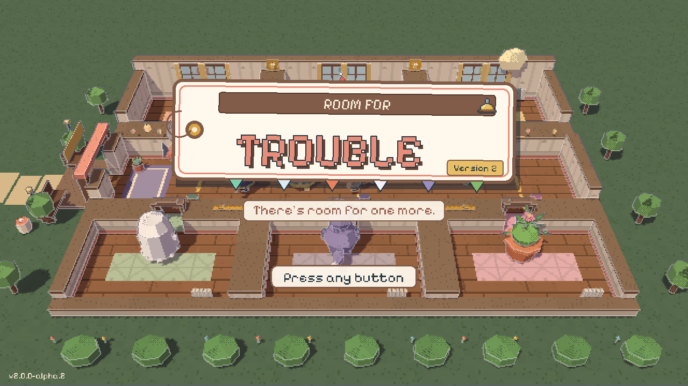
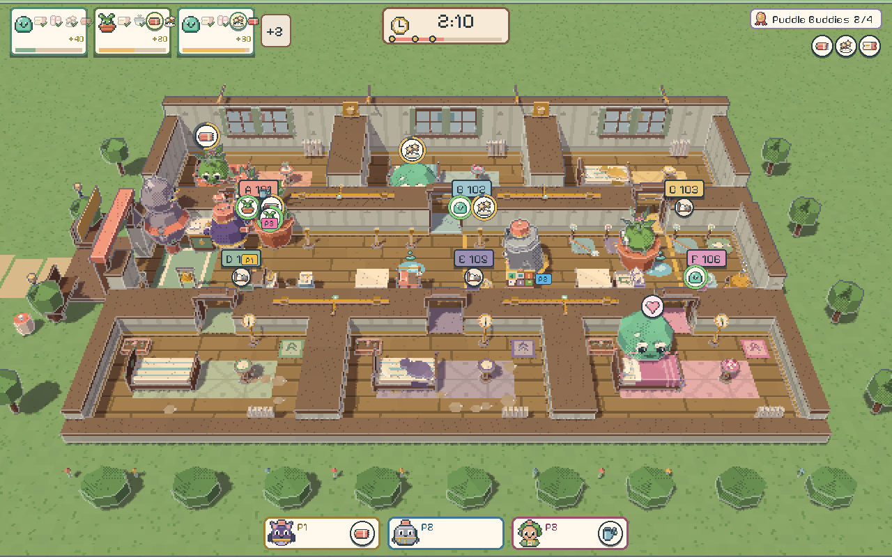
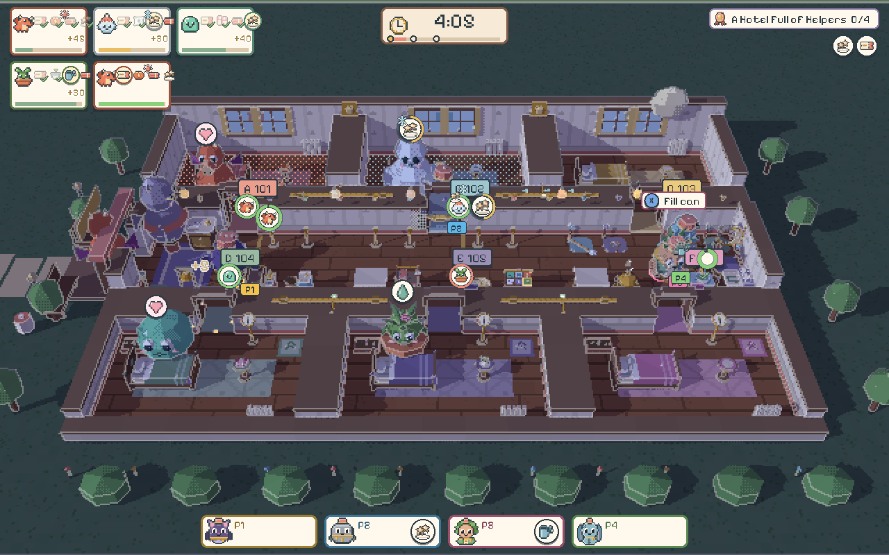
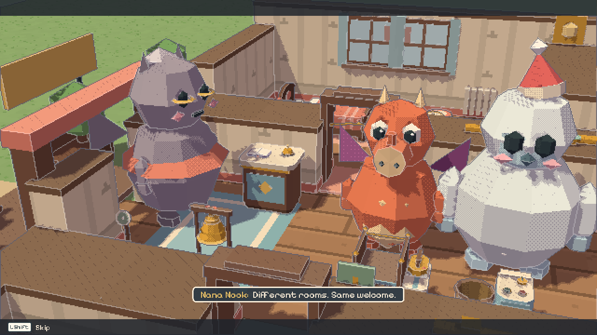

# Room for Trouble

*A cozy cooperative monster-hotel game for 1–4 players.*

<p align="center">
<a href="#easy-installers"><b>Easy installers</b></a> ·
<a href="https://github.com/gazhenko/room-for-trouble/releases/latest"><b>All downloads</b></a> ·
<a href="#controls"><b>Controls</b></a>
</p>



The Hearth & Hiccup is open, and the guests are monsters with very particular needs:

- A dragon who likes it toasty
- A yeti who sneezes when it's warm
- A ghost who needs quiet
- A moonwolf who sings
- A sprout who wants a damp room
- A slime who keeps losing a slipper

Together, the team greets guests, chooses rooms, carries towels and snacks, washes the
sheets and opens or closes vents and curtains. Every room you assign changes the hotel
around it. Nobody loses, and there is always a next move.



## Easy installers

You don't need Godot or a terminal. Both installers contain the whole game and work offline.

| Computer | Installer | How to install |
| --- | --- | --- |
| Mac, Apple Silicon or Intel | [Download Mac installer](https://github.com/gazhenko/room-for-trouble/releases/download/v2.0.0/RoomForTrouble-v2.0.0-macOS-universal.dmg) | Open the disk image, drag **Room for Trouble** onto **Applications**, then open it from Applications. |
| Windows 10/11, Intel/AMD 64-bit | [Download Windows installer](https://github.com/gazhenko/room-for-trouble/releases/download/v2.0.0/RoomForTrouble-v2.0.0-Windows-x64-Setup.exe) | Open Setup, choose **Next → Install → Finish**, then use the desktop or Start menu shortcut. No administrator password is needed. |

Each installer includes a **START HERE** guide; you can also [read it first](https://github.com/gazhenko/room-for-trouble/releases/download/v2.0.0/START-HERE.txt).
Portable archives for macOS, Windows and Linux (including Steam Deck), and the dedicated
online server, are on the [release page](https://github.com/gazhenko/room-for-trouble/releases/tag/v2.0.0).

Quit the game before updating. Updates and removal keep your saved progress. On Windows, remove
the game in **Settings → Apps**; on Mac, move it from Applications to the Trash.

The Mac app is ad-hoc signed and has not been notarized by Apple. If macOS blocks it, open it
from Applications, then use **System Settings → Privacy & Security → Open Anyway** for Room for
Trouble ([Apple's guide](https://support.apple.com/102445)). The Windows installer is unsigned;
an unfamiliar-app prompt may offer **More info → Run anyway**. Approve only the copy from the
official release. The Windows installer has been packaged and its contents checked, and the game
passes its smoke test under Wine, but neither has been run on a Windows PC.

## What's new in 2.0

Version 2 rebuilds the moment-to-moment game at Overcooked scale:

- **Small floors you can read at a glance**: four rooms on 13×13 tiles for chapter 1, six on
  19×13 after that. Staff are about 70 px tall on a 1280×800 screen, up from 28.
- **Order cards**: one per guest, with its steps in order, a timer and tips for speed. The first
  guest arrives within seconds, and a shift still never fails.
- **Snappy hands**: instant pick-up and put-down, a dash that covers ground, and pass counters to
  hand things across.
- **A middle step**: warm towels and chilled snacks at the heat pump, at an open vent, or from a
  helping dragon or yeti; a sprout's watering; festival trunks carried by two.
- **Hazards you can see**: steam that slows, frost and puddles that slide, howls that startle,
  and a lift with a car.
- **A look for every chapter**, from late morning to a lantern-lit festival night, plus a new
  title, menus, sounds for every new action, and HUD and accessibility updates for a 7" screen.

The design is in [docs/DESIGN_V2.md](docs/DESIGN_V2.md), and decisions D31–D57 are in
[DECISIONS.md](DECISIONS.md).



## What's in the game

- **Couch co-op for 1–4 players** on one screen: keyboard (two players can share one
  keyboard) and controllers in any mix. Each player has their own bindings and assists.
- **Private online rooms**: share an 8-character code. Up to 4 seats per room, from any mix
  of local and remote players, with reconnect after drops.
- **The full campaign**:
  - 3 tutorials and 24 authored shifts in 6 chapters, on 6 floor layouts
  - an opening, five chapter bridges and an ending, plus a pre-shift beat, a live gag and a
    postcard for every shift
  - progress never depends on stars
- **Six guest families**, each with its own comfort need, quirk, helper ability and look:
  Slime, Yeti, Dragon, Ghost, Moonwolf and Sprout.
- **Hotel systems**:
  - room tickets, welcome gifts, towel and snack requests
  - laundry and stock
  - relocation, thermostats, vent gates and curtains
  - moisture trays, puddles and steam
  - lifts, the shutter, festival trunks (carried with a friend, or dragged alone) and parcels
- **The hub hotel**, a **Scrapbook** (24 postcards, a guest guide, ribbons and story
  replays), a **Wardrobe** with 8 unlockable cosmetic sets, **Quick Shift** with 8 modifiers
  and a visible seed, and the **Playground** sandbox.
- **Accessibility**:
  - Cozy, Family and Busy pace
  - per-seat assists: Auto Catch, toggle Work, Quick Step on/toggle/off, Steady Feet
  - full remapping, UI scale, readable font, high contrast and colour-safe palettes
  - reduced motion and transparency, captions with speaker names, sound visualisations,
    mono audio and read-aloud
  - controller-only navigation everywhere



## Controls

| Action | Keyboard 1 | Keyboard 2 | Controller |
|---|---|---|---|
| Move | W A S D | Arrow keys | Left stick / D-pad |
| **Carry** (pick up, put down, hand over, choose) | E | Right Ctrl | A / Cross |
| **Work** (clean, wash, hang, use) | Space | Right Shift | X / Square |
| Quick Step (back in menus) | Left Shift | . | B / Circle |
| Ping (tap: "help here", hold: phrase wheel) | Q | / | Y / Triangle |
| Hint, and *ready* during planning | R | , | LB / L1 |
| Inspect a room | Tab | \ | RB / R1 |
| Pause | Esc | Enter | Start / Options |

Press **Carry** on any unused device in the seat lobby to join. Every binding can be changed
per player in **Settings → Controls**.

## Running it

**Packaged builds:** use the [easy installers](#easy-installers), or unzip the portable
package for your platform and run `RoomForTrouble` (or `Room for Trouble.app` on macOS). Saves go to the platform's user data folder (macOS:
`~/Library/Application Support/Godot/app_userdata/Room for Trouble/profiles/`). Three
rotating backups are kept, and a damaged save recovers automatically.

**From source:** install [Godot 4.7.2-stable](https://godotengine.org/download/archive/4.7.2-stable/), then:

```bash
godot --path .                      # play
godot --headless --path . --script res://tests/run_all.gd   # run the tests
tools/build.sh                      # full release build (see BUILD.md)
```

**Online:** the game connects to the endpoint in **Settings → Online**. To run your own
service, see [OPERATIONS.md](OPERATIONS.md) for the Docker + Caddy stack, the health probe,
checkpoints and rollout. Local play never needs the network.

## Troubleshooting

- **A controller does nothing.** Press **Carry** (A / Cross) on it in the seat lobby to give
  it a seat. Unjoined controllers can't move other players' menus. If a controller was
  unplugged mid-shift, the pause menu shows the missing seat: press Carry on any free
  controller to take it over.
- **Two players on one keyboard miss key presses.** Many keyboards can't register lots of
  keys at once. Use a controller for one player, or rebind in **Settings → Controls**.
- **Wrong button symbols.** The game guesses Xbox, PlayStation, Nintendo or Steam Deck
  symbols from the controller's name. Remapping works whatever symbols are shown.
- **"We restored your scrapbook from a backup."** The main save was damaged (for example by
  a power cut), so the newest valid one of three automatic backups was used. Backups are
  `couch.json.bak1`–`.bak3` in the `profiles` folder of the user-data folder.
- **"Couldn't save just now."** The disk was full or not writable. Your last good save is
  untouched; free some space and the next save will go through.
- **"Couldn't reach the server."** Check the endpoint in **Settings → Online** (it must start
  with `wss://`). Local play and your progress never depend on it. Server operators should
  see `OPERATIONS.md`.
- **"Someone needs to update the game first."** Everyone in an online room needs the same
  version.
- **macOS says the app can't be opened.** This build is not notarized: open it once from
  Applications, then choose **System Settings → Privacy & Security → Open Anyway**.

## Documentation

| Document | Contents |
|---|---|
| [BUILD.md](BUILD.md) | Toolchain, build and test commands, generators, smoke tests |
| [OPERATIONS.md](OPERATIONS.md) | Deploying and operating the private-room service |
| [DECISIONS.md](DECISIONS.md) | Implementation decisions and departures from the brief |
| [KNOWN_ISSUES.md](KNOWN_ISSUES.md) | What is unfinished, unverified or imperfect |
| [CHANGELOG.md](CHANGELOG.md) | Release history |
| [CREDITS.md](CREDITS.md) · [THIRD_PARTY_NOTICES.md](THIRD_PARTY_NOTICES.md) | Credits and licences |
| [docs/DESIGN_BRIEF.md](docs/DESIGN_BRIEF.md) | The complete design (the product contract) |
| [docs/COMPLETION_MATRIX.md](docs/COMPLETION_MATRIX.md) | Every required feature, with its verification evidence |
| [docs/REFERENCE_RUNS.md](docs/REFERENCE_RUNS.md) | 126 scripted reference runs with metrics |
| [docs/PLAYTEST_REPORT.md](docs/PLAYTEST_REPORT.md) | Family playtest status and procedure |
| [docs/PERFORMANCE.md](docs/PERFORMANCE.md) | Measured frame time, draw calls and memory |
| [docs/TUNING_LOG.md](docs/TUNING_LOG.md) | Balance changes and their evidence |
| [docs/ASSET_REGISTER.md](docs/ASSET_REGISTER.md) | Provenance and licence of every asset |

## Project layout

```
src/sim/      pure fixed-tick simulation (HotelSim + system modules, replay)
src/app/      main scene, session flow, input routing, shift/hub/playground/story screens
src/view/     pixel stage, hotel view, procedural models, audio director
src/ui/       HUD, captions, menus and screens
src/net/      private-room service, client and protocol
src/save/     versioned, checksummed, backed-up profiles
src/content/  content registry and localization
src/dev/      reference bot and shipping smoke test
data/         campaign manifest, guests, items, layouts, story, localization, icons
assets/export audio, fonts, app icon
tools/        build, validation, content/audio/icon generators, dev scenes
tests/        headless suites, UI traversal, online end-to-end
server/deploy Dockerfile, Compose + Caddy, systemd unit
```

## Status

Version 2.0.0 is a complete local and online game, built and played on macOS (Apple Silicon).
Every release build passes its automated checks: about 2,660 headless tests, a controller-only
walk through every menu (including 175% UI scale), and the online suites. The exported builds are
also checked automatically:
- **macOS:** the app's own smoke test on Metal and on Vulkan (MoltenVK).
- **Linux:** in a clean x86-64 container on software OpenGL, and on software Vulkan at the Steam
  Deck's 1280×800, plus a run with four kernel-level virtual gamepads.
- **Windows:** under Wine, with both renderers.
- **Online:** the service through a 100 ms, 2%-loss link.

Real Windows PCs, the Steam Deck itself, physical controllers, a permanent public host,
notarization and real family playtests have **not** been verified. [KNOWN_ISSUES.md](KNOWN_ISSUES.md)
lists exactly what remains.

Built with [Claude Code](https://claude.com/claude-code) for the project owner.
