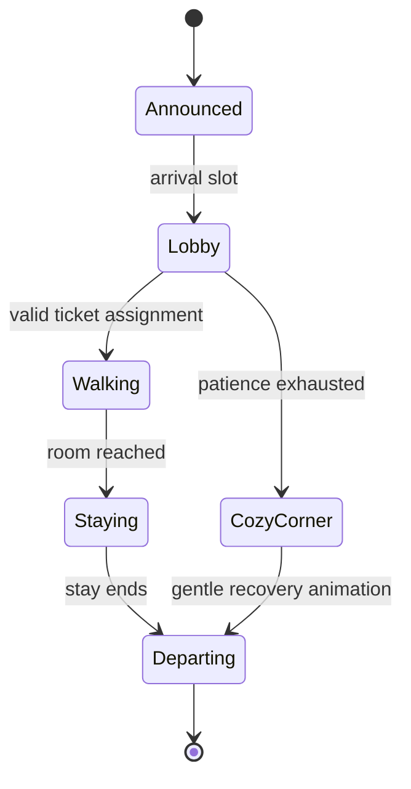
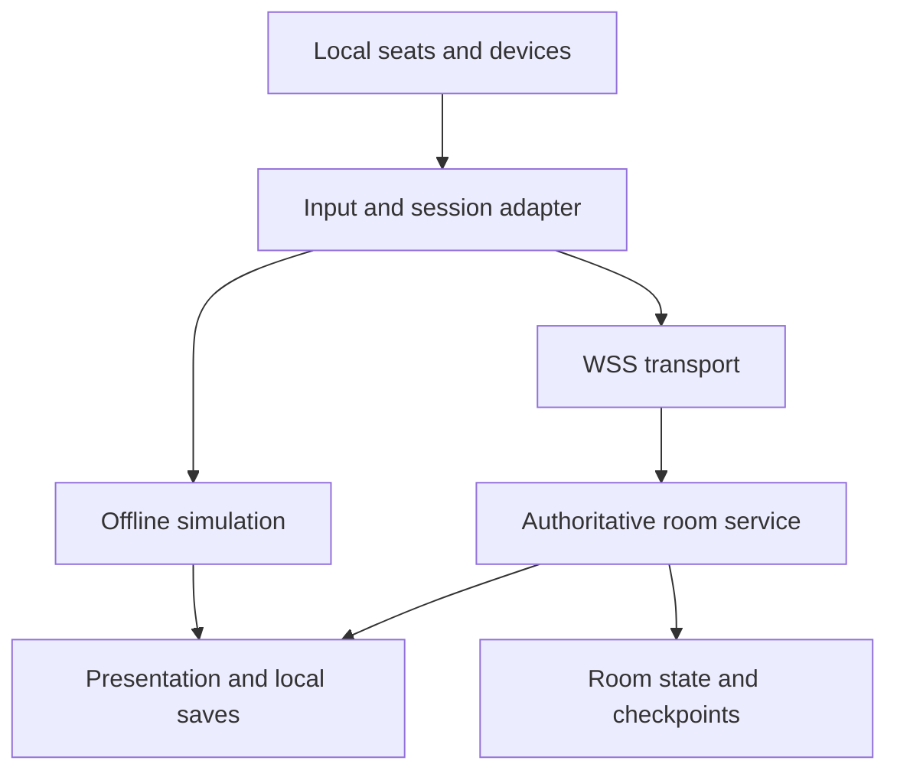

# Room for Trouble

## Complete game design, storyboard, campaign, and engineering handoff

**Document version:** 1.0 · **Design date:** October 22, 2026 · **Working title:** Room for Trouble  
**One-line pitch:** Run a cozy monster hotel with your favorite people, where every unusual guest changes the building—and helping each other turns small disasters into very good stories.

This document is the implementation brief for a complete, original, commercial-quality small cooperative game. It defines the launch product, not merely a prototype. Numeric values are the first playable balance specification, not a claim that the game has already been playtested. Validate and tune them using the procedures below while preserving the experience and recording changes.

<!-- TOC_START -->
## Contents

- [0. Instructions to the building agent](#0-instructions-to-the-building-agent)
- [1. The experience to protect](#1-the-experience-to-protect)
- [2. Launch content and session structure](#2-launch-content-and-session-structure)
- [3. World, cast, and campaign arc](#3-world-cast-and-campaign-arc)
- [4. Storyboard and presentation grammar](#4-storyboard-and-presentation-grammar)
- [5. Moment-to-moment game loop](#5-moment-to-moment-game-loop)
- [6. Controls, movement, and interaction contract](#6-controls-movement-and-interaction-contract)
- [7. Rooms, items, stations, and stock](#7-rooms-items-stations-and-stock)
- [8. Guest specification](#8-guest-specification)
- [9. Environmental systems and comic interactions](#9-environmental-systems-and-comic-interactions)
- [10. Pacing, scaling, score, and recovery](#10-pacing-scaling-score-and-recovery)
- [11. UI, accessibility, joining, and useful communication](#11-ui-accessibility-joining-and-useful-communication)
- [12. Spatial grammar and six floor templates](#12-spatial-grammar-and-six-floor-templates)
- [13. Interactive tutorials](#13-interactive-tutorials)
- [14. Complete campaign: 24 authored shifts](#14-complete-campaign-24-authored-shifts)
- [15. Event language, comedy, dialogue, and replay rules](#15-event-language-comedy-dialogue-and-replay-rules)
- [16. Hub, progression, collectibles, and replay](#16-hub-progression-collectibles-and-replay)
- [17. Art direction, camera, animation, and asset production](#17-art-direction-camera-animation-and-asset-production)
- [18. Audio and music](#18-audio-and-music)
- [19. Engineering architecture](#19-engineering-architecture)
- [20. Private online architecture and protocol](#20-private-online-architecture-and-protocol)
- [21. Data contracts, saves, localization, and reproducibility](#21-data-contracts-saves-localization-and-reproducibility)
- [22. Authoring, build, and operations workflow](#22-authoring-build-and-operations-workflow)
- [23. Implementation sequence and completion gates](#23-implementation-sequence-and-completion-gates)
- [24. Verification plan](#24-verification-plan)
- [25. Definition of done and final implementation report](#25-definition-of-done-and-final-implementation-report)
- [26. Technical sources and design status](#26-technical-sources-and-design-status)
- [Appendix A. Canonical campaign manifest](#appendix-a-canonical-campaign-manifest)
<!-- TOC_END -->

---

## 0. Instructions to the building agent

Read the entire document before implementing. Build the game, its content, tools, tests, and release package. A polished title screen, one demonstration room, or a list of future features does not satisfy this assignment.

### 0.1 Binding decisions

| Decision | Required implementation |
| --- | --- |
| Core experience | Cooperative hotel operations; characters, guests, and hazards remain friendly and funny. |
| Players | 1–4 human players total. Support solo, 2–4 players on one machine, and private online groups combining local and remote players. |
| Engine | Godot **4.7.2 stable**, standard edition, typed GDScript. Pin editor and export templates to the same version. |
| Presentation | Stylized low-poly 3D, fixed elevated orthographic camera, one complete floor visible at once. |
| Launch platforms | Windows x86-64 and Linux x86-64, including a tested Steam Deck control/layout profile. Provide a macOS export preset and build instructions; call it supported only after actual hardware validation and applicable signing. |
| Input | Full gamepad operation and keyboard operation. One keyboard player plus three controllers, or four controllers, must work. Optional two-player shared keyboard is supported with a rollover caveat in settings. |
| Online transport | Authoritative headless Godot service using WebSocket multiplayer over WSS, with private room codes. Local play is entirely offline. |
| Mandatory content | 3 tutorials, 24 campaign shifts, 6 reusable floor templates, 6 guest families, 4 playable staff characters, complete story, playground, quick-shift replay, 8 replay modifiers, 24 postcards, 8 cosmetic unlock sets. |
| Difficulty | Cozy, Family, Busy; Family is the initial recommendation. Per-player input assists and team-wide pressure settings are separate. |
| Monetization assumption | One complete premium game. All gameplay and cosmetics in this specification are included. |
| Narrative | The hotel prepares for a neighborhood Moonlight Welcome festival. The resolution is a celebration of cooperation. |
| Completion | All launch features pass the release checklist. Art and audio must form one consistent finished style. |

Godot is a deliberate default for a controller-first desktop game, not a requirement inferred from an earlier project. Browser, touch, console, cross-store platform integrations, voice chat, a public lobby, and live services are outside this launch contract. Keep the simulation and content data portable so these can be evaluated later without redesigning the game.

### 0.2 Authority and ambiguity

1. Experience rules and accessibility guarantees override a scoring incentive or a dramatic scene.
2. The canonical constants in §§6–10 govern systems. A level can override only the fields explicitly present in its manifest.
3. The embedded campaign manifest is authoritative for level timing, rosters, layouts, fixtures, events, and ribbon goals. Prose describes how those data should feel.
4. Timers use hotel seconds unless explicitly labeled action seconds. Distances use meters; one floor tile is one meter.
5. Implement unspecified cosmetic details using the art direction. Do not introduce a new core mechanic, currency, account system, enemy, or required service.
6. Resolve a routine implementation choice independently and record it in `DECISIONS.md`. Escalate only an external constraint that prevents the defined product from being delivered.
7. Preserve the complete intended scope. Build in milestones; do not silently relabel a vertical slice as the finished game.

### 0.3 Required repository deliverables

- Runnable Godot project; all authored source assets and editable game data.
- Exported Windows and Linux builds, dedicated server build, and checksums.
- `README.md`, `BUILD.md`, `OPERATIONS.md`, `DECISIONS.md`, `KNOWN_ISSUES.md`, `CHANGELOG.md`, `CREDITS.md`, and `THIRD_PARTY_NOTICES.md`.
- Automated simulation/content/network checks and a short manual family-playtest report.
- An asset register recording provenance, license, source file, export file, and whether an asset is final.
- Save migration fixtures, campaign manifest, localization source, and editable storyboard resources.
- A truthful completion matrix referencing every required feature and its verification evidence.

---

## 1. The experience to protect

### 1.1 Design pillars

**We succeed together.** The game rewards shared solutions, flexible roles, and rescues. One player can notice a problem, another prepare the fix, and a third deliver it. There is one team result and no public blame ledger.

**The guests are the fun.** Monsters are neighbors with unusual needs. Their quirks create problems and useful opportunities. A dragon can warm a room and help dry laundry. A yeti can cool a hot hallway. Neither is treated as a villain for existing.

**Every mistake has a next move.** A spill can be mopped. A missed request loses an optional score component but does not remove a child from play. Important items return. There are no deaths, injuries, permanent losses, or campaign game-over screens.

**Silly is legible.** An incident begins with an understandable warning, produces a readable effect, and ends with a small comic payoff. A player should be able to say what happened and how to help.

**Pressure comes in waves.** Alternate planning, busy periods, and brief recovery windows. Increasing difficulty creates meaningful decisions, not unreadable effects or unreliable controls.

### 1.2 The signature mechanic

Room assignment changes the hotel. Temperature can travel through visible vents; sound passes along marked acoustic connections; damp guests and steam affect moisture. The team can change room placement, curtains, thermostats, and vent gates to turn conflicting needs into a working arrangement.

An excellent solution is not always “do more chores faster.” It might be “move the noisy guest away from the ghost,” “close the vent between a hot room and a cold room,” or “ask our happy dragon to dry the next batch of sheets.”

### 1.3 Desired emotional rhythm of a shift

1. **Anticipation:** recognize the arriving silhouettes and decide where they should stay.
2. **Competence:** clean, stock, assign, and see the hotel start working.
3. **Surprise:** an announced quirk upsets a small part of the plan.
4. **Rescue:** someone spots a useful job and helps.
5. **Laughter:** the mishap resolves with a harmless gag.
6. **Celebration:** a team photograph and a guest postcard recall the group’s success.

Desired real-session behavior: “You hold the trunk; I’ll open the way,” “I’ve got your towel,” “Wait, the ghost is wearing the curtain,” followed by another round together.

### 1.4 Family design rules

- Design for independent play around age 7+, with younger children able to contribute alongside an adult. This is a design target, not an official age rating.
- A beginner can be useful carrying towels, delivering welcome gifts, ringing a greeting bell, or cleaning one room.
- Players can change responsibilities at any time. Character selection grants no gameplay advantage.
- Players do not physically block one another. Movement and targeting remain reliable during a mess.
- No compulsory precision rhythm, rapid button mashing, long reading task, or simultaneous four-player input.
- Comic reactions target the situation, not a player’s competence, size, reading ability, or mistakes.
- No individual “worst player,” missed-order count, damage score, or guest complaint naming a player.
- Guests visibly appreciate recovery. A late rescue should feel worthwhile.
- Whenever pressure rises, preserve an obvious low-complexity useful task.

### 1.5 Bound the product

Use the same six guest families, room systems, service items, and floor kit throughout the campaign. New combinations and readable events create variety. This is a tightly authored cooperative game; do not turn it into a management spreadsheet, combat game, open world, or procedural narrative engine.

---

## 2. Launch content and session structure

| Content | Quantity / behavior |
| --- | --- |
| Interactive tutorials | T01–T03; each about 3–5 minutes on a first visit; untimed with optional hints. |
| Campaign | 6 chapters × 4 shifts = 24 shifts. Typical first-session shift length 4.5–6 hotel minutes, plus planning and results. |
| Cinematics | Opening; five chapter bridges; expanded final-shift beats; ending. Captioned, replayable, skippable. |
| Floor templates | P1 Welcome Lobby, P2 Radiator Row, P3 Quiet Wing, P4 Conservatory, P5 Split Lobby, P6 Grand Hall. |
| Guest families | Slime, Yeti, Dragon, Ghost, Moonwolf, Sprout. |
| Staff | Pip, Pebble, Moss, Button; cosmetic differences only. |
| Replay | Quick Shift: select a campaign level, difficulty, seed, and optional modifiers. |
| Playground | Untimed training floor with all guest families and fixtures selectable from the beginning. |
| Progression | Completion stamps, score stars, optional teamwork ribbons, postcards, and cosmetic sets. No purchasing power affects performance. |

Main navigation: Title → Play Together / Solo / Playground / Settings / Scrapbook / Credits. “Play Together” offers This Couch and Online Room. The online room has Create Room and Join Room. All screens support controller focus.

A normal campaign session is: join → choose staff and assists → hotel hub → select shift → inspect the floor and incoming guest cards → everyone ready → countdown → shift → wrap-up → photograph/results → postcard → next shift or hub.

The planning phase is untimed. Players may inspect fixtures, see the vent graph and guest roster, and configure room thermostats and vent gates, and preview curtain positions. They cannot earn points, produce stock beyond the initial cap, spawn arrivals, or pre-complete a request during planning. Planning permits walking, inspection, and those control settings only: carrying, cleaning, bed work, production, ticket assignment, curtain installation, and goal transport begin with the shift. Curtain previews are advisory outlines and do not install a real curtain. The hotel clock begins after the three-note countdown.

---

## 3. World, cast, and campaign arc

### 3.1 Setting

The **Hearth & Hiccup Hotel** sits where a small human town meets a friendly woodland. It has hosted unusual travelers for generations. Nana Nook is reopening several neglected wings for the town’s Moonlight Welcome festival. The building is loved, eccentric, and repairable: brass piping, patterned rugs, rounded doorways, friendly signs, and a lobby bell that sometimes hiccups.

There is no eviction deadline, hostile landlord, cruel critic, or threat to a family’s home. The festival provides an exciting shared goal. If a shift is messy, Nana says, “Good. Now we know what needs a little help.”

### 3.2 Staff characters

| ID | Character | Silhouette and personality | Selection-line / signature idle |
| --- | --- | --- | --- |
| `pip` | Pip | Small round bat, oversized bellhop cap, bright scarf; eager but composed. | “Room for one more!” / cap slips over ears, then pops back. |
| `pebble` | Pebble | Friendly squat stone creature, soft square outline, brass buttons; quietly delighted. | “I brought my helping hands.” / polishes a button with own sleeve. |
| `moss` | Moss | Little woodland helper with leaf hair and rounded boots; curious and practical. | “Let’s make it lovely.” / tiny leaf unfolds from hat. |
| `button` | Button | Stitched plush-like creature with long floppy ears; gentle and expressive. | “I’ve got the other end!” / ears briefly carry a towel, then flop down. |

All use the same collision capsule, speed, reach, action times, stamina rules, and carry capabilities. Silhouette/material swaps must not alter visibility or animation timing. Skin tone, voice pitch, body shape, and outfit are never difficulty selections.

### 3.3 Supporting cast

| ID | Character | Role |
| --- | --- | --- |
| `nana` | Nana Nook | Warm gargoyle founder. Explains one idea at a time, praises recovery, appears in hub and chapter scenes. |
| `gus` | Gus | A smiling suitcase mimic with tiny feet. Operates optional solo/assist laundry support. Never steals a held object. |
| `dot` | Dot Quill | A small moth festival coordinator with a clipboard bigger than she is. Initially assumes every room can use one checklist; learns to ask guests what helps. Joins the final photograph. |
| `mallow` | Mallow | Recurring slime guest who proudly owns several shoes but only two feet at a time. |
| `flurry` | Flurry | Polite yeti with a tiny knitted travel hat. Apologizes to furniture after a sneeze. |
| `cinder` | Cinder | Little dragon with a kettle-shaped snout. Hiccups warm puffs and volunteers to dry laundry. |
| `whisp` | Whisp | Friendly ghost who needs quiet and keeps accidentally wearing hotel linens. |
| `luna` | Luna | Moonwolf with an excellent singing voice and enthusiastic indoor-volume misunderstandings. |
| `fern` | Fern | Sprout traveler with a suitcase planter and a tendency to bloom when happy. |

Recurring guests are named variants of their family, using identical mechanical parameters. Named variants never introduce hidden needs.

### 3.4 Chapter arc

| Chapter | Theme | Mechanical lesson | Story movement |
| --- | --- | --- | --- |
| 1. Open Arms | Welcome before perfection | Shared supplies, check-in, requests, laundry, carrying together. | First guests help make an old lobby feel alive. |
| 2. A Warm Welcome | Different comforts can coexist | Yeti/Dragon, thermostats, vent gates, shared heat pump. | Dot’s “one temperature for everyone” checklist becomes a paper fan. |
| 3. Quiet-ish Hours | Ask what helps | Ghost/Moonwolf, sound, curtains, announced howls. | A lullaby rehearsal becomes a wonderfully uneven chorus. |
| 4. Growing Room | Care grows through small actions | Sprout, watering, humidity, steam, safe cleanup. | The conservatory becomes the festival garden. |
| 5. The Other End | Help travels both ways | Split routes, lift pads, trunks, mixed needs, role changes. | Every guest contributes something useful to the festival. |
| 6. Room for Everyone | The hotel works because the team does | Familiar systems recombined; no new surprise rules. | A storm shifts the celebration indoors and the whole hotel becomes the welcome. |

---

## 4. Storyboard and presentation grammar

### 4.1 How to implement story panels

Create data-driven `StoryPanel` resources with `id`, scene set, camera preset, actors/poses, duration, caption key, sound cue, transition, trigger, and skip behavior. Use in-engine staging, gentle camera moves, and a few illustrated postcard backgrounds. Do not make cinematics depend on expensive video production or generated dialogue at runtime.

Dialogue advances after a minimum display time or explicit confirm. Recommended minimum is `max(2.0, 0.045 × caption_character_count)` action seconds. A single player can request skip; online, show “Skip scene?” and use the same group ready policy as starting a shift. Once every active participant has seen a scene, any player may skip it immediately on replay. Local personal skip moves their UI to a still summary while the group finishes; it never advances the simulation behind another player.

Story pauses hotel and action clocks. Mid-shift gags use the fixed gameplay camera, freeze neither clock, and never obscure tasks. Reduced-motion mode replaces camera moves with cuts and still poses. Every spoken/squeaked line has captions. Nothing mechanically important is conveyed only by dialogue.

Camera presets: `wide_hotel`, `lobby_group`, `desk_close`, `guest_close`, `room_door`, `fixture_close`, `festival_wide`, `postcard_still`. Cinematic close-ups are never active during live player control.

### 4.2 Opening sequence O00 — approximately 55–70 seconds

| Panel | Shot / duration | Action | Caption / dialogue | Audio and transition |
| --- | --- | --- | --- | --- |
| O00.1 | `wide_hotel`, 6 s | Morning light crosses the Hearth & Hiccup sign. Its final letter hangs slightly crooked. | Nana: “A hotel is a place to put your bags down.” | Soft woodwind theme; bird taps the sign straight. |
| O00.2 | `lobby_group`, 6 s | Empty lobby. Nana lifts a dust cover; Gus is underneath wearing a tiny dust cover of his own. | Nana: “And, if we do our jobs…” | Cloth swish; Gus chirps. |
| O00.3 | `desk_close`, 5 s | A festival invitation slides under the door and lands in the bell’s saucer. | Invitation: “Moonlight Welcome — neighbors, travelers, everyone.” | Three bell notes introduce the team motif. |
| O00.4 | `lobby_group`, 8 s | Selected staff enter with a crooked stack of towels. Number of actors matches the party; solo Gus holds a corner. | Pip/staff narrator: “We can help!” Nana: “I was hoping you’d say that.” | Stack wobbles, never drops on anyone. |
| O00.5 | `desk_close`, 7 s | Dot unfolds a checklist that keeps unfolding past the frame. | Dot: “Beds. Towels. One standard room temperature. How hard could it be?” | Paper concertina sound. |
| O00.6 | `guest_close`, 7 s | Outside: Flurry fogs one window while Cinder defogs the next. Whisp waves through the glass. | Nana: “We may need more than one kind of welcome.” | Gentle hiss; friendly guest murmurs. |
| O00.7 | `lobby_group`, 7 s | The lobby bell hiccups. Gus hiccups back. Everyone pauses, then smiles. | Nana: “Perfect is optional. Helping isn’t.” | Bell hiccup, suitcase squeak; no laugh track. |
| O00.8 | `postcard_still`, 5 s | Staff gather beneath the sign. The title settles into place like a luggage label. | **ROOM FOR TROUBLE** · “There’s room for one more.” | Theme resolves; transition to T01 or tutorial selection. |

### 4.3 Chapter bridges

Each bridge follows the fourth shift of chapters 1–5. Use four panels, roughly 5–7 seconds each. Specific level payoffs in the campaign section precede these scenes.

| Scene / panel | Staging | Dialogue / text | Payoff and next lesson |
| --- | --- | --- | --- |
| B01.1 | Lobby group; Mallow places a welcome postcard on the desk. | Mallow: “I only lost one slipper. That’s a personal best.” | Slipper is sitting on Mallow’s head. |
| B01.2 | Flurry and Cinder arrive at opposite sides of the doorway. | Flurry: “Somewhere cool?” Cinder: “Somewhere toasty?” | Their luggage tags display the exact cold/warm icons used in play. |
| B01.3 | Dot looks at the single-temperature checkbox. | Dot: “I may need a wider checklist.” | She folds the page into two columns. |
| B01.4 | Nana reveals visible color-and-shape-coded vent pipes. | Nana: “Let’s give everyone a little room.” | Transition to T02; chapter 2 unlocks regardless of stars. |
| B02.1 | Cinder dries a sheet while Flurry chills a pitcher. | Cinder: “I helped!” Flurry: “Me too. Very differently.” | Steam briefly forms a heart, then a sock. |
| B02.2 | Whisp enters holding a sleeping mask. | Whisp: “Just a quiet corner, please.” | Quiet icon appears. |
| B02.3 | Luna arrives mid-rehearsal, mouth open; pauses to listen. | Luna: “Is this the singing hotel?” | Nana points to a curtain rail, not to the exit. |
| B02.4 | Everyone tests a curtain; Luna’s loud note becomes a tiny squeak outside it. | Nana: “There’s room for a song. And a nap.” | Transition to T03 sound lesson. |
| B03.1 | Whisp sleeps while Luna conducts a tiny silent chorus behind a curtain. | Dot: “Two checkboxes. Both checked.” | Quiet approval, no shushing gag aimed at a player. |
| B03.2 | Fern’s suitcase sprouts leaves; one lifts Dot’s clipboard. | Fern: “I brought a little something for the garden.” | Moisture and watering icons appear. |
| B03.3 | Wide conservatory; planters are dry but intact. | Moss/Nana: “It’s got good bones. And excellent windows.” | Warm room reveal. |
| B03.4 | A single drop opens a bright flower; Gus offers an umbrella. | Nana: “Small kindnesses grow.” | Chapter 4 opens. |
| B04.1 | Guests assemble lanterns, fabric, chilled drinks, and flowers. | Dot: “Everyone has volunteered something.” | Show each guest helping in their own way. |
| B04.2 | Two staff carry a long festival trunk. Solo: Gus holds a light ribbon beside it, not the required handle. | Button/Nana: “I’ve got the other end.” | Demonstrate the next chapter’s optional faster co-carry. |
| B04.3 | A luggage lift opens on opposite sides of the lobby. | Nana: “Ask for a hand. Offer one back.” | Lift endpoints use the in-game matching symbol. |
| B04.4 | The trunk opens: one enormous paper moon rolls up gently. | Gus: delighted squeak. | Moon bounces once, then sits safely in its stand. |
| B05.1 | Festival decorations go up outdoors. | Dot: “We are almost ready.” | Hopeful music. |
| B05.2 | A soft rain starts; a paper lantern wears a droplet like a hat. | Cinder: “Is rain on the guest list?” | Weather is atmospheric, not a new simulation system. |
| B05.3 | Guests turn toward the hotel’s wide-open doors. | Nana: “We’ve spent all week making room.” | The camera reveals the Grand Hall. |
| B05.4 | Staff hang the moon indoors. | All, captioned together: “Let’s use it.” | Chapter 6 begins; no new mechanic is introduced. |

### 4.4 Ending E00 — approximately 60 seconds

The final shift always reaches this scene after wrap-up. The number of score stars affects a decorative photograph border only. A low score does not produce an inferior story ending.

| Panel | Shot / duration | Action and dialogue |
| --- | --- | --- |
| E00.1 | `festival_wide`, 6 s | Indoor lights come on. Rain stays outside. Nana: “Look at that. A whole hotel full of welcome.” |
| E00.2 | `guest_close`, 5 s | Flurry and Cinder share a bench with a small divider, both comfortable. Flurry offers a chilled cup; Cinder offers a warm biscuit. |
| E00.3 | `guest_close`, 5 s | Luna sings behind the open-sided acoustic curtain; Whisp enjoys the gentle version on the quiet side. Captions show a musical note, not lyrics requiring licensed music. |
| E00.4 | `fixture_close`, 5 s | Fern’s flowers circle the moon stand. Mallow’s lost slipper becomes a tiny flowerpot with permission. Mallow: “I knew I packed a spare.” |
| E00.5 | `desk_close`, 7 s | Dot turns the checklist over and draws a table with many different chairs. Dot: “I think I understand the important part now.” |
| E00.6 | `lobby_group`, 7 s | Staff enter the group photograph. Gus opens to reveal the camera timer, then closes too early. Photograph catches everyone blinking. |
| E00.7 | `lobby_group`, 7 s | They try again. Nobody has to press together; any confirmation begins a safe three-second photo countdown. Nana: “There. Everybody fits.” |
| E00.8 | `postcard_still`, 6 s | Final photo uses actual selected staff, guest variants, unlocked decorations, and one harmless gag prop from the shift. Caption: “Hearth & Hiccup — room for one more.” |
| E00.9 | `wide_hotel`, 5 s | A new traveler’s suitcase arrives at the door. The bell hiccups. Gus answers. |
| E00.10 | Credits overlay, player-controlled duration | Small looping lobby celebration; Play Another Shift, Scrapbook, and Credits remain accessible. The full staff and asset credits are available. |

Final photograph is generated locally from a staged in-game scene. Saving or sharing an image requires an explicit user action in the game; online rooms do not automatically publish it.

---

## 5. Moment-to-moment game loop

### 5.1 One guest’s journey

1. An incoming card announces family, desired welcome item, and comfort icons.
2. Guest appears in the nonblocking lobby queue with a visible patience ring.
3. A player takes that guest’s room ticket and carries it to a vacant, clean room’s door plaque.
4. The plaque accepts the ticket atomically; the guest walks to the assigned room.
5. Players supply the desired welcome item, set the room environment, and fulfill one or two service requests.
6. A comfortable guest may offer one clearly labeled helper action.
7. At the end of the stay, guest waves, checks out, and leaves a dirty bed and a small cleanable mess.
8. Players strip and remake the bed, return dirty linen, and mop. The room becomes available again.



Guest departure does not depend on successfully walking through a player or moving object. Guests have nonblocking navigation and a bounded recovery route.

### 5.2 One room’s journey

`CleanVacant → Reserved → Occupied → CheckoutTransition → DirtyVacant → Cleaning → CleanVacant`.

Bed cleanliness, floor mess, installed welcome item, thermal state, humidity, curtain state, and current guest are separate state fields. A room is assignable if it is vacant, its bed is made, and its floor mess is zero. Wrong or missing comfort items never hard-lock check-in; show a conspicuous advisory and let players recover.

During `Reserved`, only the assigned guest may occupy the room. A reservation expires only on an explicit cancellation, disconnected-ticket recovery, or guest departure; it cannot be stolen by another player’s input. Players may cancel at the door before the guest arrives; the ticket returns to its pedestal with remaining lobby patience.

An occupied guest can be moved once per stay using the door’s **Move Room** action: hold Work 1.5 action seconds with empty hands, pick up the marked relocation ticket, and place it at a clean vacant room. The original room stays occupied until destination validation succeeds. Stay progress, requests, satisfaction, and score history follow the guest. Moving costs no points but takes time. The old bed becomes Dirty and its floor mess becomes 100; welcome items remain unless carried separately. This is a strategic rescue, not teleportation or a way to reset needs.

Destination acceptance transfers room ownership atomically. The occupied-room cap counts this guest once, not once per source/destination. The source becomes dirty, the destination becomes reserved, and the guest walks there. Unlike initial check-in, relocation does not pause the existing stay: use destination comfort during transit and emit environmental sources only in the destination. A dropped relocation ticket returns to its original door after 8 action seconds and cancels the uncommitted move intent; it does not move the guest or reset any timer.

### 5.3 Teammate jobs

Good informal jobs include greeter/room planner, room preparation, runner, laundry, environment troubleshooter, and floating helper. The game never assigns fixed professions. Supplies, tools, and interaction rights are shared.

The HUD may suggest “Useful jobs” with at most three icons: a dirty room, an available request, or an unassigned guest. Suggestions do not command a player or expose a personal productivity score.

---

## 6. Controls, movement, and interaction contract

### 6.1 Default mappings

| Action | Xbox-style gamepad | Keyboard player 1 | Optional keyboard player 2 |
| --- | --- | --- | --- |
| Move | Left stick / D-pad | WASD | Arrow keys |
| Carry / place / hand off | South face button, A | E | Right Ctrl |
| Work / use held tool | West face button, X | Space | Right Shift |
| Quick step | East face button, B | Left Shift | Period |
| Context ping | North face button, Y | Q | Slash |
| Show / cycle useful job | Left shoulder, LB | R | Comma |
| Inspect room / guest | Right shoulder, RB; hold | Tab; hold | Backslash; hold |
| Pause / menu | Start/Menu | Escape | Enter |
| Cancel menu / release heavy handle | East face button | Escape / Carry | Escape / Carry |

Show platform-appropriate glyphs when available, otherwise shape-and-action labels. Rebinding covers every action, keyboard slot, and controller independently. Two keyboard slots are an optional convenience; full four-player support never depends on a keyboard registering six simultaneous keys.

### 6.2 Motion constants

| Constant | Initial value |
| --- | --- |
| Avatar movement | 3.6 m/action second; diagonal normalized. |
| Acceleration / deceleration | 28 / 36 m/s²; stop within about 0.18 m at full speed. |
| Carrying small item | 3.4 m/s; no additional input complexity. |
| Capsule | radius 0.28 m; height 0.9 m; same for all staff. |
| Facing / target cone | 110° forward cone; retain current target with 0.2 m hysteresis. |
| Normal interaction reach | 1.25 m, with unobstructed line segment to target interaction anchor. |
| Pickup reach | 1.05 m; held object rendered above hands at a consistent height. |
| Quick step | 0.8 m over 0.18 s; 1.0 s cooldown; stops safely before solid geometry. |
| Player-player collision | Disabled; soft visual spacing only, no gameplay push. |
| Guest-player collision | Disabled; guest can politely sidestep or fade through staff. |
| Useful-job hint cycle | Instant; highlights the next of up to 3 HUD suggestions; 0.15 s input debounce. |

Quick step grants no score bonus and is never required for a standard Family gold score in a validated reference run. It is disabled while gripping a trunk; the contextual B/East action releases the handle, as does Carry on the held handle. An assist may map repeated Carry presses to automatic nearby pickup/place while preserving the same validation. Mop, Breezer, and watering can each have one function; there is no hidden tool-mode system to learn.

Show Useful Job cycles the same three optional HUD suggestions, highlighting one for 3 action seconds without moving the avatar or claiming the job. Sort by overdue/nearest deadline request, unassigned guest patience, then dirty room, with stable ID tie-breaks; omit unavailable or already-completed targets. This hint is local presentation, not a source of extra information or automatic work.

### 6.3 Targeting priority

On each action press, choose a valid candidate using: current highlighted target → explicit room/request ping target → compatible held-item socket → held-item handoff recipient → targeted object pickup → station use. Among equal candidates sort by facing alignment, distance, then stable entity ID. A wall always blocks the interaction ray. Highlight the chosen target before an action begins; never silently select a hidden object behind a larger one.

If no compatible target exists, Carry gently places an item at the nearest valid floor spot within 0.8 m. Use an unobstructed 0.25 m lattice, nearest first, stable coordinate tie-break. If there is no space, keep holding it and show “Need a little room” with a floor icon.

### 6.4 Actions and shared progress

Work supports hold-to-work and toggle-to-work. Work progress is stored on the target, not the player. A teammate can finish another person’s cleaning. Walking outside reach cancels active input without erasing completed progress. Up to two workers can collaborate: total rate is 1.0× for one and 1.6× for two; more players do not speed it further. Individual actions that move an item are atomic and cannot produce duplicates.

| Action | Duration in action seconds | Requirements / result |
| --- | --- | --- |
| Take / place ordinary object | 0.15 | Server validates ownership and target; brief animation never blocks movement longer than this. |
| Assign ticket to door | 0.6 | Room vacant, made, mess-free; consume ticket representation, preserve guest identity. |
| Strip dirty bed | 1.2 | Empty hands; creates one dirty-linen bundle in hands or reserved adjacent output slot. |
| Make bed | 1.5 | Hold one clean-linen bundle; consume it on completion. |
| Mop floor mess | 2.0 total per room | Hold mop; removes room mess uniformly; two-worker rule applies. |
| Mop corridor puddle | 1.0 | Hold mop; one puddle removed. |
| Dispense welcome item | 1.2 | Choose family icon at kiosk; output waits if both kiosk output pads occupied. |
| Dispense snack / towel | 1.0 | One compatible item; stock rules in §7. |
| Fulfill request / place welcome | 0.4 | Correct item consumed or installed; wrong item stays held. |
| Change thermostat target | 0.6 | Empty hands or held tool; cycle Neutral → Warm → Cool; radial direct selection available on inspect. |
| Open / close vent gate | 0.7 | State latches; visible flap and light reflect the server’s state. |
| Change heat-pump priority | 0.8 | Balanced → Warm priority → Cool priority; no hidden cooldown. |
| Hang / remove curtain | 1.2 | Curtain roll required to hang; returned as roll when removed. |
| Fill watering can | 1.5 | At tap; fills to 3 charges. |
| Water room tray | 1.2 | Consume one charge; moisture/tray rules below. |
| Breezer clear steam | 1.8 | Hold Breezer, point at cloud within 1.5 m. |
| Clear frozen door | 1.5 | Work with any hands; chip with a warm rubber scraper animation, no dedicated consumable. |
| Reset tripped fixture | 1.5 | Work at fixture; restore previous mode. |
| Deliver dirty linen to hamper | 0.3 | Consume bundle into laundry queue. |
| Emergency clean-linen press | 3.0 | Unlimited, one user at a time; guarantees recovery from lost stock. |

### 6.5 Handoffs and heavy objects

Small-object handoff: holder presses Carry while facing a teammate within 1.6 m. If the receiver has empty hands and either enabled Auto Catch or pressed Carry in the last 0.35 s, transfer ownership atomically. Otherwise place at a valid shared floor spot; never force an item into a player’s hands. A short traveling arc is cosmetic, not projectile physics.

No throw button is required. The animation may look like a gentle toss, but its destination is validated and a failed handoff never flings a quest object away.

Festival trunks have two handles. One player can drag at 1.4 m/s; two move at 3.0 m/s. Two-player velocity is the normalized sum of the two requested vectors, multiplied by speed and by the smaller of 1 and the sum’s magnitude/1.2. Opposing input smoothly stops the trunk. A 0.25 s grace period retains a handle during a direction change. A releasing or disconnected participant never yanks the other player.

The trunk follows a collision-safe kinematic sweep, not a free rigid body. It cannot tip, crush, block the sole route, or trap a guest. Trunk routes preserve at least 1 m physical clearance and 2 m turning pads. Loose/carried trunks do not collide with noncarrying staff or guests; show an outline and local transparency on overlap so a parked trunk cannot seal a teammate inside a room. Carrier motion still respects walls and solid fixtures. Solo never needs an AI partner to finish a trunk goal. Optional co-carry ribbons are replaced with solo-friendly cooperation equivalents in solo mode.

### 6.6 Recovery guarantees

- Dropped tools/items stay visible through a small silhouette marker.
- A unique tool outside valid floor bounds returns to its dock within 2 action seconds.
- An unattended ordinary guest ticket returns to its lobby pedestal after 8 action seconds; guest patience does not reset. Relocation tickets use their original-door recovery rule.
- An unattended heavy object that blocks both tested routes is moved to its last valid parking pad after 4 action seconds, with a luggage-bump gag.
- Per-team **Find Tools** in pause highlights all tools and returns unheld unique tools to their docks. It never consumes a resource or affects score.
- A stuck avatar can select **Back to Lobby**; held item is placed safely, avatar moves to nearest lobby spawn, and gains 1 s of visual transparency. No score penalty.

---

## 7. Rooms, items, stations, and stock

### 7.1 Room components

Every room contains a bed anchor, welcome-item plinth, thermostat panel when enabled, curtain rail, watering tray when enabled, door plaque, comfort display, and a safe drop pad. Unused systems remain visually simple: no active thermal controls in chapter 1, no watering controls before chapter 4 unless selected in Playground.

Room ID has a letter and number: A/101, B/102, C/103, D/104, E/105, F/106. Icons always show the letter as well as any color. A player can inspect a room without opening a blocking menu.

Bed states: `Made`, `Dirty`, `Stripped`. Floor mess is an integer 0–100; checkout creates 100. A room becomes assignable when bed=Made and mess=0. Welcome items are reusable decorations: a guest’s matching gift is removed to the return shelf automatically on checkout, producing no extra carrying obligation. Players can collect it before then to reassign it.

### 7.2 Carryable inventory

| ID | Object | Purpose / handling |
| --- | --- | --- |
| `ticket` | Guest ticket | Carries guest ID; one representation per unassigned guest. |
| `move_ticket` | Relocation ticket | Reserves original guest; one active per guest. |
| `linen_clean` | Clean bundle | Makes one bed; stacks never hide the count. |
| `linen_dirty` | Dirty bundle | Feeds laundry; generated once per stripped dirty bed. |
| `towel` | Fresh towel | Universal service request; consumed on delivery. |
| `snack` | Star crackers | Universal service request; consumed on delivery. No dietary guessing. |
| `welcome_slime` | Two bright slippers | Slime welcome gift. |
| `welcome_yeti` | Snowflake pillow | Yeti welcome gift. |
| `welcome_dragon` | Ember-pattern cushion | Dragon welcome gift; not a heat source. |
| `welcome_ghost` | Moon sleeping mask | Ghost welcome gift; not the curtain itself. |
| `welcome_moonwolf` | Patchwork moon blanket | Moonwolf welcome gift. |
| `welcome_sprout` | Little ceramic pot | Sprout welcome gift; not a watering charge. |
| `curtain_roll` | Acoustic curtain | Installs a reusable curtain; separate from welcome gifts. |
| `mop` | Mop | Room mess and puddles; unlimited use, unique tool instances. |
| `watering_can` | Watering can | Three charges; refills at tap. |
| `breezer` | Breezer | Small hand fan that clears steam; unlimited use. |
| `festival_trunk` | Long trunk | Authored transport goal; cannot be discarded. |
| `festival_parcel` | Small decoration parcel | Finale delivery goal; cannot satisfy a guest request. |

Wrong items never auto-consume. Unneeded ordinary items can be put on the return shelf, restoring their relevant stock or the reusable kiosk pool. The curtain drawer uses Carry with empty hands to dispense one available roll in 1.2 action seconds; its separate tray accepts returns. Curtain pool is 2 rolls for 1–2 humans and 3 for 3–4, including installed/held rolls. Lost rolls use unique-tool recovery. Playground has 6; quiet_start explicitly starts 6 installed and no loose rolls. A dirty bundle cannot become a towel, gift, or snack through the return shelf.

### 7.3 Stations

| ID | Station | Behavior |
| --- | --- | --- |
| `reception` | Queue and ticket pedestals | Individual pedestal per waiting guest. Inspect shows remaining patience and comfort needs. |
| `welcome_kiosk` | Six-icon gift cabinet | Faces show family silhouettes. Carry takes highlighted gift; Work cycles selection; inspect provides direct radial choice. Only introduced families appear in Campaign. |
| `linen_shelf` | Clean-linen rack | Initial count `active_room_count + 2`; capacity 12. Stock withdrawal takes 0.15 s. |
| `hamper` | Laundry input | Accepts dirty bundles; processes one per 8 action seconds; queue capacity 8. If queue full, bundle stays on a visible input pad. |
| `laundry_output` | Laundry output | Adds one clean bundle per completed cycle to shelf; pauses while shelf full and holds completed output safely. |
| `emergency_press` | Always-available press | Creates one clean bundle in 3 s. Can ship as an attachment to linen shelf to save space. |
| `towel_shelf` | Towel rack | Starts at 4, cap 6, regenerates one per 4 action seconds while below cap. |
| `snack_tin` | Snack dispenser | Starts at 4, cap 6, regenerates one per 4 action seconds while below cap. |
| `return_shelf` | Returns | Restores reusable gifts/curtains and clean supplies within stock caps; excess is folded into visible storage. |
| `tool_dock` | Numbered docks | Holds tools; 2 mops, 1 Breezer, and 1 watering can when relevant. Four players get a second watering can in chapter 4+. |
| `tap` | Water refill | No water scarcity; used by watering cans. |
| `heat_pump` | Central thermal priority | Displays hot/cold capacity, active demand, and priority. Enabled from chapter 2. |
| `group_bell` | Greeting/celebration bell | Work triggers a small greeting; rate-limited 4 s; no mandatory simultaneous input. |
| `festival_stand` | Trunk/parcel destination | Accepts the specified goal object and latches completion. |

Clean linen conservation applies only to laundry and bed use. Emergency pressing intentionally creates additional supply. No shift can become impossible because a child placed the last sheet in the wrong location.

### 7.4 Gus assistance

Gus is on by default for solo and available as a team assist. Every 12 action seconds, while unpaused, he chooses one action in order: (1) carry the oldest unheld dirty bundle that has rested for at least 4 s to the hamper; (2) if no such bundle and linen stock<2, create one folded clean bundle at the shelf; (3) return the oldest unheld unique tool that has been idle for 10 s to its dock. He never fulfills requests, assigns rooms, changes environmental controls, strips/makes beds, picks up a held/reserved item, or moves a trunk. His movement is cosmetic; the scheduled transfer still observes atomic ownership checks at completion.

Turning him on adds an assist icon to results, not a lower-quality ending or a blocked unlock. He says/squeaks “A little lift?” when starting. If a player picks up his target, he cancels and waits until the next 12 s interval; he does not fight over it.

---

## 8. Guest specification

### 8.1 Shared guest state

Each guest owns: stable ID, family, named-variant ID, arrival index, queue slot, ticket entity ID, state, assigned room, arrival hotel time, remaining lobby patience, remaining stay, welcome flag, request records, comfortable hotel-seconds, total occupied hotel-seconds, last-12-second comfort samples, quirk state, helper-used flag, relocation-used flag, and score component flags.

Lobby patience is **50 hotel seconds**. At zero, the guest politely moves to the Cozy Corner for an 8-second visual recovery, then departs. Nana offers a drink. The guest earns only already-earned components; there is no negative score and no campaign failure. The incoming card always showed the patience ring. Cozy disables this timeout.

Walking to a room has a 15-hotel-second bound. A guest blocked for 3 s performs a friendly side-step; at 8 s they follow an unobstructed abstract path; at 15 s they dissolve into luggage sparkles and appear at their bed. Walking time does not reduce the stay. A guest does not wait for player collision, a closed acoustic curtain, or a frozen decorative door animation.

Stays are fixed length by family. One- or two-service counts come from the level. For one service, spawn a request at stay+22; for two, at stay+15 and +40. Each request lasts 25 hotel seconds, followed by a late-delivery window ending at the earlier of deadline+6 or checkout. A late delivery earns half that request’s points. A request never outlives the guest’s stay; given the durations below, both normal deadlines fit. Requests remain the same through relocation. Cozy disables these deadlines and holds checkout while a service remains outstanding.

Towel/snack order alternates by guest arrival index: even indexes request towel then snack; odd indexes snack then towel. One-service levels take the first item only. Request icons use object silhouettes and room letters. Repeated item delivery cannot satisfy the same request twice.

### 8.2 Family data

| Family ID | Stay | Welcome gift | Comfort test, evaluated each hotel second | Normal quirk at stay+32 s | Optional helper after 12 consecutive comfortable seconds |
| --- | --- | --- | --- | --- | --- |
| `slime` | 70 s | Slippers | Temperature between −40 and +40 inclusive. | A happy wiggle tosses a slipper into the air; harmless. Walking arrival/departure can leave limited puddles. | **Slipstream:** dries up to 3 nearby corridor puddles and lays a 12-second sparkly path that changes appearance only. |
| `yeti` | 75 s | Snowflake pillow | Temperature −65 to −15 inclusive. | Four-second sneeze warning, then own room −25 heat; open-vent neighbors receive −8 heat. Comfortable yeti sneezes into a mitten: cosmetic only. | **Cool company:** own room heat moves 20 units toward −35; restores one snack stock. |
| `dragon` | 75 s | Ember cushion | Temperature +15 to +65 inclusive. | Four-second hiccup warning, then own room +25 heat; open-vent neighbors receive +8 heat. Comfortable dragon hiccups into a tiny kettle: cosmetic only. | **Warm laundry:** completes the oldest active laundry cycle once; if none, restores one clean-linen stock. |
| `ghost` | 70 s | Moon mask | Room noise ≤20. Temperature/humidity ignored. | If disturbed, floats one unheld towel within 2 m onto own drop pad; if none, animates a non-gameplay sheet. Comfortable ghost briefly wears a sheet as a hat. | **Gentle delivery:** moves one unheld towel or snack from its marked hallway drop pad to an already-matching pending request in this room. |
| `moonwolf` | 75 s | Moon blanket | Temperature −60 to +60 inclusive. Noise/humidity ignored. | Four-second breath-in warning, then a howl pulse; curtains can contain it. A visible musical-note bubble shows the source. | **Humming along:** nearby unassigned guests gain 10 patience, capped at their original 50. One use per wolf. |
| `sprout` | 80 s | Ceramic pot | Humidity ≥55 and temperature −20 to +60 inclusive. | If humidity>85, bloom produces one entrance puddle; otherwise a flower pops out of suitcase, cosmetic only. | **Little bloom:** own room humidity +20, capped at 80; clears one corridor puddle. |

All numeric thermal additions are absolute heat units, not degrees Celsius/Fahrenheit. Name the UI “Cool / Cozy / Toasty,” not a real-world temperature readout.

Every guest has at most one normal quirk opportunity per stay. The reaction director may defer a mechanical quirk; it never repeats it to compensate. A comfortable guest’s cosmetic alternative is important: skilled families still see the funny animation.

Slime walking trail: one puddle every 3 m of arrival/departure movement, at most 3 per guest visit and 12 board-wide. Once its matching slippers are installed, departure produces no puddles. Trails cannot cover a reception pedestal, fixture interaction anchor, or the only safe tool dock access. They do not add dirty-room floor mess.

### 8.3 Guest happiness and communication

Happiness is a presentation/helper metric, not a hidden eviction meter. Compute:

`happiness = round(70 × C12 + 15 × matching_welcome_present + 15 × no_request_failed_in_last_12s)`.

`C12` is the mean environmental comfort over the last 12 hotel seconds; fill missing initial samples using the present condition. A guest can look delighted, content, or inconvenienced. They never attack, shout at a player, or leave early because of happiness. Show at most one priority need above the guest: urgent service → uncomfortable environment → missing welcome → helper available.

Helper availability requires 12 consecutive comfortable seconds, matching welcome present, no overdue request, and helper not used. Work on the guest’s heart icon invokes the helper after 0.8 action seconds. Helpers are optional; every normal objective and reference gold route must be achievable without them. Show the predicted effect before confirmation. If the effect would be zero, keep the helper available and show “Ready when needed”; consume the opportunity only when a useful effect commits.

### 8.4 Family-specific animations

All guests need spawn/walk, wave, room idle, happy idle, uncomfortable tell, service receipt, quirk warning, quirk resolution, helper, checkout, and Cozy Corner poses. Family variations share animation events and timing. Disable large silhouette changes during targeting. Slime can squash, ghost can float, sprout leaves can wiggle, but the interaction anchor remains stable.

---

## 9. Environmental systems and comic interactions

### 9.1 Simulation timing

Run the authoritative simulation at **30 fixed ticks per action second**. Player motion, tool work, laundry, stock, handoff windows, and Gus use action time. The hotel clock advances by difficulty pace per action tick: Cozy 0.65, Family 1.0, Busy 1.2. Arrival schedules, guest patience/stays/requests, environment integration, fixture events, quirk warnings, and round duration use hotel time.

Accumulate fractional hotel time; integrate environmental rooms exactly once per elapsed hotel second. No environment update is derived from rendering frame rate. Pausing stops both clocks. Network transport, heartbeat, and reconnect expiration use real monotonic time so a paused room can still reconnect.

### 9.2 Thermal simulation

Room heat is an integer in [−100,+100], initially 0 unless a level overrides it. A thermostat target is Neutral=0, Warm=+35, Cool=−35. Thermostats regulate automatically; players choose targets and manage connections, rather than repeatedly clicking to prevent inevitable overshoot.

Once each hotel second:

1. Snapshot all room heat values.
2. For each open thermal edge `(a,b)`, compute `f = round_half_away_from_zero(0.08 × (H_b − H_a))`, clamp to [−8,+8], add `f` to A and `−f` to B. Closed edges contribute zero. Apply each edge once.
3. An occupied dragon adds +3 heat; occupied yeti adds −3; other families add zero.
4. Ambient relaxation is `−sign(H)` using the snapshot, bringing heat one unit toward zero.
5. Each enabled radiator requests +8 if target−H>4, −8 if target−H<−4, otherwise 0. Empty rooms only request power if their **Prepare Room** toggle is on; occupied/reserved rooms always regulate. All chapter-2+ rooms start with Prepare Room on. Players may turn it off to reduce unused demand.
6. Divide requested heating/cooling output proportionally if there are more requests than the corresponding shared capacity. Balanced capacity is 2 hot + 2 cold radiator-equivalents; Warm Priority is 3 hot + 1 cold; Cool Priority is 1 hot + 3 cold. Available output per sign is capacity×8. Allocate integer remainder in rotating room-ID order so the same room is not always favored.
7. Add queued direct event effects; clamp final heat to [−100,+100]. All changes are simultaneous. Gate/target changes affect the next integration boundary.

Output sign is based on error, not mode name: a Cool room below −35 can request heating to recover. A comfortable arrangement can stabilize; it does not require perpetual knob maintenance. A room bordering several conflicting open vents may need an insulated gate or better placement.

Comfort rings show the guest’s accepted interval against a three-band thermometer. Inspect overlays the exact abstract number and power demand for interested players. Gate pipes display distinct hot/cold shapes plus color, travel direction particles, and a closed-flap icon.

Frozen door: heat≤−65 for 4 consecutive hotel seconds creates one incident if the room’s door is not already frozen. It increases staff traversal time through that doorway by 0.35 action seconds via a soft slowdown zone; it never closes the nav route. Work clears it in 1.5 s; radiator correction and 6 seconds above −40 also clear it. A room cannot refreeze for 20 hotel seconds after clearing.

Warm puff: heat≥+80 for 4 seconds can create a steam cloud at that room’s door, using the same incident budget. The room cannot produce another puff for 25 s. This represents cartoon plumbing, not fire. No burn state exists.

### 9.3 Sound simulation

Room noise is an integer [0,100], initially 0, decaying by 6 per hotel second before newly queued pulses. Source pulses: Moonwolf howl=72; approved scripted concert pulse=60; staff Quick Step inside a room=12, limited to one per avatar per second; trunk placed in room=20. Ordinary walking, menus, pings, celebration bell, and welcome deliveries do not create mechanical noise.

Each acoustic edge delivers a neighboring-room pulse of `round(2/3 × source_pulse)`. Do not propagate a received pulse onward; this is a one-hop system. A curtain on the source reduces outgoing amplitude to 20%; a curtain on the destination reduces received amplitude to 20%. Apply both if both exist. A source curtain also reduces its own room’s original pulse to 20%. Round once after all multipliers; clamp accumulated room noise to 100.

Curtains have a physical fabric animation and leave a generous walking opening. They never block an item handoff, guest path, or staff route. Quiet ghost comfort is noise≤20. Teach the rule by showing the source note shrink as it crosses a curtain.

Worked example: a 72-unit wolf howl sends 48 units across its acoustic edge. A curtain at the source or destination reduces that received pulse to round(48×0.2)=10, keeping a quiet ghost comfortable. Source-room attenuation and edge attenuation are computed from the original pulse independently; do not attenuate a source twice before propagation.

### 9.4 Moisture and puddles

Room humidity is an integer [0,100], initially 20 except Conservatory overrides. Every hotel second, baseline relaxation changes humidity by 1 toward 20. A watering tray stores up to 60 wet hotel-seconds; a charge adds 30 wet-seconds up to that cap and instantly adds 20 humidity. While wet and humidity is below 75, the tray adds up to 3 humidity per second, capped at 75. This gentle regulation prevents a single sensible watering from inevitably causing overflow; repeated instant watering additions can still overwater. An occupied Sprout adds 1 humidity per second. A watering action on an already-full tray leaves the charge in the can and shows a full-tray icon.

If humidity≥90 for 8 consecutive hotel seconds, create one entrance puddle, then reduce humidity by 15 and apply a 25-second overflow cooldown. Humidity never damages furniture or guests. A room’s watering tray is a control, not a compulsory consumable plant that can die.

When an open thermal edge connects rooms with a snapshot heat difference≥70, add 3 humidity to both rooms. Once per edge per 25 hotel seconds it may emit a steam cloud at the marked vent junction, subject to incident budget. The heat flux remains the normal thermal rule; no hidden thermodynamics is required.

Puddles last until mopped or 45 hotel seconds pass. A player walking across a puddle receives a short 0.25 m cosmetic foot slide and 0.25 s of reduced acceleration; steering and stopping remain available, held objects stay held, and no input is reversed. The **Steady Feet** assist removes even that movement effect for its player. Use a wet-foot squeak and a little pose; no pratfall that removes control.

### 9.5 Steam

Steam clouds have radius 1.1 m and lifetime 18 hotel seconds. They fade wall material and background contrast, never the staff outlines, item markers, target highlight, room letters, requests, or paths. The Breezer clears a cloud in 1.8 action seconds; two players can cooperate at the standard 1.6× rate. Max 2 active clouds, and max 1 in solo.

### 9.6 Power-trip fixture event

A scripted trip briefly disables one named thermostat or stock dispenser, not the whole hotel. A 5-second warning shows the exact fixture and a rubbery switch animation. Work resets it in 1.5 action seconds. Otherwise it auto-resets after 12 hotel seconds. Never trip the emergency linen press, reception, only water tap, or a required lift during its tutorial. No power puzzle introduces wiring or electrocution.

### 9.7 Interaction recipes

Use the following as the complete systemic interaction list. Unlisted overlaps may animate cosmetically but must not invent new penalties.

| Recipe | Trigger | Mechanical result | Laugh / feedback |
| --- | --- | --- | --- |
| Hot meets cold | Open vent; heat difference≥70 | Normal flux, +3 humidity to both, limited steam event. | Cloud briefly resembles a sock. |
| Snowy doorway | Cold threshold held 4 s | Soft door slowdown; scrape or warm to recover. | Frozen bell ornament goes “ting…k.” |
| Dragon laundry helper | Helper invoked | Complete one queued wash cycle or add one linen. | Sheet inflates like a tiny sail, then folds. |
| Yeti snack helper | Helper invoked | Heat toward −35; add one snack stock. | Cracker wears a tiny frost moustache. |
| Quiet singing | Wolf howl behind curtain | Attenuated sound; ghost can remain comfortable. | Big note enters curtain, tiny note exits. |
| Ghost service helper | Compatible unheld item on room pad | One validated service delivery. | Towel floats in wearing a polite bow. |
| Sprout overflow | Moisture threshold or quirk | One bounded puddle; humidity recovery. | Flower opens an umbrella over itself. |
| Slippers found | Slime’s welcome installed | Stops departure trail creation. | Slime invents two feet to try them on. |
| Shared carry | Two valid trunk handles | Faster safe kinematic movement. | Trunk’s painted eyes look toward the slowest turn. |
| Team cleanup | Two work inputs on same mess | 1.6× progress; shared help event. | Two mop heads accidentally make a heart. |
| Guest relocation | Valid destination assignment | Transfers ongoing guest state; old bed dirty. | Guest carries own miniature “Do Not Disturb” sign. |
| Handoff rescue | Valid handoff then useful delivery within 10 action s | Records a teamwork event; no score multiplier. | Tiny ribbon-shaped trail between hands. |

### 9.8 Incident director: enough trouble, never a pile-on

Classify incidents as mechanical (steam, frost, puddle burst, fixture trip, howl warning) or cosmetic (slipper flip, hat puff, sheet face). Limit simultaneous mechanical incidents to 1 solo, 2 with 2 players, 3 with 3–4 players; independent cloud cap still applies. Persistent ordinary walking-trail puddles use a separate board cap of 12 and count as an incident only for 3 s after spawning.

After a mechanical incident starts, wait at least 10 hotel seconds before starting another director-generated incident. Authored paired demonstrations are the only exception and must carry `paired_teaching: true` in their event payload. A single room receives at most one new mechanical incident per 20 s. Cap causal cascades at two edges and three affected rooms. Thermal integration itself is not an incident and continues predictably.

Priority: explicit teaching event → mandatory level event → warned guest quirk → threshold event. If budget is full, defer up to 10 hotel seconds. Then resolve as a cosmetic version and apply no hidden effect. A skipped teaching demonstration remains available via its inspect card and an optional repeat bell; completing a level never depends on the incident occurring.

The director never invents a species, changes a guest’s needs, spawns an unannounced arrival, steals an item, or increases pressure because the team is doing well. All randomized cosmetic choices use a separate RNG stream from mechanics.

---

## 10. Pacing, scaling, score, and recovery

### 10.1 Player-count scaling

The campaign manifest gives three authored rosters for a two-player Family shift. For wave base size `b`, use `round_half_up(b × S)` where S is 0.65 / 1.0 / 1.25 / 1.5 for 1 / 2 / 3 / 4 humans. Clamp to at least 1 and at most the smaller of 6, the player-count occupied-room cap, and the layout’s active-room count. This prevents a solo wave from demanding three simultaneous long stays with only two occupied rooms available. A wave’s `minimum_size` can preserve an essential teaching pair. Keep the authored first guests and cyclically repeat that wave’s roster until reaching the scaled size. All families required for the level’s core lesson must appear in the solo expansion; the manifest validator checks this.

| Humans | Max concurrently reserved/occupied rooms | Mechanical incident cap | Supplies/tools |
| --- | --- | --- | --- |
| 1 | 2 | 1 | Gus default on; 2 mops; 1 Breezer; 1 watering can when relevant. |
| 2 | 4 | 2 | Gus optional; same baseline tools. |
| 3 | 5 | 3 | Same baseline; a second watering can in chapter 4+. |
| 4 | 6 | 3 | Same as 3. |

The actual room cap is the smaller of that value and the layout’s active room count. Lobby guests do not count as occupied rooms. When the cap is reached, door plaques show “Finish a stay first” with a bed-and-clock icon. The reserved room consumes a slot immediately. Dirty/clean vacant rooms do not consume a slot.

For scaling, count the active roster at shift start. Mid-shift joiners spectate until wrap-up; controller reassignment may replace a disconnected player without adding a slot. If a player permanently leaves, keep that shift’s arrivals unchanged, offer Gus and a slower pace immediately, and apply the lower incident cap. The next shift uses the new player count.

### 10.2 Arrival scheduling

For a shift duration D, the three wave **last-arrival anchors** are `30`, `floor((30 + D − 150)/2)`, and `D − 150` hotel seconds. Within a wave of k guests, guest j (zero-based) arrives at `anchor − 5 × (k−1−j)`. Therefore all waves fit their authored interval, the first arrival is nonnegative, and the final arrival is at least 150 s before the timer expires.

Announce each guest 8 hotel seconds before arrival, clamped to time 0. Show an additional “Next wave” strip 15 s before a wave’s first arrival. Incoming cards may stack but only the next three expand; the rest remain countable silhouettes. The manifest lists every two-player family in order; scaled additions are deterministic, not a random difficulty surprise.

Arrival queue seats expand up to six without blocking the hall; excess arrivals appear on the same visible outside bench with their own tickets and rings. Never silently defer a scheduled guest, change the score denominator, or pause their patience without a mode rule. Scheduling and workload tests must show all non-Cozy target routes are achievable at each player count.

The final-arrival reserve is based on 50 s lobby patience + 15 s walking + maximum 80 s stay + up to 3 s departure =148 hotel seconds. If a custom modifier changes any of those bounds, recompute the reserve rather than assuming 150 remains valid.

### 10.3 Difficulty presets

| Setting | Cozy | Family | Busy |
| --- | --- | --- | --- |
| Hotel pace | 0.65× | 1.0× | 1.2× |
| Round countdown expiry | Disabled; D still schedules waves. | Enabled | Enabled |
| Lobby patience timeout | Disabled | 50 hotel s | 50 hotel s |
| Service deadline | Disabled | 25 hotel s + 6 s late | Same hotel-time rule, faster hotel pace. |
| Guest checkout | Waits while own service request remains; player may Wave Goodbye to clear it. | Fixed family stay | Fixed family stay |
| Incident caps | Same count caps, all motion effects optional | Standard | Standard count caps; faster hotel pace creates pressure. |
| Hint delay | 8 action s of obvious inactivity | 15 action s | 25 action s |
| Story/progression | Full | Full | Full |

Custom pressure slider covers hotel pace 0.5–1.35; changing it mid-shift records a Custom result and never deletes progress. Team-wide changes require the lobby leader to confirm; individual input/visibility assists need no vote. Busy adds no new mechanics or surprise enemies.

### 10.4 Score: one transparent team result

Every scheduled guest is worth exactly 100 potential points:

- 20 for successful room admission before lobby timeout.
- 20 for receiving the correct welcome item at least once during the stay.
- 20 split evenly among that level’s one or two service requests; half credit within the late window.
- Up to 40 for comfort: `40 × comfortable_occupied_hotel_seconds / total_stay_hotel_seconds`.

Evaluate comfort from the family table once per hotel second; partial final seconds are proportionally integrated. An abandoned guest’s unearned components are zero. A guest still staying at timed wrap-up keeps earned admission/welcome/service points and receives comfort points using the full specified stay as the denominator; unplayed remainder is zero. No negative points, currency deductions, combo decay, or score bonus for quick stepping.

`TeamPercent = round_half_up(100 × total_guest_points / (100 × scheduled_guest_count))`, clamped 0–100. Never round each guest early. One/two-request levels have the same maximum. Scripted trunk/parcel goals and optional helper uses award ribbons, not extra guest score; this keeps the denominator stable.

Stars: 1 at 55%, 2 at 75%, 3 at 90%. A completion stamp is awarded after any completed or assisted-completed shift, even at 0 stars. Store best percent separately per level, difficulty, player count, and assist signature. Campaign access depends only on completion stamps. A shared couch save can always continue.

### 10.5 Teamwork ribbons

Each level has three optional ribbon predicates in its manifest, with a solo substitute where needed. Ribbons are independent of stars, earn once per profile, and never gate content. Show progress only when useful. Events are unique-ID based; repeatedly passing the same object back and forth cannot farm a useful-handoff ribbon.

Common predicate definitions:

| Predicate | Exact meaning |
| --- | --- |
| `useful_handoffs(n)` | n distinct items transferred between different players, then consumed in a valid service/bed/gift/goal within 10 action s. Solo substitute: n direct correct deliveries. |
| `shared_work(n)` | n completed work targets with ≥0.5 action s contribution from two players. Solo substitute: finish n work targets; intentional interruption is never required. |
| `cozy_departures(n)` | n guests complete their full stay with comfort fraction≥0.8. |
| `welcome_matches(n)` | n guests receive their matching welcome item. |
| `laundry_cycles(n)` | n dirty bundles actually processed; emergency pressing does not count. |
| `requests(n)` | n unique service requests delivered, including late deliveries. |
| `vent_solution(n)` | n distinct guest stays reach 12 consecutive comfortable s after a related vent is changed. |
| `quiet_howls(n)` | n wolf howls produce destination ghost-room noise≤20 due to an installed curtain. |
| `balanced_rooms(n)` | n occupied rooms simultaneously comfortable for 10 hotel s; solo target at most 2. |
| `water_care(n)` | n Sprout stays receive water and then achieve 12 consecutive comfortable s. |
| `helpful_guests(n)` | n distinct guest helper actions invoked with a nonzero useful effect. |
| `relocations(n)` | n legal relocation completions; no requirement to create discomfort first. |
| `trunk_goal(n)` | n authored trunks reach their destination, solo or co-carried. |
| `safe_lift_deliveries(n)` | n unique items travel via the lift, then fulfill a valid task within 15 action s. |
| `festival_parcels(n)` | n distinct authored parcels installed. |
| `tidy_rooms(n)` | n rooms are made and mess-free at end; never requires every room. |

The manifest’s per-player target array overrides a generic threshold. Conditions that would be impossible due to missing content must fail validation before a build, not silently replace themselves at runtime.

### 10.6 End of shift and soft failure

After the final arrival, once all guests have departed and required level objects have been delivered, the bell offers **Finish Shift**. Any player can request it; show a 3 s cancellable team-ready prompt. Outstanding cleanup is optional. This allows efficient families to finish without waiting for an empty timer. Otherwise Family/Busy auto-wrap at D.

At timed wrap, finish in-progress atomic deliveries in the current tick, stop accepting new actions, give guests a 3 s friendly departure montage, compute results, and advance the story. Any unfinished trunk/parcel is gently parked by Nana in the montage; its ribbon remains unearned but the next level opens. The game does not ask a child to repeat a shift to see the ending.

If no guest was admitted, results say “A practice welcome” and offer Try Again or Keep Going at equal visual weight. Keeping going awards the completion stamp. No sarcastic commentary.

### 10.7 Test the actual workload

Before final balance, measure walking, work, queue time, service response, and recoveries in 1/2/3/4-player reference runs. For Family, target active useful work around 55–75% of each player’s available action time; brief peaks may exceed this, but every wave must have a recovery window. At least one workable strategy for each shift must avoid quick stepping and guest helpers. Busy targets 70–85% with greater overlap.

These are tuning targets, not proof of feasibility. Record observed median and slowest successful runs, adjust manifest values when needed, and preserve the final-arrival reserve and solo lesson coverage checks.

---

## 11. UI, accessibility, joining, and useful communication

### 11.1 Screen composition

Use a 16:9 safe composition with a 5% text-safe margin. At 1280×720 the entire navigable floor and its actionable silhouettes must remain visible. Test 16:10 Steam Deck and 21:9 desktop; widen decorative margins rather than revealing additional gameplay space.

- Top center: hotel clock and wave indicator; Cozy shows a sun/moon progress icon and “Take your time.”
- Top left: next three incoming cards, collapsed silhouettes for later arrivals.
- Top right: optional current ribbon objective and concise event warning; never more than two expanded notices.
- Room plaque: letter/number, occupied family silhouette, one highest-priority request, comfort ring.
- Lower edge: staff portraits showing input slot, held-object icon, assist indicator, connection state. No numeric individual performance.
- Near character: selected interaction outline and action glyph; work progress stays anchored to the target.
- Inspect hold: vent/acoustic lines, abstract environmental values, and a highlighted source→effect relationship; release returns to uncluttered play.

Requests, guest needs, fixture warnings, and pings use distinct shapes and animation. Color supports recognition but never carries the only meaning. Cold uses a snowflake, warm a sun, noise a note, quiet a sleeping moon, moisture a drop, clean linen a folded rectangle.

### 11.2 Pings

Context Ping marks the highlighted room, item, or request for 4 action seconds and says one of: “Help here,” “I’m bringing it,” “Room ready,” or “Thank you.” Default tap chooses the relevant phrase; hold opens a four-icon radial, navigable by stick. Text and a short optional voice chirp accompany the symbol.

Each player may have one active ping; global rate limit is one ping per player per 1.5 s. Pings do not produce room noise. An item task may be claimed by pinging while holding its matching object: show an “on the way” ribbon, expire after 8 s or delivery. Claims are advisory and never block a teammate from helping.

No voice chat, typing, microphone access, or account is required. A group should be able to coordinate using only the game’s information and pings.

### 11.3 Accessibility settings

| Category | Required options |
| --- | --- |
| Motor | Full remap, hold/toggle Work, Auto Catch, quick-step toggle or disable, adjustable stick deadzone 0.05–0.4, stick sensitivity, Steady Feet, no timed multi-button sequence. |
| Vision | UI scale 100/125/150/175%, high-contrast outlines, colorblind-safe palette variants, persistent item silhouettes, room letters, larger request mode, reduced transparent effects. |
| Hearing | Captions with speaker names, sound-source visualization, warning pulse icons, separate master/music/effects/voices sliders, mono mix, no audio-only objectives. |
| Cognitive | Cozy preset, pressure slider, reading auto-advance off, replay tutorial cards, highlight useful jobs, clear future-arrival strip, plain language, consistent icons. |
| Comfort | Camera shake off by default, reduced motion, flashes disabled by default, vibration intensity 0–100%, mute repetitive guest chatter, photosensitive-safe effect timing. |
| Literacy | Icon-first tutorials; captions optional but default on; no mandatory spelling, arithmetic, or reading speed. If OS TTS is available, expose read-aloud as optional and capability-check it. |

Individual settings follow the local player slot/profile. Shared UI scale uses the largest requested size. Reducing effects never removes mechanical information. Assist settings do not block postcards, chapter unlocks, cosmetic sets, or the ending.

### 11.4 Lobby and readiness

On one machine, pressing Join on an unused controller creates a local seat. Assign a physical device to one seat only. A controller’s Menu button affects its own seat before a shift, and requests team pause during a shift. An analog stick on an unjoined controller cannot move menu focus.

Implementation must route device-specific events or device-scoped action maps to each seat. A global gameplay `Input.is_action_pressed()` that merges all controllers is insufficient. Keyboard slots have separate binding sets; disconnect/reconnect preserves the seat’s profile and prompts for device reassignment instead of relying on an unchanged device number.

Private online rooms support up to four seats across at most four client connections. The leader selects campaign/profile, shift, difficulty, and shared settings. Every participant sees the selection and independently readies their local seats. A client with two local seats has two ready states. A 3 s countdown begins when all active seats are ready; any unready cancels it. After a first-seen story, use the same readiness behavior for the planning→shift transition.

Leader can choose **Start with ready players** after 20 s, but the unready player stays in lobby/spectates and receives an explicit message; do not silently start their character. First-time cutscene skip requires all currently participating clients to agree, while one machine’s local seats share its skip request.

### 11.5 Pause and disconnections

- Local: any player pauses immediately. Pause menu supports Resume, Settings, Find Tools, Back to Lobby, Restart Shift, and Leave Shift.
- Online: any player receives one automatic 20-real-second team pause per shift, with a polite reason icon (controller, connection, or break). After that, Pause opens a request; leader can grant unlimited team breaks. Transport keeps running.
- Controller disconnect: freeze that avatar’s movement, safely put down a held ordinary item, release a heavy handle, mark device missing, and offer reassignment. Remaining players retain control. Trigger the 20 s team pause when available.
- Network disconnect: reserve seats for 90 real seconds, keep their avatars safely idle, and issue a reconnect token. After 10 s show leader options Continue with Gus / Wait / End Shift. No duplication on reconnect.
- Server connection lost: client saves the last confirmed campaign state and a diagnostic recovery snapshot. Offer Return to Hub; online active-shift resume requires the same server’s valid checkpoint. Never pretend a disconnected local client remains authoritative for the shared room.

---

## 12. Spatial grammar and six floor templates

### 12.1 Coordinate convention and construction

All campaign templates share a **28×20** tile envelope: x=0…27, z=0…19. Coordinates below are tile-center world coordinates `(x,0,z)` in meters; Y is vertical in Godot. Rectangles are inclusive tile sets. Author walls around room interiors and preserve each listed door opening. Floor holes are decorative only and have collision-safe invisible floor where staff can walk.

The main hall is x=1…26, z=8…11. Outer boundary is solid. Room doors lie on z=7 or z=12. The small service fixtures occupy their listed footprints, not arbitrary surrounding meshes. Navigation uses actual collision geometry plus a conservative 0.3 m player radius.

| Room | Interior tiles | Door tile | Bed anchor | Welcome plinth | Thermostat / curtain | Water tray / drop pad |
| --- | --- | --- | --- | --- | --- | --- |
| A/101 | x1–7,z1–6 | (4,7) | (3,3) | (5,4) | (5,6) / door rail | (2,5) / (6,5) |
| B/102 | x10–16,z1–6 | (13,7) | (12,3) | (14,4) | (14,6) / door rail | (11,5) / (15,5) |
| C/103 | x19–25,z1–6 | (22,7) | (21,3) | (23,4) | (23,6) / door rail | (20,5) / (24,5) |
| D/104 | x1–7,z13–18 | (4,12) | (3,15) | (5,16) | (5,13) / door rail | (2,17) / (6,17) |
| E/105 | x10–16,z13–18 | (13,12) | (12,15) | (14,16) | (14,13) / door rail | (11,17) / (15,17) |
| F/106 | x19–25,z13–18 | (22,12) | (21,15) | (23,16) | (23,13) / door rail | (20,17) / (24,17) |

Room interior fixtures must leave a 1 m walking corridor from door to bed, plinth, drop pad, and controls. Bed collision is 1.6×0.8 m, oriented east-west; station collision is 0.75×0.75 m unless explicitly overridden. Decorative meshes may be larger only above interaction height and without obscuring actionable floor.

### 12.2 Shared hall fixtures

| Fixture | Coordinate | Notes |
| --- | --- | --- |
| Reception | (2,9) | Tickets appear on six small nonblocking pedestals at x3–8,z8. Guest queue itself is nonblocking. |
| Linen shelf + emergency press | (5,10) | Press is alternate Work action on the same station. |
| Hamper + laundry output | (7,10) | Output feeds shelf; animation links them. |
| Towels | (9,10) | One small stock rack. |
| Snacks | (11,10) | One small stock tin. |
| Welcome kiosk | (14,10) | Six-icon cabinet. |
| Return shelf | (16,10) | Keep front target distinct from nearby cabinet. |
| Heat pump | (18,10) | Disabled/covered in chapter 1. |
| Tap | (20,10) | Disabled/decorative before chapter 4 except Playground. |
| Mop docks | (22,10),(23,10) | Tools themselves nonblocking when docked. |
| Breezer dock | (24,10) | Available chapter 2+. |
| Watering-can dock(s) | (25,10), optional (26,10) | Available chapter 4+. |
| Group bell | (13,9) | Nonblocking pedestal base radius0.25. |
| Festival stand | (25,9) | Deliveries accepted on marked goal pad centered (24,11), radius1.0. |
| Staff starts | (10,9),(12,9),(15,9),(17,9) | Same order as seat IDs. |

Cozy Corner bench and exterior arrival silhouettes sit outside the playable floor edge as framed lobby vignettes. Their tickets remain reachable from the reception pedestals. No guest queue blocks a door.

Thermal gate anchors: AB=(8,8), BC=(17,8), DE=(8,11), EF=(17,11). The artwork makes each pipe’s endpoints explicit even though walls separate rooms. Only enabled edges have gates.

### 12.3 Templates

| ID | Active rooms | Edges | Changes / visual identity |
| --- | --- | --- | --- |
| P1 `welcome_lobby` | A,B,D,E | No thermal or acoustic propagation. | C/F are fenced renovation vignettes with closed decorative doors. Warm wallpaper, boxes, broad clear hall. Core service stations only. |
| P2 `radiator_row` | A–F | Thermal AB,BC,DE,EF; no acoustic propagation. | Visible brass pipes and four reachable gates. All rooms start Neutral; all gates open unless level overrides. |
| P3 `quiet_wing` | A–F | Thermal AB,BC,DE,EF; acoustic AD,BE,CF. | Clear musical-note trim across the hall marks sound pairs. Reusable curtain rolls are dispensed from the return shelf’s separate marked drawer: 2 total for 1–2 humans, 3 for 3–4. Installed rolls remain part of that same pool. |
| P4 `conservatory` | A–F | Same edges as P3. | Water trays active. Initial humidity A/D=40, others20. Leafy decor, visible nonblocking drains at (4,8),(13,11),(22,8). Drain art does not remove puddles automatically. |
| P5 `split_lobby` | A–F | Same edges as P3. | Divider wall at (13,9). A shutter may occupy (13,8); bypass via z10–11 is always open. **Move B's door, plaque, and curtain rail from (13,7) to (14,7)** so the shutter never covers its only approach. Move bell to (12,9). Lift pads at (3,8),(24,11) when enabled. Kiosk remains right of divider. |
| P6 `grand_hall` | A–F | Same edges as P3. | No divider/shutter. Festival stand active; lanterns, paper moon, and guest-made decorations. Water trays active. Keep center and lower lane clear for trunks. |

All templates contain the required supplies. When a system is not yet introduced, its disabled fixture is a covered prop without an interaction glyph. A later-level P2/P3 can enable watering trays explicitly; chapter number alone must not silently enable a new mechanic.

Palette/dressing assignments: P1 cream/coral, P2 sun/snow sky and coral, P3 plum with bright cream curtains, P4 sage/gold, P5 sky/walnut with travel stickers, P6 the full festival palette.

The same exterior shell is intentional: this is one evolving hotel. Distinct palette, dressings, fixtures, room accents, event timing, and routing create the six floors’ identities without requiring six unrelated building engines.

### 12.4 Shutter

The P5 upper shortcut shutter is normally open. A `shutter_cycle` event starts a 45-hotel-second loop: warn for 5 s, close for 8 s, open for 32 s. It occupies only (13,8). The lower two-tile bypass at z10–11 remains navigable. The shutter defers closing if an avatar or trunk intersects its sweep, for up to 3 action s, then closes cosmetically around a protected transparent silhouette without displacing it.

When closure changes a route, staff get a small detour arrow for 2 s. No guest delivery or mandatory task requires the shortcut. P5 is a planning choice, not a reaction-time trap.

### 12.5 Luggage lift pads

Lifts are paired floor pads, not a new vertical camera. Place a small item on one pad and Work for 0.8 action s; after 2 action s it appears on the paired pad with an arrival chime and outline. One item in transit per pair. Output pad reserves a slot before accepting input. A busy output leaves the item safely on input; nothing is lost.

Players may ride an empty lift using Work with empty hands, taking2 s. They arrive at the nearest safe point within 1 m of the opposite pad. Carrying a small item while riding is allowed and counts as one transport, not two. Trunks cannot enter lifts. Guests never require them. A lift trip event auto-resets after 12 hotel s and preserves any in-transit item until delivery.

### 12.6 Route and camera constraints

- Two routes connect left/right hall sectors while the shortcut is open; at least one permanent collision-safe bypass remains when it closes. Nonblocking wall-mounted gate handles never consume the bypass floor cells.
- Every active room is reachable at all times; an environmental doorway incident only slows.
- Every supply has at least one adjacent safe interaction position; critical supplies have two where the mesh allows.
- Trunk levels use P1 or P6 and a straight lower-hall route plus marked turning/parking pads. Adjust prop collisions to retain **at least 1 m physical clearance and 2 m turning pads**; no trunk level uses the shutter shortcut.
- Walls are no taller than 1.2 m near the camera and fade locally when obstructing a player. Do not change collision when fading.
- Static overhead framing must show all route choices. No scrolling chase camera or split screen.

---

## 13. Interactive tutorials

Tutorials are state machines with explicit success conditions. Pause hotel time for demonstrations and coaching while allowing player movement/work in designated practice states. Full story panels pause both clocks. No tutorial can soft-lock because of a wrong drop: hints offer a repeat or reset of that step without losing progress.

All participants can act. Success conditions accept any participant. After15 action s without progress, animate the relevant icon; after 30 s offer a ghost-hand demonstration; after 60 s show “Try it for me” and let Nana complete that single step. This does not skip the entire tutorial or alter story rewards.

### T01 — A Place for Your Bags

**Template:** P1, rooms A/B only assignable. **Cast:** Nana, Gus, Mallow. **Goal:** learn the full room loop. **No countdown.**

| Step | Staging / storyboard | Player action | Completion trigger |
| --- | --- | --- | --- |
| T01.1 | Nana points at staff’s feet. “A little room to move.” | Move through two glowing floor circles. | Any staff touches both; remaining players can practice freely. |
| T01.2 | A folded sheet wiggles in Gus’s open lid. | Carry linen to A’s stripped bed; Work. | Bed A becomes Made. |
| T01.3 | Mallow waves beside a ticket. “I’ve brought my best feet.” | Take ticket, assign A. | Guest reaches A; hotel stay is held at 0 for this lesson. |
| T01.4 | Welcome kiosk displays slippers only; Mallow invents a foot. | Deliver matching gift. | Welcome flag set. |
| T01.5 | Towel request appears; Nana holds one end of an example towel. | Deliver towel, optionally hand off first. | Valid service delivery; separate handoff hint only if≥2 humans. |
| T01.6 | Mallow settles into bed, then waves goodbye in a short time-lapse. | Work the “Goodbye” icon. | Guest departs; dirty bed and mess appear. |
| T01.7 | Two mop heads face the mess. “You can finish what a friend starts.” | Strip bed, deliver bundle to hamper, mop, remake. | A made/mess-free and one dirty bundle accepted. Emergency press is highlighted if stock empty. |
| T01.8 | Gus photographs a spotless room, then realizes he is facing the wall. | Ring completion bell. | Tutorial complete; first scrapbook page unlocked. |

Final caption: “Rooms get ready. Guests get comfortable. Helpers get things done together.” Replace with icon sequence when reading assistance is enabled. Campaign L01 opens whether tutorial is played, assisted, or skipped.

### T02 — Warm on One Side, Cool on the Other

**Template:** P2, A/B assignable. **Cast:** Flurry and Cinder. **Goal:** thermal targets, visible connections, gates, and recovery.

| Step | Staging / storyboard | Player action | Completion trigger |
| --- | --- | --- | --- |
| T02.1 | Flurry and Cinder hold contrasting luggage tags. Dot’s thermometer spins once, then stops. | Inspect both comfort icons. | Inspect opens each guest card; read-aloud optional. |
| T02.2 | Prepared beds; tickets wait. | Assign guests to A/B in either order. | Both reserved/occupied; solo temporarily permits2 as normal. |
| T02.3 | Radiator targets are Neutral. Nana: “The room can do the steady part.” | Set appropriate Warm/Cool targets. | Both guests achieve6 comfortable hotel s; hotel time runs slowly at 0.5 during this step. |
| T02.4 | Hot/cold pipe arrows meet. One authored steam puff forms a sock shape. | Inspect pipe, close AB gate. | Gate closed; caption explicitly says gates separate shared conditions, not all neighboring pairs require closure. |
| T02.5 | Breezer does a tiny fan bow. | Clear the teaching cloud. | Cloud removed by tool or Nana assist. |
| T02.6 | One safe door frost patch appears; rubber scraper icon. | Clear frost or let room warm. | Incident removed; route was always passable. |
| T02.7 | Both guests wave with comfortable rings. Dot folds checklist into a fan. | Optional helper action, then ring bell. | Tutorial complete. |

Tutorial event injections are tagged teaching-only and cannot appear in scored campaign runs. Neither species needs an arbitrary “correct room number”; any valid warm/cold arrangement is accepted.

### T03 — A Song and a Nap

**Template:** P3, A/D assignable. **Cast:** Whisp and Luna. **Goal:** recognize sound links, curtain attenuation, useful pings, and mode choice.

| Step | Staging / storyboard | Player action | Completion trigger |
| --- | --- | --- | --- |
| T03.1 | Whisp shows sleeping moon; Luna shows a musical note. | Assign Whisp A, Luna D or vice versa. | Pair occupied. This is an explicit demonstration placement, not a general room restriction. |
| T03.2 | Luna inhales for 4 hotel s; note line connects the rooms. | Watch/inspect. | Howl pulse lands; freeze hotel clock at its peak for explanation. |
| T03.3 | Nana unrolls a curtain; Luna peeks around it. | Hang a curtain at either relevant room. | Curtain installed. |
| T03.4 | “Let’s try that once more.” Repeat is player-triggered. | Ring repeat bell; inspect the smaller note. | Whisp noise≤20 after the repeated howl. |
| T03.5 | Towel request appears, with a clear delivery route. | Context ping, then deliver. | Any useful ping plus valid delivery; solo uses “I’m bringing it.” |
| T03.6 | Quiet/singing neighbors enjoy their rooms. | Choose Cozy/Family/Busy preview, confirm current preset. | Tutorial complete; changing preset is optional. |

First Sprout appearance is taught inline in L13: hotel time pauses, action time remains active, tap→water-tray icons demonstrate one watering action, then the wave resumes. That one coaching pause is remembered per profile and can be replayed from the guest guide.


---

<!-- CAMPAIGN_START -->
## 14. Complete campaign: 24 authored shifts

The following cards specify every launch shift. The embedded manifest in Appendix A carries the same machine-readable values. Each card has three storyboard beats: a short pre-shift setup, a nonblocking live-play gag, and a post-shift payoff. A conditional live gag fires once; its fallback time never pauses play. Story flags do not affect scoring.

| Shift | Chapter | Template | Duration, hotel s | Guests at 2 players | Requests / guest |
| --- | --- | --- | --- | --- | --- |
| L01 First Bell | 1 | P1 | 270 | 4 | 1 |
| L02 Towels, Please | 1 | P1 | 270 | 5 | 2 |
| L03 Laundry Day | 1 | P1 | 285 | 6 | 2 |
| L04 A Very Long Suitcase | 1 | P1 | 300 | 6 | 1 |
| L05 Some Like It Chilly | 2 | P2 | 330 | 6 | 1 |
| L06 Hot and Cold Running Guests | 2 | P2 | 330 | 7 | 2 |
| L07 Mind the Vents | 2 | P2 | 330 | 7 | 2 |
| L08 The Great Defrost | 2 | P2 | 345 | 8 | 2 |
| L09 Please Do Disturb | 3 | P3 | 330 | 7 | 1 |
| L10 Indoor Voices | 3 | P3 | 330 | 7 | 2 |
| L11 Curtain Confidence | 3 | P3 | 345 | 8 | 2 |
| L12 The Quiet-ish Concert | 3 | P3 | 345 | 9 | 2 |
| L13 A Little Water | 4 | P4 | 330 | 7 | 1 |
| L14 Steam and Sprouts | 4 | P4 | 345 | 8 | 2 |
| L15 Puddle Buddies | 4 | P4 | 330 | 8 | 2 |
| L16 Bloom Service | 4 | P4 | 345 | 9 | 2 |
| L17 The Other Side | 5 | P5 | 345 | 9 | 2 |
| L18 Express-ish Delivery | 5 | P5 | 345 | 9 | 2 |
| L19 A Change of View | 5 | P5 | 360 | 10 | 2 |
| L20 The Big Little Delivery | 5 | P6 | 360 | 10 | 2 |
| L21 Lantern Check-In | 6 | P6 | 345 | 10 | 2 |
| L22 Neighbors Helping Neighbors | 6 | P6 | 360 | 11 | 2 |
| L23 A Full House, Kindly | 6 | P6 | 360 | 11 | 2 |
| L24 Room for Everyone | 6 | P6 | 360 | 12 | 2 |

### L01 — First Bell

**Chapter 1: Open Arms · P1 · 270 hotel seconds · 1 request(s) per guest.**

**Purpose:** Complete the first small welcome shift. Teach recognition and shared supplies, not speed.

**Play and cooperation:** Start with all four rooms made. Nana highlights ticket→room→slippers→towel in the inspect guide. Any clean room is valid. A second player can prepare the next gift while the first admits Mallow; a solo player has enough open rooms to alternate.

**Arrival roster, two-player baseline:**
- Wave 1: Slime.
- Wave 2: Slime.
- Wave 3: Slime, Slime.

**Pressure and recovery:** Three small arrival waves use the normal scheduler. There are no scripted mechanical incidents; slime walking trails provide a small, visible cleanup opportunity. Finish Shift becomes available as soon as guests leave.

**Authored event schedule:**
- None. Normal guest quirks and room rules provide all incidents.

**Silly payoff:** Mallow proudly shows a slipper on a temporary third foot, then realizes it belongs on the other side.

**Storyboard:**

1. **Before the clock:** Desk close: Nana sets the bell down. “One welcome at a time.” Mallow waves beside a single clear ticket.
2. **During play:** Fixed-camera bubble after the first correct welcome: Mallow says, “They fit both of my feet!” A third foot appears for half a second.
3. **After wrap:** Postcard still: Mallow poses in slippers with selected staff. Nana: “That is a very good beginning.”

**Optional ribbons:**
- **A Good Fit:** matching welcomes; target for 1/2/3/4 humans = **3/4/5/6**.
- **Right This Way:** fulfilled requests; target for 1/2/3/4 humans = **2/3/4/5**.
- **A Fresh Start:** made, mess-free rooms at wrap; target for 1/2/3/4 humans = **2/3/3/4**.

**Level-specific acceptance check:** A brand-new keyboard or gamepad player can identify and perform every required action using icons; no thermostat or watering glyph is visible.

### L02 — Towels, Please

**Chapter 1: Open Arms · P1 · 270 hotel seconds · 2 request(s) per guest.**

**Purpose:** Introduce overlapping service requests and the usefulness of a runner.

**Play and cooperation:** Room letters on towel/snack cards match plaques. Stage one towel and one snack on legal drop spots, then claim a delivery with a ping. Keep roles fluid; supplies are equally reachable from either side of the hall.

**Arrival roster, two-player baseline:**
- Wave 1: Slime, Slime.
- Wave 2: Slime.
- Wave 3: Slime, Slime.

**Pressure and recovery:** Two-service stays create a second task after the first welcome. At 75 a purely cosmetic towel stack wobbles at the rack; no stock is removed and no player is blamed.

**Authored event schedule:**
- At 75 s: story/music cue `level.L02.mid`; cosmetic only. Warning begins 0 s before the event.

**Silly payoff:** A towel folds itself around Mallow like a dignified little cape. Gus imitates the pose with a dishcloth.

**Storyboard:**

1. **Before the clock:** Rack close: Nana holds a towel and a snack. “A little something for every stay.”
2. **During play:** At the first useful delivery or75, whichever comes first: Gus presents his towel-cape with a squeak.
3. **After wrap:** Lobby group: two guests wave from opposite doors. Nana: “Help can come from either direction.”

**Optional ribbons:**
- **On Its Way:** useful handoffs (solo: correct direct deliveries); target for 1/2/3/4 humans = **3/3/4/5**.
- **Little Extras:** fulfilled requests; target for 1/2/3/4 humans = **4/6/7/8**.
- **Happy Feet:** cozy departures; target for 1/2/3/4 humans = **2/3/4/5**.

**Level-specific acceptance check:** Towel and snack requests cannot be confused by color alone; a failed wrong-item action preserves the item and highlights its correct task.

### L03 — Laundry Day

**Chapter 1: Open Arms · P1 · 285 hotel seconds · 2 request(s) per guest.**

**Purpose:** Make the room-reset loop a satisfying team activity.

**Play and cooperation:** A/B begin clean; D begins dirty and E stripped with a floor mess. Show these states during planning. One helper can open extra rooms while another welcomes arrivals. Returning dirty bundles creates a visible clean-sheet cycle; the emergency press is always available.

**Arrival roster, two-player baseline:**
- Wave 1: Slime, Slime.
- Wave 2: Slime, Slime.
- Wave 3: Slime, Slime.

**Initial overrides:** `{"D":{"bed":"Dirty","mess":100},"E":{"bed":"Stripped","mess":100}}`. All unlisted values use template defaults.

**Pressure and recovery:** The pressure is work allocation, not a broken machine. No fixture trips occur. The second wave overlaps room preparation enough to make early laundry useful.

**Authored event schedule:**
- None. Normal guest quirks and room rules provide all incidents.

**Silly payoff:** A clean sheet emerges with a perfect Gus-shaped fold, which Gus treats as a flattering portrait.

**Storyboard:**

1. **Before the clock:** Bed close: Nana lifts a dirty sheet into a bundle. “Every goodbye makes room for another hello.”
2. **During play:** At the first completed wash, Gus leans beside the folded sheet and matches its shape.
3. **After wrap:** Postcard: a tidy room, a tiny sheet portrait on the wall. Nana: “Look what you made ready.”

**Optional ribbons:**
- **Round and Round:** laundry cycles; target for 1/2/3/4 humans = **1/2/2/3**.
- **Finish It Together:** completed shared-work targets (solo substitute applies); target for 1/2/3/4 humans = **2/2/3/3**.
- **Fresh Sheets:** made, mess-free rooms at wrap; target for 1/2/3/4 humans = **2/3/4/4**.

**Level-specific acceptance check:** All stock can be recovered if every loose clean sheet is returned or misplaced. Gus never collects a player-held bundle.

### L04 — A Very Long Suitcase

**Chapter 1: Open Arms · P1 · 300 hotel seconds · 1 request(s) per guest.**

**Purpose:** Introduce optional shared carrying while keeping the normal hotel readable.

**Play and cooperation:** A long festival trunk appears on the lower-left parking pad and belongs at the stand. Dragging alone works; two handles make it faster. A third or fourth player can keep the room loop running. The route is a straight, collision-tested lower hall.

**Arrival roster, two-player baseline:**
- Wave 1: Slime, Slime.
- Wave 2: Slime, Slime.
- Wave 3: Slime, Slime.

**Pressure and recovery:** The trunk is a parallel job, not an emergency. Its goal is required for early Finish Shift, while timed wrap still advances the story if it remains undelivered.

**Authored event schedule:**
- At 15 s: spawn `trunk_L04` at (2, 11); deliver to `festival_stand`. Warning begins 0 s before the event.

**Silly payoff:** The trunk opens at its destination to reveal an even smaller suitcase wearing a bow tie.

**Storyboard:**

1. **Before the clock:** Lobby wide: Nana points to the trunk. “A little help at the other end?” A handle icon appears at each end.
2. **During play:** After trunk delivery: the tiny suitcase unfolds one tiny handle, proudly.
3. **After wrap:** Staff gather around the open trunk. Nana: “Big jobs get smaller when we share them.” Then bridge B01 plays.

**Optional ribbons:**
- **The Other End:** delivered trunks; target for 1/2/3/4 humans = **1/1/1/1**.
- **Pass It Along:** useful handoffs (solo: correct direct deliveries); target for 1/2/3/4 humans = **3/3/4/5**.
- **First Full Welcome:** cozy departures; target for 1/2/3/4 humans = **2/4/4/5**.

**Level-specific acceptance check:** Solo can drag and release the trunk without an AI partner; two opposite inputs stop it safely; delivery latches once.

### L05 — Some Like It Chilly

**Chapter 2: A Warm Welcome · P2 · 330 hotel seconds · 1 request(s) per guest.**

**Purpose:** Introduce cold comfort with only one new environmental need at a time.

**Play and cooperation:** Flurry arrives before a slime in each wave. Read the snowflake range, set a room Cool, and let its thermostat regulate. A player can prepare the next cold room without standing at the knob. Open gates visibly share some cold with neighbors.

**Arrival roster, two-player baseline:**
- Wave 1: Yeti, Slime.
- Wave 2: Yeti, Slime.
- Wave 3: Yeti, Slime.

**Pressure and recovery:** An announced frost patch on F at 90 is a safe demonstration away from compulsory assignments. Scraping is useful but optional; the doorway remains passable. Occupying F is allowed, never required.

**Authored event schedule:**
- At 90 s: one reversible frost incident on room F's door. Warning begins 5 s before the event.

**Silly payoff:** Flurry sneezes into a mitten. A snowflake-shaped tissue floats down and folds itself.

**Storyboard:**

1. **Before the clock:** Guest close: Flurry holds the tiny hat. “Somewhere just a little frosty?”
2. **During play:** At 90, a frozen ornament on F goes “ting…k.” Flurry gives it an apologetic wave.
3. **After wrap:** Postcard: Flurry comfortably reading a book with a snowflake bookmark. Dot: “Cool. That is one answer.”

**Optional ribbons:**
- **Snow Welcome:** matching welcomes; target for 1/2/3/4 humans = **3/5/6/7**.
- **Just Right:** cozy departures; target for 1/2/3/4 humans = **2/4/4/5**.
- **Warm Hearts, Cool Rooms:** made, mess-free rooms at wrap; target for 1/2/3/4 humans = **2/3/4/4**.

**Level-specific acceptance check:** Setting a Cool target stabilizes a room without repetitive input; the ice event never creates a nav blockage.

### L06 — Hot and Cold Running Guests

**Chapter 2: A Warm Welcome · P2 · 330 hotel seconds · 2 request(s) per guest.**

**Purpose:** Give the signature room-planning decision its first full expression.

**Play and cooperation:** Each wave preserves a Dragon/Yeti teaching pair even in solo. Separate contrasting rooms with a gate or find a stable shared arrangement. The boiler priority display previews whether hot or cold demand is competing for capacity.

**Arrival roster, two-player baseline:**
- Wave 1: Dragon, Yeti; minimum 2 guests preserves the teaching pair.
- Wave 2: Yeti, Dragon; minimum 2 guests preserves the teaching pair.
- Wave 3: Dragon, Yeti, Slime; minimum 2 guests preserves the teaching pair.

**Pressure and recovery:** No compulsory thermal spike occurs. The challenge comes from new room targets plus service requests. A steam cloud at the AB junction at 115 demonstrates Breezer recovery without requiring guests to be placed in A/B.

**Authored event schedule:**
- At 115 s: one steam cloud at (8, 8), subject to cloud/incident caps. Warning begins 5 s before the event.

**Silly payoff:** Cinder and Flurry compare their travel hats; the hats agree on neither the weather nor their own size.

**Storyboard:**

1. **Before the clock:** Desk close: two tickets arrive side by side. Nana: “Different rooms. Same welcome.”
2. **During play:** At the steam puff, a sock-shaped cloud drifts past both luggage tags.
3. **After wrap:** Postcard: steaming tea and a chilled cup sit on the same table behind a small divider. Dot adds a second column.

**Optional ribbons:**
- **Two Kinds of Cozy:** simultaneously comfortable rooms for 10 s; target for 1/2/3/4 humans = **2/2/3/3**.
- **A Little Separation:** vent comfort solutions; target for 1/2/3/4 humans = **1/2/2/3**.
- **Hot Service:** fulfilled requests; target for 1/2/3/4 humans = **6/8/9/10**.

**Level-specific acceptance check:** Both species appear in every solo wave; complementary target modes and gate states can keep both comfortable concurrently.

### L07 — Mind the Vents

**Chapter 2: A Warm Welcome · P2 · 330 hotel seconds · 2 request(s) per guest.**

**Purpose:** Teach source tracing: solve the cause, then clear the visible mess.

**Play and cooperation:** All four gates begin open. Inspect highlights which pipe connects the uncomfortable room. A helper can close the relevant gate while another adjusts a target or clears steam. Gates should be reachable from the main hall without entering a guest room.

**Arrival roster, two-player baseline:**
- Wave 1: Dragon, Yeti.
- Wave 2: Slime, Dragon.
- Wave 3: Yeti, Dragon, Slime.

**Pressure and recovery:** At 85 A receives a warned−30 heat pulse; at 170 E receives +30. These are bounded maintenance puffs on named rooms, shown before they fire. Choose placement or recover in place; relocating is not yet required.

**Authored event schedule:**
- At 85 s: room A receives -30 heat once. Warning begins 5 s before the event.
- At 170 s: room E receives +30 heat once. Warning begins 5 s before the event.

**Silly payoff:** Dot tries using her checklist as a fan; it cools only her own eyebrows.

**Storyboard:**

1. **Before the clock:** Pipe close: arrows travel through two gates. Nana: “Follow the little arrows.”
2. **During play:** After the first useful vent change, Dot solemnly fans the nearest pipe, then notices the real lever.
3. **After wrap:** Lobby group: the checklist is now a very good hand fan. Dot: “A useful improvement.”

**Optional ribbons:**
- **Follow the Arrows:** vent comfort solutions; target for 1/2/3/4 humans = **1/2/3/3**.
- **A Helping Mop:** completed shared-work targets (solo substitute applies); target for 1/2/3/4 humans = **2/3/3/4**.
- **Comfort Travels:** cozy departures; target for 1/2/3/4 humans = **3/4/5/6**.

**Level-specific acceptance check:** A thermal pulse updates the named room once, uses the normal comfort rules, and cannot propagate an unbounded chain.

### L08 — The Great Defrost

**Chapter 2: A Warm Welcome · P2 · 345 hotel seconds · 2 request(s) per guest.**

**Purpose:** Combine warm/cold control, door recovery, and ordinary service into a chapter capstone.

**Play and cooperation:** A begins at−55, B at+55; other rooms neutral. Planning reveals these values and the open gates. Setting sensible targets and preparing alternative rooms reduces reactive work. The team may rotate between service and environmental jobs.

**Arrival roster, two-player baseline:**
- Wave 1: Yeti, Dragon, Slime.
- Wave 2: Dragon, Yeti.
- Wave 3: Yeti, Dragon, Slime.

**Initial overrides:** `{"A":{"heat":-55},"B":{"heat":55}}`. All unlisted values use template defaults.

**Pressure and recovery:** A warned frost patch on C at 75, a steam cloud at the DE junction at 130, and a radiator-E trip at 185 are separated. The trip auto-resets after 12 hotel seconds and affects only that radiator.

**Authored event schedule:**
- At 75 s: one reversible frost incident on room C's door. Warning begins 5 s before the event.
- At 130 s: one steam cloud at (8, 11), subject to cloud/incident caps. Warning begins 5 s before the event.
- At 185 s: trip `radiator_E`; Work resets, automatic recovery after 12 hotel s. Warning begins 5 s before the event.

**Silly payoff:** Gus rolls into a warm towel, emerges with static-fluffed eyebrows, and looks immensely pleased.

**Storyboard:**

1. **Before the clock:** Hall wide: Nana places a warm scarf and cool hat on the same hook. “We can make this work.”
2. **During play:** After a recovery or at 150, Gus displays his new towel eyebrows without obstructing a task.
3. **After wrap:** Guest group: Cinder dries the scarf while Flurry cools drinks. Bridge B02 follows.

**Optional ribbons:**
- **A Balanced Welcome:** simultaneously comfortable rooms for 10 s; target for 1/2/3/4 humans = **2/3/3/4**.
- **Guests Lend a Hand:** useful guest helpers; target for 1/2/3/4 humans = **1/2/2/3**.
- **Ready for the Next Hello:** made, mess-free rooms at wrap; target for 1/2/3/4 humans = **2/3/4/4**.

**Level-specific acceptance check:** Events respect incident caps at all player counts; room comfort can recover after the trip; all guests and stars use the same denominator.

### L09 — Please Do Disturb

**Chapter 3: Quiet-ish Hours · P3 · 330 hotel seconds · 1 request(s) per guest.**

**Purpose:** Introduce quiet comfort without a mandatory noisy guest in the same wave.

**Play and cooperation:** Whisp needs a low-noise room; walking and ordinary work are quiet. Room pairs are marked by musical-note trim. A planned demonstration note from D shows why an acoustic curtain helps A; players can choose any room instead.

**Arrival roster, two-player baseline:**
- Wave 1: Ghost, Slime.
- Wave 2: Ghost, Slime.
- Wave 3: Ghost, Dragon, Slime.

**Pressure and recovery:** At 95 a warned concert pulse starts in D. It uses the normal one-hop attenuation rule. There are no other authored incidents. The new curtain item is clearly separate from Whisp’s moon-mask gift.

**Authored event schedule:**
- At 95 s: room D emits a 60-unit acoustic pulse. Warning begins 5 s before the event.

**Silly payoff:** Whisp mistakes a towel for formalwear, then adds a tiny bow.

**Storyboard:**

1. **Before the clock:** Guest close: Whisp whispers, “A quiet corner, if you have one.” Nana nods toward several choices.
2. **During play:** At the demonstration note, Whisp’s sheet eyebrows rise, then settle as the note fades.
3. **After wrap:** Postcard: Whisp naps under a moon mask while a towel bow hangs on the hook.

**Optional ribbons:**
- **A Quiet Welcome:** matching welcomes; target for 1/2/3/4 humans = **3/5/6/7**.
- **Sleep Well:** cozy departures; target for 1/2/3/4 humans = **2/4/4/5**.
- **Softly Delivered:** useful handoffs (solo: correct direct deliveries); target for 1/2/3/4 humans = **3/3/4/5**.

**Level-specific acceptance check:** Ordinary work and pings do not create hidden noise; a source pulse cannot leak past a curtain using a second propagation step.

### L10 — Indoor Voices

**Chapter 3: Quiet-ish Hours · P3 · 330 hotel seconds · 2 request(s) per guest.**

**Purpose:** Let a singer and a sleeper coexist through room choice and acoustic control.

**Play and cooperation:** Solo waves preserve the Wolf/Ghost pair. Use separate acoustic pairs, curtain the source, curtain the destination, or combine them. A helper can deliver requests while another hangs a curtain before the four-second inhale ends.

**Arrival roster, two-player baseline:**
- Wave 1: Moonwolf, Ghost; minimum 2 guests preserves the teaching pair.
- Wave 2: Ghost, Moonwolf; minimum 2 guests preserves the teaching pair.
- Wave 3: Moonwolf, Ghost, Slime; minimum 2 guests preserves the teaching pair.

**Pressure and recovery:** Wolf quirks supply the primary pressure. No extra scripted mechanical event is added. Every howl shows the source and a destination pulse, even if the curtain makes it tiny.

**Authored event schedule:**
- None. Normal guest quirks and room rules provide all incidents.

**Silly payoff:** A grand howl emerges on the quiet side as a squeak so small that Gus leans in to hear it.

**Storyboard:**

1. **Before the clock:** Luna and Whisp compare a music note and a sleeping moon. Nana: “Both belong on the guest list.”
2. **During play:** At the first attenuated howl, Luna smiles proudly at the tiny note and mouths “perfect.”
3. **After wrap:** Postcard: a big note and a little moon hang on the same welcome sign.

**Optional ribbons:**
- **Indoor Voice:** curtain-protected ghost/wolf howls; target for 1/2/3/4 humans = **1/2/2/3**.
- **Quiet Service:** fulfilled requests; target for 1/2/3/4 humans = **6/8/9/10**.
- **A Song and a Nap:** simultaneously comfortable rooms for 10 s; target for 1/2/3/4 humans = **2/2/3/3**.

**Level-specific acceptance check:** A curtain on either side of an AD/BE/CF edge can keep the ghost’s received howl at≤20; the ribbon recognizes source and destination solutions.

### L11 — Curtain Confidence

**Chapter 3: Quiet-ish Hours · P3 · 345 hotel seconds · 2 request(s) per guest.**

**Purpose:** Combine acoustic planning with the already-known thermal system.

**Play and cooperation:** Warm/cold guests share the floor with singers and sleepers. Curtains affect sound only; vent gates affect temperature only. Inspect makes the two edge styles distinct, preventing a curtain from looking like a thermal fix.

**Arrival roster, two-player baseline:**
- Wave 1: Moonwolf, Ghost, Slime.
- Wave 2: Dragon, Ghost.
- Wave 3: Yeti, Moonwolf, Ghost.

**Pressure and recovery:** A radiator-B trip at 140 is the one authored maintenance event. A curtain remains effective during the trip. Room relocation is available as a rescue but not required.

**Authored event schedule:**
- At 140 s: trip `radiator_B`; Work resets, automatic recovery after 12 hotel s. Warning begins 5 s before the event.

**Silly payoff:** Gus wears an acoustic curtain as a cape; a tiny fabric corner reveals where he is hiding.

**Storyboard:**

1. **Before the clock:** Fixture close: Nana points to pipe and music symbols. “Different little problems. Different little helpers.”
2. **During play:** At 140, Dot checks the correct symbol before touching the switch; Gus’s curtain cape quietly passes behind her.
3. **After wrap:** Postcard: curtain cape is neatly folded; Dot’s checklist now includes pictures.

**Optional ribbons:**
- **A Gentle Note:** curtain-protected ghost/wolf howls; target for 1/2/3/4 humans = **1/1/2/2**.
- **The Right Little Fix:** vent comfort solutions; target for 1/2/3/4 humans = **1/1/2/2**.
- **Through Helping Hands:** useful handoffs (solo: correct direct deliveries); target for 1/2/3/4 humans = **4/4/5/6**.

**Level-specific acceptance check:** Thermal and acoustic graphs are separate, curtains do not disable gates, and every tool highlight distinguishes the correct system.

### L12 — The Quiet-ish Concert

**Chapter 3: Quiet-ish Hours · P3 · 345 hotel seconds · 2 request(s) per guest.**

**Purpose:** Run a small hotel concert while preserving quiet rooms.

**Play and cooperation:** Choose where to put each guest before the next wave. Two announced stage-note events use D as the visible rehearsal room. A curtain on D protects its linked room even without a wolf assigned there. Service routes remain clear.

**Arrival roster, two-player baseline:**
- Wave 1: Moonwolf, Ghost, Slime.
- Wave 2: Moonwolf, Ghost, Dragon.
- Wave 3: Ghost, Yeti, Moonwolf.

**Pressure and recovery:** Concert pulses in D at 90 and 180 are warned. They do not add a second sound graph or require rhythm timing. A window displays a little conductor illustration rather than an offscreen hazard.

**Authored event schedule:**
- At 90 s: room D emits a 60-unit acoustic pulse. Warning begins 5 s before the event.
- At 180 s: room D emits a 60-unit acoustic pulse. Warning begins 5 s before the event.

**Silly payoff:** Luna conducts three towel puppets. They all bow at different times, and she loves the result.

**Storyboard:**

1. **Before the clock:** Lobby wide: Luna lifts a spoon as a baton. “A small rehearsal?” Nana: “A considerate one.”
2. **During play:** At 180, towel puppets perform their uneven bow in the background while all interaction silhouettes remain visible.
3. **After wrap:** Staff and guests share a curtain-framed group photo. Bridge B03 opens the conservatory.

**Optional ribbons:**
- **Quiet-ish:** curtain-protected ghost/wolf howls; target for 1/2/3/4 humans = **1/2/2/3**.
- **A Kind Chorus:** useful guest helpers; target for 1/2/3/4 humans = **1/2/2/3**.
- **Encore, Please:** cozy departures; target for 1/2/3/4 humans = **3/5/6/7**.

**Level-specific acceptance check:** Even with wolf and stage pulses close together, cap/decay behavior remains bounded; quiet-howl ribbons count actual wolves, not the scripted stage notes.

### L13 — A Little Water

**Chapter 4: Growing Room · P4 · 330 hotel seconds · 1 request(s) per guest.**

**Purpose:** Teach watering as a readable comfort action and preserve a relaxed first encounter.

**Play and cooperation:** The first Sprout card pauses hotel time for one tap→can→tray demonstration. Action time continues so players can practice. One sensible charge brings a room toward a comfortable moisture range; overwatering is visible, not a surprise plant failure.

**Arrival roster, two-player baseline:**
- Wave 1: Sprout, Slime.
- Wave 2: Sprout, Slime.
- Wave 3: Sprout, Ghost, Slime.

**Pressure and recovery:** There are no authored mechanical incidents. Normal guests create the small pressure. P4 A/D start at 40 humidity, so preselecting a naturally damp room is a valid useful plan.

**Authored event schedule:**
- At 0 s: first-visit coaching `sprout_first_water`; only hotel time pauses. Warning begins 0 s before the event.

**Silly payoff:** Fern’s first flower opens a leaf umbrella above one drop of water, then proudly puts it away.

**Storyboard:**

1. **Before the clock:** Conservatory wide: Fern says, “Somewhere with a little moisture?” Nana points to the watering-can icon.
2. **During play:** After the first successful watering, one leaf gives a tiny thumbs-up shape.
3. **After wrap:** Postcard: selected staff and Fern stand beside one bright new blossom.

**Optional ribbons:**
- **A Little Kindness:** watered and comfortable Sprout stays; target for 1/2/3/4 humans = **2/3/3/4**.
- **Pot Luck:** matching welcomes; target for 1/2/3/4 humans = **3/5/6/7**.
- **Room to Grow:** made, mess-free rooms at wrap; target for 1/2/3/4 humans = **2/3/4/4**.

**Level-specific acceptance check:** First-visit coaching is once per profile, can be replayed, and never advances the arrival schedule while the player learns the can.

### L14 — Steam and Sprouts

**Chapter 4: Growing Room · P4 · 345 hotel seconds · 2 request(s) per guest.**

**Purpose:** Combine humidity with hot/cold room planning without adding another resource system.

**Play and cooperation:** The inspect overlay shows three distinct comfort icons. Steam can add moisture, but deliberately watering is always a valid reliable option. Use valves to contain conflicting heat, then clear steam to keep the corridor visually calm.

**Arrival roster, two-player baseline:**
- Wave 1: Sprout, Dragon.
- Wave 2: Yeti, Sprout, Dragon.
- Wave 3: Sprout, Yeti, Dragon.

**Pressure and recovery:** A steam cloud appears at BC’s junction at 105. At 175 roomE receives a warned +20 humidity pulse. Neither event removes a watering charge or changes a guest’s preferences.

**Authored event schedule:**
- At 105 s: one steam cloud at (17, 8), subject to cloud/incident caps. Warning begins 5 s before the event.
- At 175 s: room E receives +20 humidity once. Warning begins 5 s before the event.

**Silly payoff:** A steam cloud resembles a watering can; Fern offers it a tiny flower before it drifts away.

**Storyboard:**

1. **Before the clock:** Pipe and tray close: Nana says, “A little warm, a little cool, a little water.”
2. **During play:** At the steam event, the cloud’s spout-shaped curl waters one decorative flower, with no extra hidden effect.
3. **After wrap:** Postcard: warm and cool cups sit beside a thriving potted plant.

**Optional ribbons:**
- **Green Welcome:** watered and comfortable Sprout stays; target for 1/2/3/4 humans = **2/3/3/4**.
- **Comfort in the Pipes:** vent comfort solutions; target for 1/2/3/4 humans = **1/2/2/3**.
- **A Growing Team:** useful guest helpers; target for 1/2/3/4 humans = **1/2/2/3**.

**Level-specific acceptance check:** Steam-related humidity uses the documented cap/cooldown; no environmental effect obscures the correct room or held tool.

### L15 — Puddle Buddies

**Chapter 4: Growing Room · P4 · 330 hotel seconds · 2 request(s) per guest.**

**Purpose:** Turn cleanup into a small rescue opportunity rather than a punishment.

**Play and cooperation:** Slime and Sprout visits create visible low-stakes puddles. Two players can clear the same mess together; a runner can simply walk around it. Steady Feet is available per player and never disables the team’s ribbons.

**Arrival roster, two-player baseline:**
- Wave 1: Slime, Sprout, Slime.
- Wave 2: Sprout, Slime.
- Wave 3: Slime, Sprout, Slime.

**Pressure and recovery:** At 65 two puddles appear at(6,9),(19,8); at 150 two more at(10,11),(21,8). Warnings show splash rings. Puddle cap and safe-anchor rules still apply; a blocked spawn moves to the nearest valid cell.

**Authored event schedule:**
- At 65 s: spawn puddles at (6, 9), (19, 8); safe-anchor relocation applies. Warning begins 5 s before the event.
- At 150 s: spawn puddles at (10, 11), (21, 8); safe-anchor relocation applies. Warning begins 5 s before the event.

**Silly payoff:** Two mop heads leave a heart-shaped dry patch. Mallow tries to autograph it and briefly becomes a heart too.

**Storyboard:**

1. **Before the clock:** Hall close: Nana brings two mops. “Many hands make light puddles.”
2. **During play:** On the first completed shared clean, the heart patch appears for 1 s without changing traction.
3. **After wrap:** Postcard: mop handles form a little arch over a perfectly ordinary dry floor.

**Optional ribbons:**
- **Puddle Buddies:** completed shared-work targets (solo substitute applies); target for 1/2/3/4 humans = **3/3/4/4**.
- **Gentle Watering:** watered and comfortable Sprout stays; target for 1/2/3/4 humans = **2/3/3/4**.
- **Dry Delivery:** fulfilled requests; target for 1/2/3/4 humans = **5/8/9/10**.

**Level-specific acceptance check:** Puddles never drop carried objects, reverse controls, overlap critical interaction anchors, or exceed board/incident caps.

### L16 — Bloom Service

**Chapter 4: Growing Room · P4 · 345 hotel seconds · 2 request(s) per guest.**

**Purpose:** Finish the conservatory with all six families represented in solo as well as co-op.

**Play and cooperation:** The first two guests of each wave preserve the complete six-family lesson in solo. Plan a warm/cold pair, a quiet/singing pair, and a damp room. All ordinary services still use the same towel/snack icons.

**Arrival roster, two-player baseline:**
- Wave 1: Sprout, Slime, Dragon.
- Wave 2: Yeti, Dragon, Moonwolf.
- Wave 3: Ghost, Moonwolf, Sprout.

**Pressure and recovery:** RoomC receives a warned +25 humidity pulse at 95; radiatorD trips at 180. Guests’ own quirks supply the remaining variety. No new mechanic appears after the first wave.

**Authored event schedule:**
- At 95 s: room C receives +25 humidity once. Warning begins 5 s before the event.
- At 180 s: trip `radiator_D`; Work resets, automatic recovery after 12 hotel s. Warning begins 5 s before the event.

**Silly payoff:** Fern’s flower crowns land on guests at delightfully unsuitable angles; Whisp’s crown hovers a little too high.

**Storyboard:**

1. **Before the clock:** Conservatory wide: Nana places a blank festival sign beside the first flowers. “We have room to make something lovely.”
2. **During play:** After three cozy departures, or at 210, a decorative flower crown lands on Gus’s handle.
3. **After wrap:** Postcard: the indoor garden is ready. Bridge B04 introduces the shared festival delivery.

**Optional ribbons:**
- **Something for Everyone:** simultaneously comfortable rooms for 10 s; target for 1/2/3/4 humans = **2/2/3/3**.
- **In Bloom:** watered and comfortable Sprout stays; target for 1/2/3/4 humans = **1/2/2/3**.
- **A Garden of Helpers:** useful guest helpers; target for 1/2/3/4 humans = **2/3/3/4**.

**Level-specific acceptance check:** Solo expansion includes P,S,Y,D,G,W across the three waves; the environmental UI remains readable with all systems active.

### L17 — The Other Side

**Chapter 5: The Other End · P5 · 345 hotel seconds · 2 request(s) per guest.**

**Purpose:** Introduce a route choice while keeping a permanent, generous bypass.

**Play and cooperation:** Welcome gifts and environmental controls sit on the right; several supplies sit on the left. A top shortcut sometimes closes. The bottom route always works. Players can stage items or pass them through the open lanes, and every role can cross the hall.

**Arrival roster, two-player baseline:**
- Wave 1: Dragon, Yeti, Slime.
- Wave 2: Ghost, Moonwolf, Sprout.
- Wave 3: Sprout, Slime, Dragon.

**Pressure and recovery:** The shutter cycle begins at 45 and follows the exact45-second warn/close/open schedule. No additional authored mechanical event is added. Its first warning pauses hotel time once for a route arrow if this is a first visit.

**Authored event schedule:**
- At 45 s: start45 s shutter cycle: warn 5, closed 8, open 32; lower bypass remains open. Warning begins 0 s before the event.
- At 40 s: first-visit coaching `shutter_bypass`; only hotel time pauses. Warning begins 0 s before the event.

**Silly payoff:** Dot waits ceremoniously for the shutter, while Gus simply walks the lower route and politely waves.

**Storyboard:**

1. **Before the clock:** Hall wide: Nana points to the two routes. “There is usually another way to help.”
2. **During play:** First closure: Gus demonstrates the bypass without collecting an item or completing a task.
3. **After wrap:** Postcard: two arrows curve around the divider and meet at a heart.

**Optional ribbons:**
- **Across the Hall:** useful handoffs (solo: correct direct deliveries); target for 1/2/3/4 humans = **4/4/5/6**.
- **Other-Side Service:** fulfilled requests; target for 1/2/3/4 humans = **6/9/10/11**.
- **A Way Through:** cozy departures; target for 1/2/3/4 humans = **3/5/6/7**.

**Level-specific acceptance check:** Nav validation finds the bypass in every shutter state; no player, ticket, or guest is trapped by closure.

### L18 — Express-ish Delivery

**Chapter 5: The Other End · P5 · 345 hotel seconds · 2 request(s) per guest.**

**Purpose:** Introduce lifts as an optional logistics shortcut and a useful handoff location.

**Play and cooperation:** Matching suitcase-pad symbols connect the two ends of the hall. Work sends one small item or one staff member. A separate runner can collect the arriving towel and finish a delivery; walking remains viable.

**Arrival roster, two-player baseline:**
- Wave 1: Dragon, Yeti, Slime.
- Wave 2: Ghost, Moonwolf, Sprout.
- Wave 3: Sprout, Slime, Dragon.

**Pressure and recovery:** Shutter cycle begins at 45. Lift trips at 145 for at most12 hotel seconds; in-transit items are held safely and then complete. The upper route and lower bypass remain available throughout.

**Authored event schedule:**
- At 0 s: first-visit coaching `luggage_lift`; only hotel time pauses. Warning begins 0 s before the event.
- At 45 s: start45 s shutter cycle: warn 5, closed 8, open 32; lower bypass remains open. Warning begins 0 s before the event.
- At 145 s: trip `lift_pair`; Work resets, automatic recovery after 12 hotel s. Warning begins 5 s before the event.

**Silly payoff:** Gus rides the lift facing the wrong way, exits with a tiny sightseeing postcard, and is thrilled.

**Storyboard:**

1. **Before the clock:** Lift close: Nana taps both matching symbols. “A little lift, when you need one.”
2. **During play:** After the first valid lift delivery, Gus’s purely cosmetic sightseeing trip plays beside the actual pad.
3. **After wrap:** Postcard: the two lift symbols frame a towel with a travel sticker.

**Optional ribbons:**
- **Express-ish:** useful lift deliveries; target for 1/2/3/4 humans = **2/3/4/4**.
- **Special Delivery:** useful handoffs (solo: correct direct deliveries); target for 1/2/3/4 humans = **4/4/5/6**.
- **Unpacked:** made, mess-free rooms at wrap; target for 1/2/3/4 humans = **2/3/4/4**.

**Level-specific acceptance check:** Lift output reservation prevents duplication/loss; client disconnect during transit yields exactly one eventual item.

### L19 — A Change of View

**Chapter 5: The Other End · P5 · 360 hotel seconds · 2 request(s) per guest.**

**Purpose:** Show relocation as a strategic rescue that preserves a guest’s visit history.

**Play and cooperation:** An optional notice invites the team to give one guest a new view. Choose any clean spare room and use Move Room. The original bed becomes dirty; welcome gift and service history do not duplicate. Planning can leave a spare room ready for this purpose.

**Arrival roster, two-player baseline:**
- Wave 1: Dragon, Yeti, Slime, Ghost.
- Wave 2: Ghost, Moonwolf, Sprout.
- Wave 3: Sprout, Slime, Moonwolf.

**Pressure and recovery:** Shutter cycle starts at 45. A warned heat pulse of+25 affects B at 130; moving is one response, changing target/gate is another. Relocation is a ribbon, not a forced bad assignment or a new service type.

**Authored event schedule:**
- At 45 s: start45 s shutter cycle: warn 5, closed 8, open 32; lower bypass remains open. Warning begins 0 s before the event.
- At 80 s: story/music cue `level.L19.view`; cosmetic only. Warning begins 0 s before the event.
- At 130 s: room B receives +25 heat once. Warning begins 5 s before the event.

**Silly payoff:** The moving guest carries a tiny Do Not Disturb sign labeled “Exploring.”

**Storyboard:**

1. **Before the clock:** Room-door close: Nana holds two room keys. “Sometimes a new corner helps.”
2. **During play:** On first relocation, the guest pauses to admire the same hallway from a new angle.
3. **After wrap:** Postcard: one guest points between two windows with equal delight.

**Optional ribbons:**
- **A New View:** legal relocations; target for 1/2/3/4 humans = **1/1/1/1**.
- **Helpful Routes:** useful lift deliveries; target for 1/2/3/4 humans = **2/3/4/4**.
- **Room to Adapt:** simultaneously comfortable rooms for 10 s; target for 1/2/3/4 humans = **2/3/3/4**.

**Level-specific acceptance check:** Move Room cannot reset requests, replay a quirk, regain helper use, duplicate score, or reserve two destination rooms at once.

### L20 — The Big Little Delivery

**Chapter 5: The Other End · P6 · 360 hotel seconds · 2 request(s) per guest.**

**Purpose:** Bring festival equipment through a working hotel and make asking for help feel good.

**Play and cooperation:** Two trunks arrive on separate lower-hall parking pads. Players can drag them separately, carry together, or trade jobs mid-route. Both go to the stand. Use the open Grand Hall template, not the narrow shutter shortcut.

**Arrival roster, two-player baseline:**
- Wave 1: Dragon, Yeti, Slime.
- Wave 2: Ghost, Moonwolf, Sprout.
- Wave 3: Sprout, Slime, Dragon, Moonwolf.

**Pressure and recovery:** Trunks spawn at 15 and 155. No extra authored incident is added; mixed guests already provide enough pressure. Early Finish Shift waits for both trunks, but timed wrap always reaches the next story.

**Authored event schedule:**
- At 15 s: spawn `trunk_L20_a` at (2, 11); deliver to `festival_stand`. Warning begins 0 s before the event.
- At 155 s: spawn `trunk_L20_b` at (6, 11); deliver to `festival_stand`. Warning begins 0 s before the event.

**Silly payoff:** The first trunk contains a huge folded moon. The second contains one tiny instruction card: “This way up,” with arrows in every direction.

**Storyboard:**

1. **Before the clock:** Hall wide: Nana pats the trunk. “Another job with two good ends.”
2. **During play:** After the second delivery, the tiny instruction card unfurls into an unexpectedly long ribbon.
3. **After wrap:** Staff hang the paper moon in a short still scene. Bridge B05 moves the festival indoors.

**Optional ribbons:**
- **The Big Little Job:** delivered trunks; target for 1/2/3/4 humans = **2/2/2/2**.
- **Take a Turn:** completed shared-work targets (solo substitute applies); target for 1/2/3/4 humans = **3/3/4/4**.
- **Everyone Brings Something:** useful guest helpers; target for 1/2/3/4 humans = **2/3/3/4**.

**Level-specific acceptance check:** Two trunks have independent IDs, safe parking, and one-time goal latches; simultaneous arrivals cannot occupy the same spawn.

### L21 — Lantern Check-In

**Chapter 6: Room for Everyone · P6 · 345 hotel seconds · 2 request(s) per guest.**

**Purpose:** Decorate a lively hotel using only familiar carrying and room systems.

**Play and cooperation:** Three light parcels need installing at the festival stand. Any player can carry them; a simple delivery is a useful beginner job while others plan mixed guests. Decorations are cosmetic once installed and never change comfort needs.

**Arrival roster, two-player baseline:**
- Wave 1: Dragon, Yeti, Slime.
- Wave 2: Ghost, Moonwolf, Sprout.
- Wave 3: Sprout, Slime, Dragon, Moonwolf.

**Pressure and recovery:** Parcels appear at 15 on marked safe pads. A steam cloud near BC at 120 adds one recovery. The normal arrival schedule supplies the rest of the shift.

**Authored event schedule:**
- At 15 s: spawn 3 parcels on their listed pads; deliver to `festival_stand`. Warning begins 0 s before the event.
- At 120 s: one steam cloud at (17, 8), subject to cloud/incident caps. Warning begins 5 s before the event.

**Silly payoff:** A lantern tries on Gus’s cap. Gus tries on the lantern’s tassel.

**Storyboard:**

1. **Before the clock:** Festival wide: Nana lifts a lantern. “Let’s make it easy to find the welcome.”
2. **During play:** After the first installed parcel, a background lantern briefly wears the bellhop cap.
3. **After wrap:** Postcard: three lit lanterns and the selected staff beneath the paper moon.

**Optional ribbons:**
- **Light the Welcome:** installed parcels; target for 1/2/3/4 humans = **3/3/3/3**.
- **A Little Light:** useful handoffs (solo: correct direct deliveries); target for 1/2/3/4 humans = **4/5/6/7**.
- **Guests of Honor:** cozy departures; target for 1/2/3/4 humans = **3/5/6/7**.

**Level-specific acceptance check:** Parcel delivery cannot satisfy towel/snack requests, and its goal points never alter the guest score denominator.

### L22 — Neighbors Helping Neighbors

**Chapter 6: Room for Everyone · P6 · 360 hotel seconds · 2 request(s) per guest.**

**Purpose:** Reward recognizing what happy guests can contribute, without making helpers mandatory.

**Play and cooperation:** Helper hearts and predicted effects are easy to inspect. Cinder can finish laundry, Flurry can stock snacks, Fern can clear a puddle, and Luna can reassure a queue. One player can invite a helper while another delivers an ordinary request.

**Arrival roster, two-player baseline:**
- Wave 1: Dragon, Yeti, Slime, Sprout.
- Wave 2: Ghost, Moonwolf, Sprout.
- Wave 3: Sprout, Slime, Dragon, Moonwolf.

**Pressure and recovery:** Two puddles appear at 90 near(6,9),(21,8), giving a useful optional Sprout/Slime helper target. A towel-rack trip at 170 lasts at most12 hotel seconds. Emergency resources remain available.

**Authored event schedule:**
- At 90 s: spawn puddles at (6, 9), (21, 8); safe-anchor relocation applies. Warning begins 5 s before the event.
- At 170 s: trip `towels`; Work resets, automatic recovery after 12 hotel s. Warning begins 5 s before the event.

**Silly payoff:** Dot offers to help by holding the clipboard. Gus hands her a towel instead. She beams.

**Storyboard:**

1. **Before the clock:** Guest group: Nana says, “We have more helpers than we thought.” Each heart uses the same icon from the guest guide.
2. **During play:** After two useful helper actions, Dot and Gus perform their tiny towel handoff in the background.
3. **After wrap:** Postcard: guests and staff each hold one small contribution to the festival.

**Optional ribbons:**
- **Neighbors Helping:** useful guest helpers; target for 1/2/3/4 humans = **2/3/4/4**.
- **Thank You:** useful handoffs (solo: correct direct deliveries); target for 1/2/3/4 humans = **4/5/6/7**.
- **A Comfortable Company:** simultaneously comfortable rooms for 10 s; target for 1/2/3/4 humans = **2/3/3/4**.

**Level-specific acceptance check:** Every helper has an accurate preview and one-use state; the level can still reach Family gold without invoking any helper.

### L23 — A Full House, Kindly

**Chapter 6: Room for Everyone · P6 · 360 hotel seconds · 2 request(s) per guest.**

**Purpose:** Provide the campaign’s busiest conventional shift before a celebratory finale.

**Play and cooperation:** All systems are familiar. Leave a room ready for a later-wave guest, use room letters and delivery claims, and change responsibilities when a teammate is overloaded. More players receive more rooms and guests, never a hidden speed boost requirement.

**Arrival roster, two-player baseline:**
- Wave 1: Dragon, Yeti, Slime, Ghost.
- Wave 2: Ghost, Moonwolf, Sprout.
- Wave 3: Sprout, Slime, Dragon, Moonwolf.

**Pressure and recovery:** At 85 a cloud appears near DE; at 150 snacks trip; at 215 radiatorF trips. Warnings are spaced, capped, and reversible. No added arrival can exceed the manifest.

**Authored event schedule:**
- At 85 s: one steam cloud at (8, 11), subject to cloud/incident caps. Warning begins 5 s before the event.
- At 150 s: trip `snacks`; Work resets, automatic recovery after 12 hotel s. Warning begins 5 s before the event.
- At 215 s: trip `radiator_F`; Work resets, automatic recovery after 12 hotel s. Warning begins 5 s before the event.

**Silly payoff:** The lobby bell hiccups during a very serious clipboard check. Dot answers with an equally serious hiccup.

**Storyboard:**

1. **Before the clock:** Lobby wide: Nana straightens one lantern. “A busy house can still be a kind house.”
2. **During play:** After a recovery or at 180, bell and Dot exchange their dignified hiccups. No laugh track.
3. **After wrap:** Postcard: the hotel windows show six different comfortable silhouettes. Dot leaves the clipboard on a hook and joins the group.

**Optional ribbons:**
- **Kindly Service:** fulfilled requests; target for 1/2/3/4 humans = **7/12/14/16**.
- **A Full Welcome:** cozy departures; target for 1/2/3/4 humans = **4/6/7/8**.
- **Room for Tomorrow:** made, mess-free rooms at wrap; target for 1/2/3/4 humans = **2/3/4/4**.

**Level-specific acceptance check:** A measured Family reference run at every player count can recover from one deliberately missed request without losing campaign progression.

### L24 — Room for Everyone

**Chapter 6: Room for Everyone · P6 · 360 hotel seconds · 2 request(s) per guest.**

**Purpose:** End with shared competence and a generous celebration, using no new mechanic.

**Play and cooperation:** Three final decoration parcels and the normal three guest waves form the complete objective set. Solo prefixes preserve D/Y, G/W, P/S across the waves. Keep the stand route open and let beginners handle parcels while experienced players manage comforts.

**Arrival roster, two-player baseline:**
- Wave 1: Dragon, Yeti, Slime, Sprout.
- Wave 2: Ghost, Moonwolf, Sprout, Slime.
- Wave 3: Sprout, Slime, Dragon, Moonwolf.

**Pressure and recovery:** Parcels arrive at 15. A single warned steam cloud at 110 is the only authored mechanical incident. At 210 the music adds its final layer; at 260 decorative lanterns glow steadily, never flashing. Finish early once visits and parcels are done, or reach a gentle timed wrap.

**Authored event schedule:**
- At 15 s: spawn 3 parcels on their listed pads; deliver to `festival_stand`. Warning begins 0 s before the event.
- At 110 s: one steam cloud at (17, 8), subject to cloud/incident caps. Warning begins 5 s before the event.
- At 210 s: story/music cue `level.L24.music`; cosmetic only. Warning begins 0 s before the event.
- At 260 s: story/music cue `level.L24.lanterns`; cosmetic only. Warning begins 0 s before the event.

**Silly payoff:** Gus’s camera takes a photo of his own lid first. The second photo includes everyone. A missing parcel is placed by Nana in the wrap montage without withholding the ending.

**Storyboard:**

1. **Before the clock:** Festival wide: rain outside, warm light inside. Nana: “One last welcome. Together.”
2. **During play:** At 210, guest silhouettes begin a small in-place celebration; they continue normal services and comfort rules until checkout.
3. **After wrap:** Bell close: any one player can start the three-note celebration. Full ending E00 follows for every score result.

**Optional ribbons:**
- **Everyone Fits:** installed parcels; target for 1/2/3/4 humans = **3/3/3/3**.
- **A Hotel Full of Helpers:** useful guest helpers; target for 1/2/3/4 humans = **2/3/4/4**.
- **Room for One More:** cozy departures; target for 1/2/3/4 humans = **4/7/8/9**.

**Level-specific acceptance check:** The ending is reachable with zero stars, any assist, solo play, a finished timer, or all successful early goals; it uses the real selected party and no missing character dependencies.
<!-- CAMPAIGN_END -->

---

## 15. Event language, comedy, dialogue, and replay rules

### 15.1 Complete event type contract

The campaign event table and Appendix A use only these event types. An event ID fires at most once per shift instance, except the explicitly repeating shutter state machine. Warnings begin at `max(0, at−warning_s)`. Pausing hotel time pauses warnings and firing. If an incident is deferred, keep the warning’s source highlighted and replace its timer with a small waiting dot.

| Type | Required args | Exact application |
| --- | --- | --- |
| `announce` | `text_key`, `icon` | One nonblocking subtitle/music/decor cue. Does not consume incident budget or award score. L24 music/lantern keys also set the corresponding decorative state. |
| `coach` | `coach_id`, `once_per_profile` | Register first-use inline coach; when relevant action/fixture is first encountered, pause hotel time only until its demonstrated action or Skip Coach. No effect in repeat runs unless requested. |
| `thermal_pulse` | `room`, `delta` | Queue a one-time heat addition at the next environment integration; clamp normally. It is a warned maintenance puff with no damage. |
| `humidity_pulse` | `room`, `delta` | One-time humidity addition at the next integration, clamped normally. |
| `steam_cloud` | `position` | Create one standard cloud at a validated walkable junction; director/cloud caps apply. |
| `frost_patch` | `room` | Create one standard reversible door-frost incident even without a threshold crossing. Normal scrape/warm recovery and cooldown apply. Visual cause is a little maintenance snow puff. |
| `concert_pulse` | `room`, `amplitude` | Emit a one-hop sound pulse through the acoustic graph; curtains apply normally. Does not count as a wolf howl for ribbons. |
| `fixture_trip` | `fixture` | Disable the named room radiator, towel rack, snack tin, or lift pair. Preserve its mode/stock/item; reset after 12 hotel s or Work. Stock regeneration pauses, existing rack stock remains withdrawable. |
| `puddle_patch` | `positions` | Create one puddle at each position, nearest safe floor if needed, max radius1.5 m from requested point; skip if no valid spot. Treat group as one director incident. |
| `shutter_cycle` | `period=45`, `warning=5`, `closed=8` | Start P5’s warn/close/open loop; open duration is period−warning−closed=32. Before `at`, shutter stays open. |
| `trunk_spawn` | `object_id`, `position`, `goal` | Spawn one persistent unique trunk; goal flags begin false. Reserve a safe alternate parking pad if occupied. |
| `parcels_spawn` | `object_ids`, `positions`, `goal` | Spawn listed unique small parcels one-to-one on pads; safely relocate within 1.5 m if occupied. |

Allowed runtime fixture IDs: `radiator_A`…`radiator_F`, `towels`, `snacks`, `lift_pair`. The heat pump, emergency press, reception, and only tap cannot be tripped by campaign data. Teaching-only events use a separate tutorial graph and are never loaded into campaign scores.

### 15.2 Comedy budget

Use warm visual surprises: overly formal luggage, hats on the wrong object, tiny versions of large things, big voices becoming small notes, guests helping in unexpected ways. Do not use humiliation, pain, bodily-fluid humor, startling screams, threatening pursuit, jump scares, deliberate griefing, or jokes about someone being bad at the game.

Cosmetic gags cannot alter hitboxes, detach a held object, consume supplies, hide a request, seize the camera, or pause input. A gag uses a maximum 1.2-second foreground motion; longer reactions stay in the background. No more than one highlighted comic cue per6 action seconds. Always prioritize a mechanical warning over a gag subtitle.

Every campaign card has a unique live gag. Its condition is specified in the storyboard. If the condition never occurs and no fallback time is named, play a short background version during wrap-up. Conditional and timed references to the same beat share one cue ID (`story.<level>.mid`) so, for example, L02’s first delivery and its75-second fallback cannot play twice.

### 15.3 Bark library

Use the following shipped English lines as localization source. Squeak/warble voices need not pronounce the text; captions carry the line. Preserve meaning across localization rather than requiring exact wordplay.

| Situation | Nana / team guidance | Guest / ambient response |
| --- | --- | --- |
| Shift starts | “One welcome at a time.” / “There’s room to help.” / “Let’s make it lovely.” | “Hello, neighbors!” / “Lovely place for a stay.” |
| Wrong item | “That has another good home.” | “A little different from my request.” |
| Room not ready | “A fresh bed and a clean floor.” | Bed + mop icon; no impatient insult. |
| Useful handoff | “Good hands.” / “On its way.” | “Oh, thank you!” |
| Shared work | “You’ve got the other end.” / “A little quicker together.” | Two small delighted chirps. |
| Recovered comfort | “There we are.” / “A good little fix.” | “Just right.” / “Much cozier.” |
| Missed request | “We can help with the next one.” | “No trouble. Thank you for trying.” |
| Lobby timeout | “This way for a little rest.” | “I’ll catch the next welcome.” |
| Tool lost | “Let’s find our little helpers.” | Gus suitcase-rattle locator cue. |
| Thermal conflict | “Follow the pipe.” | Dragon: “A little toastier?” Yeti: “A little frostier?” |
| Quiet request | “A song and a nap can both fit.” | Ghost: “A softer corner, please.” |
| Watering | “A little goes a long way.” | Sprout: “That hits the spot.” |
| Busy moment | “One useful thing at a time.” | No shouted blame or countdown taunts. |
| Timer wraps | “Let’s bring everyone in.” | Guests wave; bell plays three gentle notes. |
| Low-score result | “A practice welcome is still a welcome.” | Gus adds a slightly crooked sticker. |
| Any completion | “Look what you made room for.” | Group cheer, with volume-safe mix. |

Guest-specific delight lines: Mallow “Both slippers accounted for!”; Flurry “Perfect sweater weather.”; Cinder “Warm all the way to my tail.”; Whisp “A wonderfully quiet sort of lovely.”; Luna “I can hum that softly.”; Fern “I feel positively leafy.” Dot’s arc lines are fully specified in the story panels; do not generate personality changes at runtime.

Bark selection is deterministic cosmetic RNG with no repeated line within 60 action seconds if alternatives exist. Subtitle priority: teaching > critical input/disconnect > mechanical warning > explicit ping > story beat > bark. At most two subtitle lines plus speaker label; queue low-priority lines for up to 3 s, then drop rather than flood the screen.

---

## 16. Hub, progression, collectibles, and replay

### 16.1 Hub

The hub is a small walkable non-scored lobby using the same controls and selected party. It contains a campaign postcard board, guest guide, practice door, settings bell, cosmetic wardrobe, and start-shift desk. Every function is also accessible from a conventional menu so physical navigation never becomes an accessibility barrier.

No chores, timers, stamina, daily rewards, real-money prompts, or online obligations run in the hub. Guests occasionally wave in the background. The player can try controls and hand off a practice towel that automatically returns.

### 16.2 Unlock rules

- L01 is initially accessible; finishing any Lxx unlocks the next numbered shift.
- Every group participant receives the played shift’s stamp, postcard, earned ribbons, and next-shift access, even if their own save has gaps. Earlier unplayed chapters remain selectable via **Catch Up**, with story spoiler labels rather than artificial locks.
- Tutorial access, all six families in Playground, settings, and guest-guide reference pages are available immediately. A profile can enable “Discover guests through the story” to hide unencountered guide flavor text without hiding comfort icons in a joined game.
- First completion of each shift grants its postcard with that level’s title, group photo, and one named guest note drawn from the level’s defined payoff.
- Three stars are optional mastery; ribbons are optional teamwork memories; no score is spent.

### 16.3 Eight cosmetic sets

Each set includes four appropriately fitted staff cap/scarf material variants and one hub decoration. These are visual resources, not stat modifiers. Unlock criteria are deliberately reachable across difficulties and assists.

| Set ID | Name / art | Unlock |
| --- | --- | --- |
| `first_hello` | Cream cap, coral scarf; tiny welcome pennant | Finish L01. |
| `fresh_fold` | Linen-blue trim; folded-sheet sculpture | Finish chapter 1. |
| `two_temperatures` | Sun/snowflake patches; split warm/cool lamp | Finish chapter 2. |
| `quiet_chorus` | Moon-and-note trim; tiny fabric stage | Finish chapter 3. |
| `little_bloom` | Leaf-green scarf; flowerpot trio | Finish chapter 4. |
| `other_end` | Travel-sticker cap; miniature trunk | Finish chapter 5. |
| `everyone_fits` | Festival colors; paper moon stand | Finish L24. |
| `helping_hands` | Hand/heart patch; thank-you garland | Earn any6 distinct ribbons. |

No cosmetic changes character footprint or target visibility. The default four staff palettes remain fully available without unlocks.

### 16.4 Quick Shift and eight modifiers

Quick Shift uses any accessible campaign level, a visible seed, and up to two compatible modifiers. It records a separate Custom best result; campaign stamps and postcards still count if the level was not yet completed. Show exactly what changes before Ready. The maximum two-modifier limit keeps readability and test scope bounded.

| Modifier ID | Change | Compatibility / reserve impact |
| --- | --- | --- |
| `extra_towels` | Every service request is a towel; request count unchanged. | All levels; no timing change. |
| `snack_social` | Every service request is a snack. | Conflicts with extra_towels; no timing change. |
| `closed_vents` | All thermal gates start closed. | Thermal levels only; players can reopen; no timing change. |
| `quiet_start` | All active-room curtains start installed; temporarily expand the reusable curtain pool to active-room count. | Sound levels only; no timing change. |
| `damp_start` | Every active room starts humidity60. | Moisture levels only; no timing change. |
| `mirror_hall` | Reflect room geometry/fixtures and path positions across x=13.5. Room letters and edge IDs stay attached to their rooms; transform event coordinates and stand/lift pads consistently. | All levels; validator rechecks routes. |
| `helpful_house` | Gus enabled and useful-job hints always visible. | All levels; no timing change. |
| `musical_welcome` | Every correct welcome plays a different soft note and a small confetti flourish. No mechanical noise. | All levels; cosmetic only. |

Do not add randomized arrival counts, altered stay lengths, unannounced species, blind rooms, or unrecoverable resources to this launch modifier set. Seeds alter named guest variants, cosmetic gags, and card backgrounds; the campaign’s mechanical rosters remain authored and reproducible.

### 16.5 Playground

Playground uses P6 with no countdown, score, story gate, or mandatory objective. A controller-accessible board can spawn any of six guests, clear guests, dirty/make rooms, set heat/humidity/noise, demonstrate a quirk/helper, and toggle the six-floor template preview. At most6 guests; controls respect ownership and navigation. A reset asks for one clear confirmation because it removes a live practice setup.

All guest timeouts are disabled. A guest waits for outstanding services, then can be waved goodbye. Include a button **Show a good arrangement** that loads a documented six-family room setup: A Yeti with Cool target; B Dragon with Warm target and AB/BC gates closed; C Ghost with curtain; D Moonwolf with curtain; E Sprout with watered tray; F Slime with Neutral target. Close DE/EF if their heat would interfere. This is an illustrative solution, not the only valid one.

---

## 17. Art direction, camera, animation, and asset production

### 17.1 Visual target

Make a small, welcoming toy hotel: rounded low-poly forms, soft painted surfaces, warm wood, brass, patterned cloth, colored glass, and gentle paper decorations. Characters resemble expressive toys with clear shapes. Avoid realistic horror anatomy, aggressive teeth, dark threatening corridors, or tiny fussy details that disappear at the gameplay scale.

Base palette: cream `#F7EAD6`, walnut `#805C49`, coral `#E88D79`, sage `#8BAE91`, sky `#8EBBC7`, plum `#8C7CA8`, ink `#33434B`, gold `#E8BF66`. Check contrast in context; do not assume these values automatically meet every UI requirement. UI text uses a high-contrast ink/cream pair; icons retain outlines under every accessibility palette.

Semantic colors are accompanied by shapes: warm coral/sun, cold sky/snowflake, quiet plum/moon, sound gold/note, water sage/drop, cleaning cream/fold. Background walls never match all staff accents simultaneously.

### 17.2 Camera and lighting

Use an orthographic camera at an elevated oblique angle, looking toward the grid center. Begin with yaw0°, pitch approximately55° downward and fit the28×20 floor plus1.5 m border into the safe viewport. Set orthographic size from actual projected bounds, not a magic value that crops different aspect ratios.

Gameplay camera is fixed. Optional dynamic framing may move≤0.15 m for a celebration, disabled by reduced motion. Directional light plus soft ambient fill, baked/static contribution where practical, one modest shadow pass. Do not render one shadow light per guest or fixture. Transparent steam and curtain materials have a strict overdraw budget.

### 17.3 Minimum asset register

These counts are the launch inventory, not permission to substitute unrelated asset packs. Modular pieces can share meshes/materials. Each family or staff silhouette still needs a coherent finished result.

| Group | Minimum authored assets |
| --- | --- |
| Building kit | 3 floor materials, 6 chapter wall treatments, straight/corner/door wall modules, window, door, roof/exterior sign, fence/renovation panel, rugs, visible thermal pipe/gate, sound-link trim, drain, divider/shutter. |
| Room kit | Bed with made/dirty/stripped variants, pillow, welcome plinth, curtain rail/roll/installed cloth, thermostat, moisture tray, comfort plaque, drop-pad marker. |
| Service kit | Reception and ticket pedestal, linen/press combination, hamper/washer output, towel rack, snack tin, welcome cabinet, return/curtain shelf, heat pump, tap, tool docks, group bell, lift pad, festival stand. |
| Carryables | All 18 item categories in §7.2, with six distinct gift meshes. Tickets can be a shared mesh with unique icon material. |
| Actors | 4 staff,6 guest families, Nana, Dot, Gus. Named variants use safe material/accessory swaps. |
| Story props | Festival invitation, long checklist/fan, paper moon, lantern, flower crown, tiny suitcase, camera, travel hats, clipboard, towel puppet, small umbrella. |
| Interface | 6 family icons,4 staff portraits, room letters/numbers,8 system/task icons, all carryable icons, controller glyph set,8 cosmetic set badges,3 star states, completion stamp, teamwork ribbon, connection/assist icons. |
| Collectibles |24 postcard layouts using6 chapter frames and unique level photo/prop combinations;8 hub decoration sets. |
| Effects |Puddle, steam, ice ornament, heat/cold pipe arrows, small note/big note, water splash, helpful-handoff ribbon, cleaning heart, guest-helper heart, soft confetti, arrival sparkle, photo flash alternative. |

The item category count in §7.2 is authoritative if a tabulation changes; validate the register against the actual IDs rather than hard-coding the descriptive minimum above.

### 17.4 Mesh and rig budgets

Target staff/guest meshes≤5k triangles each, simple body rigs≤24 bones, most props≤1k triangles, major stations≤3k. Shared material atlases and instancing should keep a busy floor below roughly350k visible triangles and 150 draw calls on the low preset; these are initial budgets to verify, not performance guarantees.

Use a shared semantic animation API even when rigs differ: `idle`, `walk`, `carry`, `work`, `handoff`, `wave`, `happy`, `concern`, `quirk_warn`, `quirk`, `helper`, `photo`. Staff need one-/two-handed tool poses and trunk handles. Guest rig adapters map floating/slime motion to the same event timings. Work progress comes from simulation; animation event callbacks never award score or spawn resources.

Footsteps and body squash stay cosmetic. An item attaches to a stable hand anchor; matching hover icons never bounce enough to impair reading. The frozen ornament, sheet hat, towel cape, and sock cloud must be readable at 720p.

### 17.5 Asset creation workflow

Create original assets using Blender, procedural mesh scripts, vector UI tools, or appropriately licensed source material. Procedural assets are acceptable final art if they meet the same style/readability criteria. A flat debugging cube labeled “dragon” is not final art.

Maintain source→export automation and record scale, pivot, material slots, animation names, collision footprint, and license in the asset register. Export glTF2.0 for animated models; generate collision from authored simplified footprints, not complex mesh triangles. Use deterministic filenames and stable Godot resource references.

Reference art prompts, if image-generation assistance is used by the building agent, should describe original “rounded toy-like monster hotel characters, soft painted low-poly forms, warm cream/brass/sage palette, friendly expressive silhouettes, clear at distant gameplay scale.” Do not imitate a named living artist or borrow another game’s character designs. Any generated concept image is a reference until converted into usable, validated game assets.

### 17.6 Final art acceptance

Check a full mixed-family floor at 720p and handheld scale. Within one second a viewer should distinguish four staff, held objects, six room letters, one environmental warning, and a requested item. Render each animation against a busy room backdrop. Fix silhouette/contrast issues before adding decorative density.

---

## 18. Audio and music

### 18.1 Direction

Warm, playful, slightly homemade: brushed percussion, soft plucked strings, marimba/woodblocks, clarinet-like melody, gentle bells, felt piano, and suitcase squeaks. No panic siren, harsh alarm, angry crowd, sudden scream, or punitive buzzer. Timing information appears visually too.

Use one original short three-note welcome motif for bell, title, results, and ending. Example interval shape: root→third→fifth; compose an original melody around it. Commission/create original music or use licenses that explicitly cover the release. No recognizable commercial song is necessary.

### 18.2 Music inventory

- Title/hub loop,90–120 s.
- Six chapter arrangements sharing a108 BPM,4/4 grid and at least 16 bars, with four synchronized stems: calm bed, movement, busy percussion, celebration melody.
- Planning cue and pause low-pass/volume transition.
- Three-note shift start, short shift wrap, postcard reveal, cosmetic unlock, and ending/credits arrangement.

Select intensity from number of pending useful tasks and active guests, not individual mistakes. Crossfade only on bar boundaries; minimum dwell16 action seconds. Busy mode changes task pace, not the pitch of music. Cozy uses a thinner mix. A full room is lively without being sonically exhausting.

### 18.3 Sound inventory and mixing

| Group | Required cues |
| --- | --- |
| Input/work |Pickup, place, handoff, valid target, soft invalid target, work start/loop/finish, mop, linen fold, curtain swish, watering, fan. |
| Hotel |Arrival, chime, request appeared, request fulfilled, late request, goodbye, laundry start/done, stock refill, gate, thermostat, heat-pump mode, lift depart/arrive, shutter warning/close/open. |
| Guests |Distinct friendly family idle, delight, need, quirk warning, quirk resolution, helper, checkout; at least 2 variants of frequent cues. |
| Staff/NPC |Distinct short effort/thanks/wave chirps; Nana/Dot/Gus story reactions. No fully voiced sentence is required. |
| Incidents |Frost ting, steam puff, wet-foot squeak, fixture trip/reset, howl inhale/note, water overflow. |
| Celebration/UI |Bell motif, ready/unready, menu move/confirm/back, photo timer, photo shutter, postcard, star reveal, ribbon, unlock. |

Buses: Master, Music, Effects, Voices,UI. Limit simultaneous guest chatter to 2 and incident warning sounds to 1 prioritized source. Duck music by 3 dB under story captions/voice chirps and important warnings, with gradual0.2/0.5 s attack/release. Use a limiter and audit actual peaks; no stated loudness target substitutes for listening tests. A “gentle sound” preset reduces warning/chatter peaks while preserving feedback.

Howls are short musical, friendly notes with a visible breath-in, not a realistic alarming dog howl. Repeated target-invalid feedback has a0.7 s cooldown. Volume-safe group cheers consist of a small mix, not four full-volume copies of the same sound.

---

## 19. Engineering architecture

### 19.1 Repository layout

```text
project.godot
export_presets.cfg
README.md / BUILD.md / OPERATIONS.md / DECISIONS.md
KNOWN_ISSUES.md / CHANGELOG.md / CREDITS.md / THIRD_PARTY_NOTICES.md
src/app/              boot, menus, profiles, settings, session flow
src/sim/              pure authoritative hotel state and fixed-tick systems
src/net/              transport, protocol, private rooms, snapshots, reconnect
src/view/             3D scene adapters, animation, camera, VFX, sound
src/ui/               input-aware controller UI, HUD, inspect, pings
src/content/          loaders, schemas, semantic validation, localization
src/save/             atomic persistence, migrations, backup/recovery
data/guests/          six GuestDefinition resources / JSON source
data/items/           item and station definitions
data/layouts/         P1–P6 geometry, anchors, graphs, safe pads
data/levels/          L01–L24 expanded resources from canonical manifest
data/tutorials/       T01–T03 state graphs
data/story/           opening, chapter bridges, level beats, ending
data/localization/    English source and extraction output
assets/source/        editable models, vector icons, music/audio source
assets/export/        imported runtime meshes, textures, audio
tools/                import/build scripts, editor tools, validators
tests/                pure sim, content, save, replay, networking
server/               deployment templates, environment example, health probes
build/                ignored generated exports and test reports
```

Use source control from the first milestone. Keep generated imports/caches/build outputs out of committed source unless they are the necessary runtime exports. No gameplay asset is downloaded dynamically from an untrusted URL during play.

### 19.2 Separate simulation from presentation

`HotelSimulation` is a pure state machine, not a Godot scene full of mutually dependent signal callbacks. It accepts validated commands and time ticks, updates state, and emits semantic events. `HotelView` renders that state and events. `InputRouter` emits the same commands for offline and online sessions. `ContentRegistry` resolves immutable IDs to definitions.

The local game runs the same authoritative simulator in-process. Online runs it in the headless server. A renderer, audio source, animation callback, or UI widget cannot mutate stock, room assignment, scores, or guest state directly.

Suggested system modules:

| Module | Owns |
| --- | --- |
| SessionFlow | Lobby, planning, countdown, active, wrap, results, story, hub. |
| InputRouter | Device→local seat mapping, rebinding, action edges, assist transformations. |
| MovementSystem | Position, collision sweep, quick step, heavy handles, safe recovery. |
| InteractionSystem | Highlight candidate validation, work claims, carry/place, handoffs. |
| InventorySystem | Single ownership, consumptions, output pads, stock, tool returns. |
| RoomSystem | Bed/mess state, reservation, occupancy, relocation, fixtures. |
| ArrivalSystem | Manifest expansion, announcements, queue tickets, patience. |
| GuestSystem | Walking/stay timers, requests, comfort, happiness, quirks, helpers, exit. |
| EnvironmentSystem | Thermal, sound, moisture, conditions, graphs. |
| IncidentDirector | Warnings, caps, cooldowns, queued/cosmetic resolutions. |
| WorkSystem | Action progress, cooperative rate, cancellation, completion transactions. |
| GoalSystem | Unique trunk/parcel latches and ribbon predicates. |
| ScoreSystem | Per-guest component history, normalized result, no renderer dependency. |
| ReplaySystem | Initial seed/content hash, validated commands, periodic state hashes. |
| SaveService | Local profiles, idempotent result commits, migrations/backups. |

### 19.3 State ownership and command order

Every mutable entity has a stable integer ID unique within the shift instance. Never recycle an ID during a shift. Items have one of these mutually exclusive locations: held by seat, in world at coordinate, installed in socket, in station queue, in lift transit, consumed, or returned-to-pool. A two-handle trunk has two handle claims but only one world owner/location.

Commands carry `protocol_version`, `shift_id`, `seat_id`, `sequence`, `action`, and bounded args. Network sender identity determines which seats it may control; never trust a claimed peer ID. Reject an old sequence, wrong shift, invalid range, nonexistent target, forbidden action, or stale ownership without side effects. Emit a gentle reason icon, not an exception visible to a player.

Per action tick:

1. Accept/de-duplicate commands and resolve lobby/pause/disconnect changes.
2. Update staff intents and collision-safe movement.
3. Determine interaction validity and progress contributions from current positions.
4. Commit completed work, item transfers, assignments, and goal deliveries atomically.
5. Advance action timers, laundry, stock, lifts, tool recovery, and Gus.
6. Advance hotel time; process due arrivals and explicit events in `(time,event_id)` order.
7. Integrate each due environment second from one snapshot.
8. Advance guest requests/stays and comfort accumulation; schedule departures/quirks.
9. Run incident budget/cooldowns, then ribbon and terminal checks.
10. Emit ordered events and snapshot/hash opportunities.

If two simultaneous commands claim the same object, use rotating seat priority starting at `tick mod active_seat_count`, then command sequence. Exactly one wins; the other preserves its prior state. A successful delivery in the same tick as a deadline is processed first and counts on time. Timed wrap occurs after valid current-tick transactions.

### 19.4 Time representation and numerical stability

Action time is integer ticks at 30 Hz. Quantize action durations upward to whole ticks, with at most one-tick tolerance from the displayed initial duration. Hotel time uses integer quanta: add `pace_milli` per action tick; **30,000 quanta =1 hotel second**. Family pace_milli=1000, Cozy=650, Busy=1200. This avoids frame-rate drift and supports exact arrival/deadline comparisons.

Room heat/humidity/noise and stock are integers. Fractional power allocation uses a deterministic remainder accumulator. Positions use millimeters plus fractional movement remainders. Quantize move axes to signed8-bit values; normalize diagonal magnitude before integration. Render positions interpolate separately.

Use conservative 2D collision against authored static AABBs expanded by the staff radius. Resolve the dominant movement axis first, X on exact ties, then slide the other axis. Trunks use their kinematic rectangle sweep. Gameplay does not rely on free rigid-body physics, cloth simulation, or floating debris collisions. Node3D/CharacterBody presentation adapters may animate the resolved state without simulating a second authoritative movement.

Guest paths use a deterministic AStarGrid2D-compatible grid with fixed neighbor order and stable tie-breaking. They are nonblocking agents with the recovery bounds in §8. Online clients do not need cross-platform bit-identical scene physics: the server is authoritative. Repeatability is required for the pure simulation under the same version/content/command log.

### 19.5 Replays, diagnostics, and debug tools

Record level ID, seed, expanded arrival roster, difficulty, assists, content hash, initial snapshot, accepted commands, and a canonical state hash every 5 action seconds. Exclude cosmetic-only RNG from the mechanical hash. A replay can run headlessly, report the first divergent tick, and export queue/work/comfort metrics.

Developer overlay toggles: nav grid; interaction anchors; held-owner IDs; room graphs; heat/noise/humidity; incident queue/caps; arrival times; action/hotel clocks; network RTT; snapshot age; pending work; goal flags. A debug inspector can step one action tick or one hotel second and spawn each event. Debug features are unavailable from normal release gameplay unless explicitly launched with a development flag.

Add **Validate Level**, **Play Level as1/2/3/4**, **Preview Wave**, **Preview Story Panel**, and **Reset to Seed** tools. Content authors should not need to edit gameplay scripts to change a roster, cue, fixture coordinate, or ribbon target.

### 19.6 Performance targets

Initial release targets:1080p60 on a modest discrete-GPU desktop;720p30 low on an Intel UHD630-class integrated GPU;800p60 low on Steam Deck LCD. These are targets requiring actual measurement. Do not label an untested target as verified.

Budgets: main gameplay frame≤16.7 ms at the60 fps target; pure simulation≤2 ms per action tick on desktop reference hardware; UI layout not rebuilt every frame; no per-frame scene tree searches; total normal client RAM target≤1 GB; compressed distribution target≤1.5 GB. Profile worst-case four staff, six occupied rooms, visible queue, all six systems, three incidents, and active story decorations.

Pool short-lived VFX and request widgets. Cache navigation and interaction broadphase. Headless mode must load no graphics/audio assets beyond harmless resource placeholders needed for consistent data references.

---

## 20. Private online architecture and protocol

### 20.1 Service topology

Native clients connect outbound to a configured WSS endpoint, for example `wss://play.example.invalid/game`. A TLS reverse proxy forwards to one headless Godot service’s WebSocket listener. The service multiplexes independent room simulations by room ID; it sends each snapshot only to that room’s peers. This avoids requiring families to configure a home router or requiring a third-party matchmaking SDK.

The example endpoint is intentionally non-routable documentation, not an existing service. Ship an endpoint setting and a clear Self-host/Join Endpoint flow. Production online availability requires an operator to deploy the supplied service and configure a real endpoint. Local play never contacts it.

Use one fixed RPC path, such as `/root/Net`, on client and server. Keep the high-level Godot multiplayer transport but manually route validated messages to room simulation instances; do not rely on one global replicated SceneTree containing every room. A room has at most4 human seats and 4 client connections. Default service cap is16 rooms, configurable after profiling.



### 20.2 Room creation and joining

1. Establish WSS, then exchange protocol version, engine build compatibility tag, and content hash. Reject mismatches with an actionable update message; never deserialize remote object resources to fix one.
2. Create Room requests1–4 local seats and display preferences. Server generates a random room ID and 8-character Crockford Base32 code, displayed in two groups of 4. Map ambiguous typed O→0 and I/L→1; matching is case-insensitive.
3. Join Room supplies the code and desired local-seat count. Server validates remaining capacity before allocating any seat.
4. Server issues a cryptographically random256-bit reconnect token for that connection’s seats. Store only its hash server-side; keep the client token in session memory and the temporary reconnect record, not logs.
5. Server returns room state, leader seat, seat IDs, and a full lobby snapshot. All Ready states begin false.
6. Leader selects a shift; everyone sees the same content/settings hash. Start only through the ready policy.

Room code possession grants access; there is no public discovery. Joining a full room or a room in an active shift offers a spectator slot only if the service has capacity and the leader allows it; a spectator has zero controllable seats and cannot receive tokens for someone else’s seat. The baseline UI may simply say “This shift is underway—join at the next welcome” and keep the connection in a waiting lobby.

Leader privileges affect selection/pause/return-to-hub, never direct world authority. If leader leaves, after 10 real seconds elect the oldest connected seat. The server remains authoritative, so no peer-host simulation migration is required.

### 20.3 Message contract

Transport payloads are bounded primitive values/JSON bytes; remote object decoding is disabled. Use explicit message schemas, never arbitrary method names or resource paths supplied by a client.

| Message | Direction | Required fields / result |
| --- | --- | --- |
| `hello` | Client→server | protocol,build_tag,content_hash; server replies accepted/reason. |
| `create_room` | Client→server | local_seat_count; returns room_code,room_id,seat_ids,reconnect_token. |
| `join_room` | Client→server | room_code,local_seat_count; returns authoritative membership or reason. |
| `reconnect` | Client→server | room_id,reconnect_token,last_ack; returns valid seats and full snapshot or expiry. |
| `lobby_command` | Client→server | monotonic sequence,owned seat,ready/character/settings/leader action; schema validation. |
| `input_frame` | Client→server | shift_id,owned seat,sequence,quantized axes,button edges,ping/target hints; at most30 Hz per seat. |
| `command_ack` | Server→client | seat,sequence,applied_tick,result_code; never reflects trusted authority to client. |
| `state_snapshot` | Server→client | room_id,shift_id,tick,hotel_q,last_ack_by_seat,world state delta/full,checksum. |
| `sim_events` | Server→client | unique event IDs,ordered tick and semantic payload; bounded cosmetic fields. |
| `pause_state` | Server→client | paused,reason,remaining_auto_pause_real_s,leader/options. |
| `shift_result` | Server→client | unique result_id,manifest/settings hash,score components,stars,ribbons,progress delta. |
| `leave_room` | Client→server | own connection/seat intent; server safely releases objects and membership. |
| `heartbeat` | Both | sequence,monotonic send/echo; RTT and stale detection. |

Do not accept client claims such as “request complete,” “stock now7,” “room heat35,” or “my score is90.” Clients request actions; the authoritative simulation derives results.

### 20.4 Synchronization and prediction

Simulate30 Hz. Send state deltas at 10 Hz and a full state at least every 2 s, on join/reconnect, and after a detected checksum mismatch. Send essential discrete events promptly and reliably. WebSocket is reliable/ordered; do not design this as if unreliable UDP channels were available.

Predict only local staff movement and cosmetic work feedback. Reconcile to acknowledged server positions with small visual smoothing over100 ms; snap only for safe recovery/teleport/large divergence. Remote actors interpolate around100 ms behind server time. A locally predicted item may show a ghost outline, but it gains no authoritative owner until acknowledged. An input repeated due to reconnect cannot repeat a transfer or score event.

Coalesce queued unsent input intent and discard superseded unsent snapshots in the application layer. Once bytes are in TCP/WebSocket buffers, they cannot be selectively retracted. Limit outgoing backlog; if snapshot age>500 ms, reduce cosmetics and send a fresh bounded full state when the connection recovers. Stop a staff member’s server movement after 250 ms without a fresh intent, preventing a runaway character.

Target responsive operation at≤150 ms RTT and≤30 ms jitter. Higher latency should show a small connection-quality icon and remain resource-safe. Test2% loss for stability; do not promise the same responsiveness as a clean LAN.

### 20.5 Disconnect and checkpoint behavior

Persist active-room checkpoints every 5 action seconds and on completed transactions that change campaign progress. Store schema/version/content hash, room state, remaining seat reservation times, reconnect-token hashes, accepted-command high-water marks, and result IDs. Use atomic write and a previous checkpoint. TTL idle rooms after 10 real minutes; active rooms with no connected participants pause for 90 s, then save a recoverable checkpoint and close. Retain inactive recovery records for 24 hours or an operator-configured shorter interval.

On same-server restart, reconstruct rooms from valid checkpoints. Reconnect returns a full snapshot and a clear “Restored a few seconds of the visit” message if rollback occurred. Do not apply already-committed result deltas twice. If the checkpoint/content version is incompatible, return to hub with durable completed progress intact.

Checkpoint restoration is recovery, not a guarantee of invisible continuous uptime. No live host migration between arbitrary services is required.

### 20.6 Service safeguards and deployment files

- Keep room data isolated; no broadcast of another room’s state, code, or token.
- Rate-limit connection/hello, code guesses, room creation, and input. Initial limits:10 joins/min/IP,3 creates/min/IP,60 input frames/s/seat accepted burst ceiling, then token-bucket backoff. Keep thresholds configurable for shared networks.
- Bound client messages: hello/join≤2 KiB, individual input≤1 KiB, other client payload≤8 KiB. Server full snapshots≤64 KiB; split a larger state into a bounded chunk sequence. Configure WebSocket receive buffers and connection counts before accepting sustained traffic.
- Reject nonfinite coordinates, impossible axes, huge arrays, invalid UTF-8, unknown enums, forged seats, old shift IDs, malformed nesting, and unexpected fields.
- Avoid user-generated network text. Staff identity is a character plus slot number. Optional local nicknames remain on that machine; remote peers see generated friendly labels.
- Logs include build/room-internal correlation IDs, errors, counts, and timings; redact codes, tokens, IPs beyond short-lived rate-limit memory, and optional names. No microphone/camera collection.
- Provide Dockerfile, Compose example, TLS reverse-proxy configuration, health probe, resource limits, environment example, and restart policy. Pin image/binary digests in a deployment lock file.
- Run unprivileged; keep source/assets read-only, checkpoints on a dedicated writable volume, and secrets outside the repository. Expose only TLS publicly; the Godot listener stays on the private container/host network.

Online release verification requires a real deployed test endpoint. A local loopback demonstration does not establish internet functionality.

---

## 21. Data contracts, saves, localization, and reproducibility

### 21.1 Content registry

All content uses stable lowercase IDs, except canonical room/level/template labels. Require unique IDs and explicit schema versions. Resolve references during import and fail validation with a useful file/field path before launch. Never silently substitute a slime for an unknown guest or ignore an unsupported event.

Content hash covers gameplay definitions, layouts/collision, level manifests, tutorial state graphs, and protocol schema. Cosmetic-only patch changes may have a separate cosmetic hash, but never allow differing collision or timings under the same gameplay hash.

Minimum records:

| Record | Required fields |
| --- | --- |
| GuestDefinition | id, stay_s, welcome_item_id, comfort predicates, request schedule rule, quirk definition, helper definition, visual rig ID, icon ID, localization keys. |
| ItemDefinition | id, category, carry size, valid destinations, consumption/reuse rule, collision role, visual/icon ID. |
| StationDefinition | id, interactions, stock initial/cap/refill, queue/output slots, footprint, anchors, visual ID. |
| LayoutDefinition | id, envelope, active rooms, room rectangles/doors, static collision, fixtures, thermal/acoustic edges, gate anchors, safe pads, spawns, goals, decor set. |
| LevelDefinition | fields exactly specified in Appendix A, plus references to its storyboard/postcard resources. |
| StoryPanel | id, trigger, scene/camera, actor poses, caption key, audio cue, duration, skip policy, next panel. |
| RibbonDefinition | predicate, target array, solo substitution rule, title/icon, progress display policy. |
| ModifierDefinition | id, compatibility, transform function IDs, result signature, localization. |

### 21.2 Campaign-manifest schema rules

Appendix A is valid JSON with `schema_version:1` and 24 `levels`. Each level requires:

```json
{
  "id": "L01",
  "title": "First Bell",
  "chapter": 1,
  "layout": "P1",
  "duration_hotel_s": 270,
  "waves": [
    {"roster": ["slime"], "minimum_size": 1},
    {"roster": ["slime"], "minimum_size": 1},
    {"roster": ["slime", "slime"], "minimum_size": 1}
  ],
  "service_count": 1,
  "systems": ["core"],
  "initial_rooms": {},
  "events": [],
  "ribbons": [
    {"predicate": "welcome_matches", "targets_1_to_4": [3,4,5,6], "label": "A Good Fit"},
    {"predicate": "requests", "targets_1_to_4": [2,3,4,5], "label": "Right This Way"},
    {"predicate": "tidy_rooms", "targets_1_to_4": [2,3,3,4], "label": "A Fresh Start"}
  ],
  "required_goal_ids": []
}
```

Structural validation: ID pattern `L(01…24)`; chapter 1…6; exactly 4 levels/chapter; layout in P1…P6; duration≥270; exactly 3 waves; each baseline roster1…4 known families; minimum_size1…2 and≤roster length; service_count1 or2; systems from `core,thermal,sound,moisture,shutter,lift,festival`; at most6 initial room overrides; unique event IDs; nonnegative event times≤D; exactly 3 ribbons with four positive integer targets; required goal IDs refer to a unique object spawned in this level.

Semantic validation: family comfort systems enabled; event type/payload matches §15; room/fixture/coordinate references exist; event positions have safe alternatives; trip target allowed; shutter onlyP5; lift onlyenabled P5; trunk onlyP1/P6; all required objects have reachable goals; minimum wave size fits solo capacity; all player-count expansions fit static seat/room caps; last-arrival reserve preserved; ribbon species/task upper bounds sufficient; solo L16/L24 cover all 6 families; transformed mirror layouts retain routes.

### 21.3 Local save schema

Store versioned JSON plus checksum, not executable serialized objects. Suggested exact top-level format:

```json
{
  "schema_version": 1,
  "profile_id": "local-generated-uuid",
  "created_at": "RFC3339 timestamp",
  "updated_at": "RFC3339 timestamp",
  "completed_levels": [],
  "accessible_levels": ["L01"],
  "tutorial_status": {"T01":"unseen","T02":"unseen","T03":"unseen"},
  "seen_coaches": [],
  "seen_story_panels": [],
  "postcards": {},
  "earned_ribbons": [],
  "unlocked_cosmetic_sets": [],
  "selected_staff": "pip",
  "selected_cosmetic_set": "default",
  "best_results": {},
  "recent_committed_result_ids": [],
  "settings": {},
  "checksum": "canonical-payload-sha256-excluding-this-field"
}
```

`best_results` key is `level|preset|humans|assist_signature|modifier_signature`; value stores best percent, stars, result ID, and date. Postcards store level ID, staged photo seed/character/outfit IDs, unlocked state, and optional local exported-photo path. They do not need a permanently embedded multi-megabyte bitmap.

The shared couch profile is the default. Optional named local profiles can be selected per seat; one machine always retains a party completion copy so a guest child’s missing profile does not block continuing. In online play each connected client applies the authoritative progress delta to its selected local profiles. A remote party never writes files on another machine directly.

Write a new temporary file, flush, verify checksum, atomically rename, and retain three previous good versions. On corruption, recover most recent valid backup and display a plain message. Save at settings changes, tutorial/coach completion, unlocks, result commit, and orderly exit. Do not write every rendered frame.

Result application is idempotent: stamps/ribbons/unlocks are set unions, best results use max, and a recent result ID prevents duplicate photo notifications. Retaining1024 recent IDs is sufficient for notification de-duplication; permanent unlock correctness must not depend on that bounded list.

### 21.4 Active shift resume

Offline solo or local group may suspend a shift at pause. Store full sim state, content hash, local seat/device preferences, seed/RNG state, command high-water marks, clocks, pending work, object ownership, and the incident queue. On resume, reassign missing controllers before starting. Resume pauses at planning-like inspection; it does not respawn arrivals or replay score events.

If content changed incompatibly, preserve completed progress and offer Restart This Shift. Do not attempt an unsafe partial migration of live entities. Online resume follows the server checkpoint contract, not the offline file.

### 21.5 Localization and typography

Ship complete English source strings with no hard-coded gameplay text in scripts. Keys follow `ui.*`, `guest.*`, `story.*`, `level.Lxx.*`, `item.*`, `ribbon.*`. Support variable substitution and plural forms, UTF-8, and at least 40% text expansion. Do not concatenate sentences around room names. Test pseudo-localization and right-to-left layout readiness, although additional translated languages are not a mandatory launch deliverable.

Choose a friendly readable font with a verified redistribution license and a clear fallback for unsupported characters. Include license files. Controller glyphs have textual alternatives. Never rasterize essential translated text into an image.

---

## 22. Authoring, build, and operations workflow

### 22.1 Content import

Extract Appendix A into `data/campaign_manifest.json`. Import it into typed runtime definitions with a repeatable tool, keeping generated files distinguishable from authored source. Do not manually maintain a second roster table. Story panels and layout data reference the manifest’s stable IDs.

The importer must report unknown fields, duplicate IDs, mismatched event payloads, invalid systems, missing localization keys, and unreachable fixture anchors. It can provide a derived arrival schedule for each player count and a ribbon feasibility summary. A build fails on errors; warnings require a recorded decision.

### 22.2 Useful editor tools

Minimum Godot editor/development tools:

1. Layout preview showing collision, door cells, fixture anchors, thermal/acoustic edges, and safe parking/drop zones.
2. Level inspector showing expanded solo/2/3/4 rosters, exact arrival/deadline times, environmental overrides, and event warnings.
3. Play-from-phase: planning, wave1/2/3, late cleanup, results, or specific story panel.
4. Guest behavior preview with one-click quirk/helper and environmental sliders.
5. UI preview for 720p/800p/1080p,150–175% scale, color palettes, pseudo-localization, reduced motion.
6. Story camera/actor-pose preview with caption timing and skip-policy simulation.
7. Replay runner with first-divergence report and command/event timeline.

Tools are part of the build deliverable; they prevent24 levels from becoming a collection of fragile hard-coded scenes.

### 22.3 Build commands to implement and document

Use a `godot` executable resolving to 4.7.2. Commit export presets with no signing secrets. The following command interface is the expected repository contract; implement the referenced project scripts:

```bash
godot --headless --editor --path . --import
python3 tools/validate_manifest.py data/campaign_manifest.json
godot --headless --path . --script res://tools/validate_content.gd
godot --headless --path . --script res://tests/run_all.gd
godot --headless --path . --export-release Windows build/windows/RoomForTrouble.exe
godot --headless --path . --export-release Linux build/linux/RoomForTrouble.x86_64
godot --headless --path . --export-release ServerLinux build/server/RoomForTroubleServer.x86_64
```

Required export preset names: `Windows`, `Linux`, `ServerLinux`, `macOS`. A macOS export is a candidate build until real hardware validation and applicable signing/notarization are complete. Do not put platform credentials into the project or this document.

Python validation tools must run with Python 3.11+ standard library unless an explicitly pinned dependency materially improves the workflow. Tests can use a lightweight custom headless GDScript runner; a particular third-party testing addon is not required.

### 22.4 Dedicated server invocation

The exported server supports user arguments after Godot’s `--` separator:

```bash
./RoomForTroubleServer.x86_64 --headless -- --server --port 8080 --max-rooms 16 --data-dir /var/lib/rft
```

Provide environment overrides for public endpoint, listener address/port, room cap, log level, checkpoint path/TTL, and connection/rate limits. Use a generated operator secret only if checkpoint signing or admin authentication needs it; do not require an unrelated third-party API key to run the game.

The health probe must connect to the game service, perform a bounded protocol health exchange, and exit with a meaningful code. A reverse proxy returning200 by itself is not proof that the room service is healthy. Expose an aggregate ready/room-count status without room codes or player identity. Shut down gracefully: stop new rooms, notify current rooms, checkpoint, then exit within the configured grace window.

### 22.5 Deployment and operating notes

`OPERATIONS.md` explains first deployment, TLS/domain setup, client endpoint configuration, data volume backup, log location, health checks, process restart, checkpoint recovery, version rollout, rollback, and how to disable online creation while retaining local play. A content/protocol update must not place mismatched clients in the same room; keep the old build available or drain rooms before replacing it.

Do not silently provision paid services or publish a public release as part of implementation. Prepare the runnable service and exact deployment commands; actual accounts, domains, store listings, signing credentials, hosting spend, and publishing are external release tasks. These external steps are distinct from building and testing the complete game.

### 22.6 Package structure

Release archive includes the executable/PCK or platform-equivalent package, license notices, version/build hash, brief controls/readme, and troubleshooting for controllers/save recovery/online endpoint. Default startup is a clean title screen with local play immediately available. No editor window, debugger console, placeholder scene, hidden dependency on a developer folder, or missing imported asset.

Make the build reproducible from a fresh checkout and pinned engine/templates. Include checksums and an artifact manifest. Never call an export successful merely because the export command returned0; launch the actual artifact and perform its smoke checks.

---

## 23. Implementation sequence and completion gates

The milestones define order, not reduced scope or promised calendar estimates. Keep a live checklist and continue until the launch acceptance matrix is complete.

| Milestone | Deliverable | Gate before expanding |
| --- | --- | --- |
| M0 — Foundation | Pinned project, content schema/import, pure fixed-tick sim, device-seat mapping, local session adapter, initial network protocol skeleton. | Headless content tests run; two local seats issue independent commands; duplicate item claims cannot duplicate an item. |
| M1 — Whole hotel loop | Tickets, rooms, gifts, requests, laundry, stock, work sharing, safe movement, score, wrap, save. L01–L04 graybox. | A complete shift can be started, played, ended, saved, and replayed solo and on one couch; early network client can drive the same sim API. |
| M2 — Signature fun | All 6 families, environmental graphs, relocation, helper actions, incident limits, playable L06/L10/L13 with representative art/audio. | A new player understands why a guest is uncomfortable and successfully helps; first two-client authoritative test works. |
| M3 — Campaign | All 24 manifests,6 layouts,3 tutorials, story panel resources, postcards, progression, ribbons, trunk/lift/shutter/parcel mechanics. | Every level finishes at every player count in deterministic smoke/replay tests; solo lesson and route validators pass. |
| M4 — Online and recovery | Private room UX, mixed local/remote seats, TLS deployment, snapshots, reconnect/checkpoints, pause/leader changes, malformed-input limits. | Real internet endpoint tested; no ownership/progress duplication across disconnects; offline play works with network unavailable. |
| M5 — Finished presentation | Cohesive final art, all animation/audio, complete story, responsive accessible UI, hub/scrapbook/cosmetics,8 modifiers, Playground. | No debug stand-ins in normal play; every caption/icon and control path works at handheld scale. |
| M6 — Family balance and release | Reference runs, family playtests, performance/controller matrix, export packages, docs, credits, completion report. | Release definition of done in §25 passes; untested external platforms/services are stated honestly. |

### 23.1 Protect against common implementation shortcuts

- A task-list UI cannot replace walking around the hotel and passing objects.
- Independent player minigames cannot replace shared rooms, supplies, and environmental cause/effect.
- A random event timer cannot replace the authored campaign and bounded director.
- One generic guest in six colors cannot replace the six defined comfort/quirk/helper behaviors.
- A star total cannot gate a family out of later story chapters.
- A second local window cannot substitute for functioning internet play.
- Cosmetic menus and trailers cannot substitute for a complete gameplay loop.
- Debug assets are appropriate during development; they must be replaced or deliberately finished to the art direction for release.

### 23.2 Tuning log

For each balance change record level/system, previous/new value, observed issue, affected player counts, acceptance invariants rechecked, and replay/test evidence. Update the canonical source first and regenerate derived data. If player count scaling changes, rerun every roster and ribbon upper-bound check; if stay/patience changes, recompute arrival reserve; if a fixture moves, rerun route/target tests.

---

## 24. Verification plan

### 24.1 Automated system and content checks

These tests protect actual failure modes and invariants. They do not need to mirror every getter or animation implementation.

| ID | Check | Required result |
| --- | --- | --- |
| DATA01 | Parse manifest and resolve every reference. | Exactly 24 unique sequential levels,6 chapters×4,3 waves/level, known species/events/items/layouts. |
| DATA02 | Expand rosters for 1–4 humans and all 8 modifiers/compatible pairs. | Valid capacity, preserved intro pairs, nonnegative arrivals, final reserve, no unsupported system. |
| DATA03 | Bound ribbon opportunities against species/request/object counts. | No impossible numerical target; exact feasibility remains a playtest check. |
| MAP01 | Flood-fill/sweep routes in all floor/shutter/mirror states. | Every active door, station, spawn, and goal reachable; lower bypass survives closure. |
| MAP02 | Interaction rays/anchors and safe drops. | No target through a wall; all critical fixtures have a usable adjacent point. |
| ITEM01 | Simultaneous pickup/handoff/consume/drop commands. | Item exists in exactly one location; no negative stock or duplicate output. |
| ITEM02 | Full output pads and a full laundry queue. | Work pauses or preserves the held object; no disappearance/deadlock. |
| ITEM03 | Unique tool/ticket out-of-bounds recovery. | Correct dock/pedestal return without patience or goal reset. |
| WORK01 | Two workers, cancellation, handoff midway, disconnect. | Shared progress retained, rate≤1.6×, exactly one completion transaction. |
| ROOM01 | Admission/reservation/move-room race. | One guest/room, one room/guest; original remains valid until move succeeds. |
| ROOM02 | Relocate after request/quirk/helper. | No reset, duplication, extra points, or repeated helper. |
| GUEST01 | Request deadline boundary/late window/stay end. | Same-tick delivery accepted first; late half credit; no orphan request. |
| GUEST02 | Path failure and exhausted patience. | Bounded safe arrival or Cozy Corner; no blocking path or campaign failure. |
| ENV01 | Thermal conservation of each vent flux before sources/clamp. | Paired transfer sums to zero; simultaneous integration; bounded heat. |
| ENV02 | Curtains and one-hop acoustic graph. | Correct multiplier/decay; source or destination curtain can protect ghost from wolf. |
| ENV03 | Moisture tray, overflow, caps, and can stock. | Correct charge count, no overfill consumption, bounded puddles, no automatic control reversal. |
| DIR01 | Cascading cold/steam/quirk/scripted events. | Incident/cloud/room cooldown caps hold; deferred event resolves only once. |
| SCORE01 | All-perfect scripted stays. |100%; stars90/75/55 exact at boundaries; no double-rounding drift. |
| SCORE02 | Abandonment/timed wrap/late request/relocation. | Stable scheduled denominator; no negative points; progress still unlocks. |
| SOLO01 | L16/L24 expansions and all protected pair levels. | All required families/lessons survive solo; no required two-human input. |
| SAVE01 | Power interruption/corrupt primary/version migration. | Valid backup recovered, no loss of durable stamps/unlocks. |
| SAVE02 | Duplicate result delivery/reconnect. | Idempotent stars, ribbons, postcards, unlocks; no repeated notification storm. |
| REPLAY01 | Same seed/content/accepted commands. | Same mechanical hashes under the supported build; first divergence identifiable. |
| UI01 | Controller-only menu traversal and rebind. | No focus traps; all actions/settings reachable without mouse. |
| NET01 | Forged seat, wrong shift, duplicate/out-of-order sequence. | Rejected with no world mutation. |
| NET02 | Disconnect while holding/working/lifting/co-carrying. | Safe release or reserved state; exactly one owned resource after reconnect. |
| NET03 | Four clients; mixed2+1+1 seats; full room join. | Four total controllable seats, no cross-room data, clear capacity rejection. |
| NET04 | Server restart/checkpoint/content mismatch. | Valid restore or honest return-to-hub; durable progress preserved. |
| NET05 | Delayed TCP traffic/2% loss/oversized payloads. | Resource-safe, bounded memory/backlog, no runaway motion or crash. |
| MOD01 | Mirror transformation with every event/goal/lift. | Coordinates, graphs, anchors, signage transformed consistently. |
| STORY01 | All scenes skipped/replayed,0-star ending, selected staff. | No soft lock, duplicate grant, missing actor, or blocked finale. |

### 24.2 Gameplay reference-run matrix

For every level record at least: solo Family with Gus, two-player Family, four-player Family, and one Busy reference run at a relevant count. Three-player coverage can use a mixture of actual players and a transparent scripted driver for mechanical checks, but include real three-player sessions for usability. Do not describe bots as family playtests.

For each run capture: guest arrivals/admissions/abandons, service latency, work/travel time, per-room comfort, incident overlap, resource waits, score, ribbons, early finish time, and one recovery. A reference gold route must be possible without Quick Step or guest helpers; optional Gus is recorded. Solo must have no mandatory paired button or co-carry requirement.

Test one deliberately imperfect run per chapter: wrong gift, late request, dropped ticket, bad room choice, absent teammate, or ignored incident. The team must retain an understandable recovery and reach the next story. If a player cannot explain what happened, improve feedback before increasing the timer.

### 24.3 Family usability sessions

Target at least three distinct15–30-minute sessions: mixed adult/child abilities, two adults or friends unfamiliar with the game, and a solo first-time player. Where available test a four-person family. Ask ordinary consent for playtesting and collect observations without children’s personal data.

Observe rather than coach after the tutorial. Record:

- Can the beginner identify one useful job within 30 s?
- Can players explain the difference between a curtain and a vent gate?
- Does someone voluntarily rescue or finish another person’s work?
- Do incidents create laughter without confusion or loss of control?
- Can the group continue after a poor result without feeling shut out?
- Does every participant report at least one contribution they felt good about?
- Does the group voluntarily request another shift?

Treat joy as a design goal requiring observation. A test pass or humorous line is not proof that the game is fun. Change pacing, readability, and chores when people become silent, frustrated, or assigned to a permanently boring job.

### 24.4 Accessibility and hardware checks

Test keyboard-only; one keyboard+three controllers; four controllers; mixed Xbox/PlayStation-style glyphs; controller unplug/replug; custom remap;125/150/175% UI; mono audio; all audio muted; reduced motion; high contrast; Steady Feet; toggle Work; Auto Catch; Cozy; caption-only story;720p and 800p. Check Steam Deck suspend/resume and focus changes on an actual device before claiming verification.

Validate window/fullscreen changes, alt-tab, device ID reassignment after reconnect, laptop sleep, system clock changes, and save-write failure. The simulation uses monotonic/fixed clocks, not wall time, so clock changes cannot advance a stay. A disk-full error leaves the previous good save intact and shows a clear recoverable message.

### 24.5 Shipping smoke test

From the exported artifact on a clean machine: launch → choose local play → join two seats → play T01 or skip → finish L01 → confirm save → restart → continue → open Playground → demonstrate each family → join a private online endpoint → deliver a handoff → reconnect → finish a shift → confirm both clients receive progress → open credits/licenses → exit cleanly.

Repeat from an offline machine to confirm local play and saves never require the online service. Run the dedicated server without a GPU/display/audio device. Validate that final package references no absolute development paths.

---

## 25. Definition of done and final implementation report

The game is ready for the user to review as a complete build when all of the following are true:

- [ ] A complete local game runs from exported Windows and Linux packages.
- [ ]1–4 seats work with the required keyboard/controller arrangements.
- [ ] All 6 guest families have their distinct comfort, quirk, helper, and visual behavior.
- [ ] All 24 shifts,6 layouts,3 tutorials, chapter bridges, opening, and ending are implemented.
- [ ] Every shift supports solo, soft wrap-up, and progression independent of stars.
- [ ] Room tickets, requests, laundry, gifts, relocation, curtains, vents, moisture, lifts, shutter, trunks, and parcels follow their contracts.
- [ ] Handoffs/shared work/co-carry produce visible useful cooperation without duplicate resources.
- [ ] Private online rooms work through a real WSS endpoint, including mixed local/remote seats and reconnect.
- [ ] Offline play, active-shift suspension, save recovery, and idempotent progress are verified.
- [ ] Cozy/Family/Busy and individual accessibility settings operate throughout menus and gameplay.
- [ ] Hub,24 postcards,8 cosmetic sets,8 modifiers, Quick Shift, and Playground are complete.
- [ ] Final art/audio/story/UI is coherent, readable, and free of debug stand-ins.
- [ ] Performance and hardware claims have actual measurement records.
- [ ] Automated tests, route/content checks, exports, and family-playtest observations are documented.
- [ ] Build/operation/license/asset-provenance documents and checksums are included.
- [ ] Unavailable external credentials/platform access/untested hardware are precisely identified without mislabeling unfinished implementation as complete.

The final implementation report must state what was built, how to run it, exact build version/hash, verification completed, measured performance, known issues, and any external publishing/hosting/signing tasks remaining. Include links to runnable builds and source. Do not claim that a design document, graybox, video, or demo is the complete game.

### 25.1 Ready-to-send implementation instruction

The following can accompany this document when assigning the project:

> Build **Room for Trouble** from the attached complete blueprint. Treat the document’s defined launch scope, six guest systems,24-level campaign, storyboards, accessibility promises, and acceptance checks as the product contract. Read it fully, extract the canonical campaign manifest, create the pinned Godot project, and implement in the stated milestones until the complete game and release packages are ready to review. Use the same authoritative simulation for offline and private online sessions. Make routine implementation decisions independently and record them. Preserve recoverable family-friendly play, understandable cause and effect, and useful cooperation at every skill level. Validate content, item ownership, score, solo workload, networking, saves, and actual exported artifacts. Produce coherent finished art/audio and the specified story, tools, tests, and documentation. Be explicit about measurements and external hosting/signing/store tasks. Continue through the full definition of done; a single-level demo does not finish the assignment.

---

## 26. Technical sources and design status

The game concept, fiction, mechanics, numbers, level scripts, and architecture in this document are original design proposals. They have not yet been implemented or playtested. The build agent must verify feasibility and tune using the documented invariants rather than treating initial values as experimentally established facts.

The engine baseline and platform/API choices were checked against primary sources on October 22, 2026:

- [Godot 4.7.2 stable download archive](https://godotengine.org/download/archive/4.7.2-stable/) — pinned engine and matching export-template baseline.
- [Godot release policy](https://docs.godotengine.org/en/stable/about/release_policy.html) — choose stable releases and keep patch compatibility explicit.
- [Godot high-level multiplayer documentation](https://docs.godotengine.org/en/stable/tutorials/networking/high_level_multiplayer.html) — transport/API grounding. The private room routing, checkpoint scheme, and WSS deployment here are proposed application architecture, not turnkey features supplied by the engine.
- [Godot controller documentation](https://docs.godotengine.org/en/stable/tutorials/inputs/controllers_gamepads_joysticks.html) — device-aware input and controller baseline.
- [Godot dedicated server exports](https://docs.godotengine.org/en/stable/tutorials/export/exporting_for_dedicated_servers.html) — headless runtime/export approach.

Use documentation matching the pinned engine when implementing; a moving `/stable/` URL can later describe a newer version. Runtime API differences should be resolved against4.7.2 and recorded, not hidden behind an engine upgrade that changes the product halfway through.

Title availability, formal age ratings, storefront acceptance, console support, final budget/schedule, and production hosting costs are not established by this design. They are external release decisions. None prevents building the complete local game and supplied private-room service.


---

<!-- MANIFEST_START -->
## Appendix A. Canonical campaign manifest

Copy the following JSON verbatim into the project’s campaign source. It contains all 24 baseline rosters, timing values, feature flags, overrides, events, goals, and ribbon targets. Apply the scaling/arrival rules in §10 at runtime or during content import. The human-readable level cards and storyboard remain part of the same contract.

```json
{
  "schema_version": 1,
  "levels": [
    {
      "id": "L01",
      "title": "First Bell",
      "chapter": 1,
      "layout": "P1",
      "duration_hotel_s": 270,
      "waves": [
        {
          "roster": [
            "slime"
          ],
          "minimum_size": 1
        },
        {
          "roster": [
            "slime"
          ],
          "minimum_size": 1
        },
        {
          "roster": [
            "slime",
            "slime"
          ],
          "minimum_size": 1
        }
      ],
      "service_count": 1,
      "systems": [
        "core"
      ],
      "initial_rooms": {},
      "events": [],
      "ribbons": [
        {
          "predicate": "welcome_matches",
          "targets_1_to_4": [
            3,
            4,
            5,
            6
          ],
          "label": "A Good Fit"
        },
        {
          "predicate": "requests",
          "targets_1_to_4": [
            2,
            3,
            4,
            5
          ],
          "label": "Right This Way"
        },
        {
          "predicate": "tidy_rooms",
          "targets_1_to_4": [
            2,
            3,
            3,
            4
          ],
          "label": "A Fresh Start"
        }
      ],
      "required_goal_ids": []
    },
    {
      "id": "L02",
      "title": "Towels, Please",
      "chapter": 1,
      "layout": "P1",
      "duration_hotel_s": 270,
      "waves": [
        {
          "roster": [
            "slime",
            "slime"
          ],
          "minimum_size": 1
        },
        {
          "roster": [
            "slime"
          ],
          "minimum_size": 1
        },
        {
          "roster": [
            "slime",
            "slime"
          ],
          "minimum_size": 1
        }
      ],
      "service_count": 2,
      "systems": [
        "core"
      ],
      "initial_rooms": {},
      "events": [
        {
          "id": "L02_towel_cape",
          "at": 75,
          "type": "announce",
          "warning_s": 0,
          "args": {
            "text_key": "level.L02.mid",
            "icon": "towel"
          }
        }
      ],
      "ribbons": [
        {
          "predicate": "useful_handoffs",
          "targets_1_to_4": [
            3,
            3,
            4,
            5
          ],
          "label": "On Its Way"
        },
        {
          "predicate": "requests",
          "targets_1_to_4": [
            4,
            6,
            7,
            8
          ],
          "label": "Little Extras"
        },
        {
          "predicate": "cozy_departures",
          "targets_1_to_4": [
            2,
            3,
            4,
            5
          ],
          "label": "Happy Feet"
        }
      ],
      "required_goal_ids": []
    },
    {
      "id": "L03",
      "title": "Laundry Day",
      "chapter": 1,
      "layout": "P1",
      "duration_hotel_s": 285,
      "waves": [
        {
          "roster": [
            "slime",
            "slime"
          ],
          "minimum_size": 1
        },
        {
          "roster": [
            "slime",
            "slime"
          ],
          "minimum_size": 1
        },
        {
          "roster": [
            "slime",
            "slime"
          ],
          "minimum_size": 1
        }
      ],
      "service_count": 2,
      "systems": [
        "core"
      ],
      "initial_rooms": {
        "D": {
          "bed": "Dirty",
          "mess": 100
        },
        "E": {
          "bed": "Stripped",
          "mess": 100
        }
      },
      "events": [],
      "ribbons": [
        {
          "predicate": "laundry_cycles",
          "targets_1_to_4": [
            1,
            2,
            2,
            3
          ],
          "label": "Round and Round"
        },
        {
          "predicate": "shared_work",
          "targets_1_to_4": [
            2,
            2,
            3,
            3
          ],
          "label": "Finish It Together"
        },
        {
          "predicate": "tidy_rooms",
          "targets_1_to_4": [
            2,
            3,
            4,
            4
          ],
          "label": "Fresh Sheets"
        }
      ],
      "required_goal_ids": []
    },
    {
      "id": "L04",
      "title": "A Very Long Suitcase",
      "chapter": 1,
      "layout": "P1",
      "duration_hotel_s": 300,
      "waves": [
        {
          "roster": [
            "slime",
            "slime"
          ],
          "minimum_size": 1
        },
        {
          "roster": [
            "slime",
            "slime"
          ],
          "minimum_size": 1
        },
        {
          "roster": [
            "slime",
            "slime"
          ],
          "minimum_size": 1
        }
      ],
      "service_count": 1,
      "systems": [
        "core",
        "festival"
      ],
      "initial_rooms": {},
      "events": [
        {
          "id": "L04_trunk",
          "at": 15,
          "type": "trunk_spawn",
          "warning_s": 0,
          "args": {
            "object_id": "trunk_L04",
            "position": [
              2,
              11
            ],
            "goal": "festival_stand"
          }
        }
      ],
      "ribbons": [
        {
          "predicate": "trunk_goal",
          "targets_1_to_4": [
            1,
            1,
            1,
            1
          ],
          "label": "The Other End"
        },
        {
          "predicate": "useful_handoffs",
          "targets_1_to_4": [
            3,
            3,
            4,
            5
          ],
          "label": "Pass It Along"
        },
        {
          "predicate": "cozy_departures",
          "targets_1_to_4": [
            2,
            4,
            4,
            5
          ],
          "label": "First Full Welcome"
        }
      ],
      "required_goal_ids": [
        "trunk_L04"
      ]
    },
    {
      "id": "L05",
      "title": "Some Like It Chilly",
      "chapter": 2,
      "layout": "P2",
      "duration_hotel_s": 330,
      "waves": [
        {
          "roster": [
            "yeti",
            "slime"
          ],
          "minimum_size": 1
        },
        {
          "roster": [
            "yeti",
            "slime"
          ],
          "minimum_size": 1
        },
        {
          "roster": [
            "yeti",
            "slime"
          ],
          "minimum_size": 1
        }
      ],
      "service_count": 1,
      "systems": [
        "core",
        "thermal"
      ],
      "initial_rooms": {},
      "events": [
        {
          "id": "L05_frost",
          "at": 90,
          "type": "frost_patch",
          "warning_s": 5,
          "args": {
            "room": "F"
          }
        }
      ],
      "ribbons": [
        {
          "predicate": "welcome_matches",
          "targets_1_to_4": [
            3,
            5,
            6,
            7
          ],
          "label": "Snow Welcome"
        },
        {
          "predicate": "cozy_departures",
          "targets_1_to_4": [
            2,
            4,
            4,
            5
          ],
          "label": "Just Right"
        },
        {
          "predicate": "tidy_rooms",
          "targets_1_to_4": [
            2,
            3,
            4,
            4
          ],
          "label": "Warm Hearts, Cool Rooms"
        }
      ],
      "required_goal_ids": []
    },
    {
      "id": "L06",
      "title": "Hot and Cold Running Guests",
      "chapter": 2,
      "layout": "P2",
      "duration_hotel_s": 330,
      "waves": [
        {
          "roster": [
            "dragon",
            "yeti"
          ],
          "minimum_size": 2
        },
        {
          "roster": [
            "yeti",
            "dragon"
          ],
          "minimum_size": 2
        },
        {
          "roster": [
            "dragon",
            "yeti",
            "slime"
          ],
          "minimum_size": 2
        }
      ],
      "service_count": 2,
      "systems": [
        "core",
        "thermal"
      ],
      "initial_rooms": {},
      "events": [
        {
          "id": "L06_steam",
          "at": 115,
          "type": "steam_cloud",
          "warning_s": 5,
          "args": {
            "position": [
              8,
              8
            ]
          }
        }
      ],
      "ribbons": [
        {
          "predicate": "balanced_rooms",
          "targets_1_to_4": [
            2,
            2,
            3,
            3
          ],
          "label": "Two Kinds of Cozy"
        },
        {
          "predicate": "vent_solution",
          "targets_1_to_4": [
            1,
            2,
            2,
            3
          ],
          "label": "A Little Separation"
        },
        {
          "predicate": "requests",
          "targets_1_to_4": [
            6,
            8,
            9,
            10
          ],
          "label": "Hot Service"
        }
      ],
      "required_goal_ids": []
    },
    {
      "id": "L07",
      "title": "Mind the Vents",
      "chapter": 2,
      "layout": "P2",
      "duration_hotel_s": 330,
      "waves": [
        {
          "roster": [
            "dragon",
            "yeti"
          ],
          "minimum_size": 1
        },
        {
          "roster": [
            "slime",
            "dragon"
          ],
          "minimum_size": 1
        },
        {
          "roster": [
            "yeti",
            "dragon",
            "slime"
          ],
          "minimum_size": 1
        }
      ],
      "service_count": 2,
      "systems": [
        "core",
        "thermal"
      ],
      "initial_rooms": {},
      "events": [
        {
          "id": "L07_cool_A",
          "at": 85,
          "type": "thermal_pulse",
          "warning_s": 5,
          "args": {
            "room": "A",
            "delta": -30
          }
        },
        {
          "id": "L07_warm_E",
          "at": 170,
          "type": "thermal_pulse",
          "warning_s": 5,
          "args": {
            "room": "E",
            "delta": 30
          }
        }
      ],
      "ribbons": [
        {
          "predicate": "vent_solution",
          "targets_1_to_4": [
            1,
            2,
            3,
            3
          ],
          "label": "Follow the Arrows"
        },
        {
          "predicate": "shared_work",
          "targets_1_to_4": [
            2,
            3,
            3,
            4
          ],
          "label": "A Helping Mop"
        },
        {
          "predicate": "cozy_departures",
          "targets_1_to_4": [
            3,
            4,
            5,
            6
          ],
          "label": "Comfort Travels"
        }
      ],
      "required_goal_ids": []
    },
    {
      "id": "L08",
      "title": "The Great Defrost",
      "chapter": 2,
      "layout": "P2",
      "duration_hotel_s": 345,
      "waves": [
        {
          "roster": [
            "yeti",
            "dragon",
            "slime"
          ],
          "minimum_size": 1
        },
        {
          "roster": [
            "dragon",
            "yeti"
          ],
          "minimum_size": 1
        },
        {
          "roster": [
            "yeti",
            "dragon",
            "slime"
          ],
          "minimum_size": 1
        }
      ],
      "service_count": 2,
      "systems": [
        "core",
        "thermal"
      ],
      "initial_rooms": {
        "A": {
          "heat": -55
        },
        "B": {
          "heat": 55
        }
      },
      "events": [
        {
          "id": "L08_frost_C",
          "at": 75,
          "type": "frost_patch",
          "warning_s": 5,
          "args": {
            "room": "C"
          }
        },
        {
          "id": "L08_steam_DE",
          "at": 130,
          "type": "steam_cloud",
          "warning_s": 5,
          "args": {
            "position": [
              8,
              11
            ]
          }
        },
        {
          "id": "L08_trip_E",
          "at": 185,
          "type": "fixture_trip",
          "warning_s": 5,
          "args": {
            "fixture": "radiator_E"
          }
        }
      ],
      "ribbons": [
        {
          "predicate": "balanced_rooms",
          "targets_1_to_4": [
            2,
            3,
            3,
            4
          ],
          "label": "A Balanced Welcome"
        },
        {
          "predicate": "helpful_guests",
          "targets_1_to_4": [
            1,
            2,
            2,
            3
          ],
          "label": "Guests Lend a Hand"
        },
        {
          "predicate": "tidy_rooms",
          "targets_1_to_4": [
            2,
            3,
            4,
            4
          ],
          "label": "Ready for the Next Hello"
        }
      ],
      "required_goal_ids": []
    },
    {
      "id": "L09",
      "title": "Please Do Disturb",
      "chapter": 3,
      "layout": "P3",
      "duration_hotel_s": 330,
      "waves": [
        {
          "roster": [
            "ghost",
            "slime"
          ],
          "minimum_size": 1
        },
        {
          "roster": [
            "ghost",
            "slime"
          ],
          "minimum_size": 1
        },
        {
          "roster": [
            "ghost",
            "dragon",
            "slime"
          ],
          "minimum_size": 1
        }
      ],
      "service_count": 1,
      "systems": [
        "core",
        "thermal",
        "sound"
      ],
      "initial_rooms": {},
      "events": [
        {
          "id": "L09_note_D",
          "at": 95,
          "type": "concert_pulse",
          "warning_s": 5,
          "args": {
            "room": "D",
            "amplitude": 60
          }
        }
      ],
      "ribbons": [
        {
          "predicate": "welcome_matches",
          "targets_1_to_4": [
            3,
            5,
            6,
            7
          ],
          "label": "A Quiet Welcome"
        },
        {
          "predicate": "cozy_departures",
          "targets_1_to_4": [
            2,
            4,
            4,
            5
          ],
          "label": "Sleep Well"
        },
        {
          "predicate": "useful_handoffs",
          "targets_1_to_4": [
            3,
            3,
            4,
            5
          ],
          "label": "Softly Delivered"
        }
      ],
      "required_goal_ids": []
    },
    {
      "id": "L10",
      "title": "Indoor Voices",
      "chapter": 3,
      "layout": "P3",
      "duration_hotel_s": 330,
      "waves": [
        {
          "roster": [
            "moonwolf",
            "ghost"
          ],
          "minimum_size": 2
        },
        {
          "roster": [
            "ghost",
            "moonwolf"
          ],
          "minimum_size": 2
        },
        {
          "roster": [
            "moonwolf",
            "ghost",
            "slime"
          ],
          "minimum_size": 2
        }
      ],
      "service_count": 2,
      "systems": [
        "core",
        "thermal",
        "sound"
      ],
      "initial_rooms": {},
      "events": [],
      "ribbons": [
        {
          "predicate": "quiet_howls",
          "targets_1_to_4": [
            1,
            2,
            2,
            3
          ],
          "label": "Indoor Voice"
        },
        {
          "predicate": "requests",
          "targets_1_to_4": [
            6,
            8,
            9,
            10
          ],
          "label": "Quiet Service"
        },
        {
          "predicate": "balanced_rooms",
          "targets_1_to_4": [
            2,
            2,
            3,
            3
          ],
          "label": "A Song and a Nap"
        }
      ],
      "required_goal_ids": []
    },
    {
      "id": "L11",
      "title": "Curtain Confidence",
      "chapter": 3,
      "layout": "P3",
      "duration_hotel_s": 345,
      "waves": [
        {
          "roster": [
            "moonwolf",
            "ghost",
            "slime"
          ],
          "minimum_size": 1
        },
        {
          "roster": [
            "dragon",
            "ghost"
          ],
          "minimum_size": 1
        },
        {
          "roster": [
            "yeti",
            "moonwolf",
            "ghost"
          ],
          "minimum_size": 1
        }
      ],
      "service_count": 2,
      "systems": [
        "core",
        "thermal",
        "sound"
      ],
      "initial_rooms": {},
      "events": [
        {
          "id": "L11_trip_B",
          "at": 140,
          "type": "fixture_trip",
          "warning_s": 5,
          "args": {
            "fixture": "radiator_B"
          }
        }
      ],
      "ribbons": [
        {
          "predicate": "quiet_howls",
          "targets_1_to_4": [
            1,
            1,
            2,
            2
          ],
          "label": "A Gentle Note"
        },
        {
          "predicate": "vent_solution",
          "targets_1_to_4": [
            1,
            1,
            2,
            2
          ],
          "label": "The Right Little Fix"
        },
        {
          "predicate": "useful_handoffs",
          "targets_1_to_4": [
            4,
            4,
            5,
            6
          ],
          "label": "Through Helping Hands"
        }
      ],
      "required_goal_ids": []
    },
    {
      "id": "L12",
      "title": "The Quiet-ish Concert",
      "chapter": 3,
      "layout": "P3",
      "duration_hotel_s": 345,
      "waves": [
        {
          "roster": [
            "moonwolf",
            "ghost",
            "slime"
          ],
          "minimum_size": 1
        },
        {
          "roster": [
            "moonwolf",
            "ghost",
            "dragon"
          ],
          "minimum_size": 1
        },
        {
          "roster": [
            "ghost",
            "yeti",
            "moonwolf"
          ],
          "minimum_size": 1
        }
      ],
      "service_count": 2,
      "systems": [
        "core",
        "thermal",
        "sound"
      ],
      "initial_rooms": {},
      "events": [
        {
          "id": "L12_note_1",
          "at": 90,
          "type": "concert_pulse",
          "warning_s": 5,
          "args": {
            "room": "D",
            "amplitude": 60
          }
        },
        {
          "id": "L12_note_2",
          "at": 180,
          "type": "concert_pulse",
          "warning_s": 5,
          "args": {
            "room": "D",
            "amplitude": 60
          }
        }
      ],
      "ribbons": [
        {
          "predicate": "quiet_howls",
          "targets_1_to_4": [
            1,
            2,
            2,
            3
          ],
          "label": "Quiet-ish"
        },
        {
          "predicate": "helpful_guests",
          "targets_1_to_4": [
            1,
            2,
            2,
            3
          ],
          "label": "A Kind Chorus"
        },
        {
          "predicate": "cozy_departures",
          "targets_1_to_4": [
            3,
            5,
            6,
            7
          ],
          "label": "Encore, Please"
        }
      ],
      "required_goal_ids": []
    },
    {
      "id": "L13",
      "title": "A Little Water",
      "chapter": 4,
      "layout": "P4",
      "duration_hotel_s": 330,
      "waves": [
        {
          "roster": [
            "sprout",
            "slime"
          ],
          "minimum_size": 1
        },
        {
          "roster": [
            "sprout",
            "slime"
          ],
          "minimum_size": 1
        },
        {
          "roster": [
            "sprout",
            "ghost",
            "slime"
          ],
          "minimum_size": 1
        }
      ],
      "service_count": 1,
      "systems": [
        "core",
        "thermal",
        "sound",
        "moisture"
      ],
      "initial_rooms": {},
      "events": [
        {
          "id": "L13_water_coach",
          "at": 0,
          "type": "coach",
          "warning_s": 0,
          "args": {
            "coach_id": "sprout_first_water",
            "once_per_profile": true
          }
        }
      ],
      "ribbons": [
        {
          "predicate": "water_care",
          "targets_1_to_4": [
            2,
            3,
            3,
            4
          ],
          "label": "A Little Kindness"
        },
        {
          "predicate": "welcome_matches",
          "targets_1_to_4": [
            3,
            5,
            6,
            7
          ],
          "label": "Pot Luck"
        },
        {
          "predicate": "tidy_rooms",
          "targets_1_to_4": [
            2,
            3,
            4,
            4
          ],
          "label": "Room to Grow"
        }
      ],
      "required_goal_ids": []
    },
    {
      "id": "L14",
      "title": "Steam and Sprouts",
      "chapter": 4,
      "layout": "P4",
      "duration_hotel_s": 345,
      "waves": [
        {
          "roster": [
            "sprout",
            "dragon"
          ],
          "minimum_size": 1
        },
        {
          "roster": [
            "yeti",
            "sprout",
            "dragon"
          ],
          "minimum_size": 1
        },
        {
          "roster": [
            "sprout",
            "yeti",
            "dragon"
          ],
          "minimum_size": 1
        }
      ],
      "service_count": 2,
      "systems": [
        "core",
        "thermal",
        "sound",
        "moisture"
      ],
      "initial_rooms": {},
      "events": [
        {
          "id": "L14_cloud",
          "at": 105,
          "type": "steam_cloud",
          "warning_s": 5,
          "args": {
            "position": [
              17,
              8
            ]
          }
        },
        {
          "id": "L14_damp_E",
          "at": 175,
          "type": "humidity_pulse",
          "warning_s": 5,
          "args": {
            "room": "E",
            "delta": 20
          }
        }
      ],
      "ribbons": [
        {
          "predicate": "water_care",
          "targets_1_to_4": [
            2,
            3,
            3,
            4
          ],
          "label": "Green Welcome"
        },
        {
          "predicate": "vent_solution",
          "targets_1_to_4": [
            1,
            2,
            2,
            3
          ],
          "label": "Comfort in the Pipes"
        },
        {
          "predicate": "helpful_guests",
          "targets_1_to_4": [
            1,
            2,
            2,
            3
          ],
          "label": "A Growing Team"
        }
      ],
      "required_goal_ids": []
    },
    {
      "id": "L15",
      "title": "Puddle Buddies",
      "chapter": 4,
      "layout": "P4",
      "duration_hotel_s": 330,
      "waves": [
        {
          "roster": [
            "slime",
            "sprout",
            "slime"
          ],
          "minimum_size": 1
        },
        {
          "roster": [
            "sprout",
            "slime"
          ],
          "minimum_size": 1
        },
        {
          "roster": [
            "slime",
            "sprout",
            "slime"
          ],
          "minimum_size": 1
        }
      ],
      "service_count": 2,
      "systems": [
        "core",
        "thermal",
        "sound",
        "moisture"
      ],
      "initial_rooms": {},
      "events": [
        {
          "id": "L15_splash_1",
          "at": 65,
          "type": "puddle_patch",
          "warning_s": 5,
          "args": {
            "positions": [
              [
                6,
                9
              ],
              [
                19,
                8
              ]
            ]
          }
        },
        {
          "id": "L15_splash_2",
          "at": 150,
          "type": "puddle_patch",
          "warning_s": 5,
          "args": {
            "positions": [
              [
                10,
                11
              ],
              [
                21,
                8
              ]
            ]
          }
        }
      ],
      "ribbons": [
        {
          "predicate": "shared_work",
          "targets_1_to_4": [
            3,
            3,
            4,
            4
          ],
          "label": "Puddle Buddies"
        },
        {
          "predicate": "water_care",
          "targets_1_to_4": [
            2,
            3,
            3,
            4
          ],
          "label": "Gentle Watering"
        },
        {
          "predicate": "requests",
          "targets_1_to_4": [
            5,
            8,
            9,
            10
          ],
          "label": "Dry Delivery"
        }
      ],
      "required_goal_ids": []
    },
    {
      "id": "L16",
      "title": "Bloom Service",
      "chapter": 4,
      "layout": "P4",
      "duration_hotel_s": 345,
      "waves": [
        {
          "roster": [
            "sprout",
            "slime",
            "dragon"
          ],
          "minimum_size": 1
        },
        {
          "roster": [
            "yeti",
            "dragon",
            "moonwolf"
          ],
          "minimum_size": 1
        },
        {
          "roster": [
            "ghost",
            "moonwolf",
            "sprout"
          ],
          "minimum_size": 1
        }
      ],
      "service_count": 2,
      "systems": [
        "core",
        "thermal",
        "sound",
        "moisture"
      ],
      "initial_rooms": {},
      "events": [
        {
          "id": "L16_damp_C",
          "at": 95,
          "type": "humidity_pulse",
          "warning_s": 5,
          "args": {
            "room": "C",
            "delta": 25
          }
        },
        {
          "id": "L16_trip_D",
          "at": 180,
          "type": "fixture_trip",
          "warning_s": 5,
          "args": {
            "fixture": "radiator_D"
          }
        }
      ],
      "ribbons": [
        {
          "predicate": "balanced_rooms",
          "targets_1_to_4": [
            2,
            2,
            3,
            3
          ],
          "label": "Something for Everyone"
        },
        {
          "predicate": "water_care",
          "targets_1_to_4": [
            1,
            2,
            2,
            3
          ],
          "label": "In Bloom"
        },
        {
          "predicate": "helpful_guests",
          "targets_1_to_4": [
            2,
            3,
            3,
            4
          ],
          "label": "A Garden of Helpers"
        }
      ],
      "required_goal_ids": []
    },
    {
      "id": "L17",
      "title": "The Other Side",
      "chapter": 5,
      "layout": "P5",
      "duration_hotel_s": 345,
      "waves": [
        {
          "roster": [
            "dragon",
            "yeti",
            "slime"
          ],
          "minimum_size": 1
        },
        {
          "roster": [
            "ghost",
            "moonwolf",
            "sprout"
          ],
          "minimum_size": 1
        },
        {
          "roster": [
            "sprout",
            "slime",
            "dragon"
          ],
          "minimum_size": 1
        }
      ],
      "service_count": 2,
      "systems": [
        "core",
        "thermal",
        "sound",
        "moisture",
        "shutter"
      ],
      "initial_rooms": {},
      "events": [
        {
          "id": "L17_shutter",
          "at": 45,
          "type": "shutter_cycle",
          "warning_s": 0,
          "args": {
            "period": 45,
            "warning": 5,
            "closed": 8
          }
        },
        {
          "id": "L17_route_coach",
          "at": 40,
          "type": "coach",
          "warning_s": 0,
          "args": {
            "coach_id": "shutter_bypass",
            "once_per_profile": true
          }
        }
      ],
      "ribbons": [
        {
          "predicate": "useful_handoffs",
          "targets_1_to_4": [
            4,
            4,
            5,
            6
          ],
          "label": "Across the Hall"
        },
        {
          "predicate": "requests",
          "targets_1_to_4": [
            6,
            9,
            10,
            11
          ],
          "label": "Other-Side Service"
        },
        {
          "predicate": "cozy_departures",
          "targets_1_to_4": [
            3,
            5,
            6,
            7
          ],
          "label": "A Way Through"
        }
      ],
      "required_goal_ids": []
    },
    {
      "id": "L18",
      "title": "Express-ish Delivery",
      "chapter": 5,
      "layout": "P5",
      "duration_hotel_s": 345,
      "waves": [
        {
          "roster": [
            "dragon",
            "yeti",
            "slime"
          ],
          "minimum_size": 1
        },
        {
          "roster": [
            "ghost",
            "moonwolf",
            "sprout"
          ],
          "minimum_size": 1
        },
        {
          "roster": [
            "sprout",
            "slime",
            "dragon"
          ],
          "minimum_size": 1
        }
      ],
      "service_count": 2,
      "systems": [
        "core",
        "thermal",
        "sound",
        "moisture",
        "shutter",
        "lift"
      ],
      "initial_rooms": {},
      "events": [
        {
          "id": "L18_lift_coach",
          "at": 0,
          "type": "coach",
          "warning_s": 0,
          "args": {
            "coach_id": "luggage_lift",
            "once_per_profile": true
          }
        },
        {
          "id": "L18_shutter",
          "at": 45,
          "type": "shutter_cycle",
          "warning_s": 0,
          "args": {
            "period": 45,
            "warning": 5,
            "closed": 8
          }
        },
        {
          "id": "L18_trip_lift",
          "at": 145,
          "type": "fixture_trip",
          "warning_s": 5,
          "args": {
            "fixture": "lift_pair"
          }
        }
      ],
      "ribbons": [
        {
          "predicate": "safe_lift_deliveries",
          "targets_1_to_4": [
            2,
            3,
            4,
            4
          ],
          "label": "Express-ish"
        },
        {
          "predicate": "useful_handoffs",
          "targets_1_to_4": [
            4,
            4,
            5,
            6
          ],
          "label": "Special Delivery"
        },
        {
          "predicate": "tidy_rooms",
          "targets_1_to_4": [
            2,
            3,
            4,
            4
          ],
          "label": "Unpacked"
        }
      ],
      "required_goal_ids": []
    },
    {
      "id": "L19",
      "title": "A Change of View",
      "chapter": 5,
      "layout": "P5",
      "duration_hotel_s": 360,
      "waves": [
        {
          "roster": [
            "dragon",
            "yeti",
            "slime",
            "ghost"
          ],
          "minimum_size": 1
        },
        {
          "roster": [
            "ghost",
            "moonwolf",
            "sprout"
          ],
          "minimum_size": 1
        },
        {
          "roster": [
            "sprout",
            "slime",
            "moonwolf"
          ],
          "minimum_size": 1
        }
      ],
      "service_count": 2,
      "systems": [
        "core",
        "thermal",
        "sound",
        "moisture",
        "shutter",
        "lift"
      ],
      "initial_rooms": {},
      "events": [
        {
          "id": "L19_shutter",
          "at": 45,
          "type": "shutter_cycle",
          "warning_s": 0,
          "args": {
            "period": 45,
            "warning": 5,
            "closed": 8
          }
        },
        {
          "id": "L19_view_notice",
          "at": 80,
          "type": "announce",
          "warning_s": 0,
          "args": {
            "text_key": "level.L19.view",
            "icon": "move_room"
          }
        },
        {
          "id": "L19_heat_B",
          "at": 130,
          "type": "thermal_pulse",
          "warning_s": 5,
          "args": {
            "room": "B",
            "delta": 25
          }
        }
      ],
      "ribbons": [
        {
          "predicate": "relocations",
          "targets_1_to_4": [
            1,
            1,
            1,
            1
          ],
          "label": "A New View"
        },
        {
          "predicate": "safe_lift_deliveries",
          "targets_1_to_4": [
            2,
            3,
            4,
            4
          ],
          "label": "Helpful Routes"
        },
        {
          "predicate": "balanced_rooms",
          "targets_1_to_4": [
            2,
            3,
            3,
            4
          ],
          "label": "Room to Adapt"
        }
      ],
      "required_goal_ids": []
    },
    {
      "id": "L20",
      "title": "The Big Little Delivery",
      "chapter": 5,
      "layout": "P6",
      "duration_hotel_s": 360,
      "waves": [
        {
          "roster": [
            "dragon",
            "yeti",
            "slime"
          ],
          "minimum_size": 1
        },
        {
          "roster": [
            "ghost",
            "moonwolf",
            "sprout"
          ],
          "minimum_size": 1
        },
        {
          "roster": [
            "sprout",
            "slime",
            "dragon",
            "moonwolf"
          ],
          "minimum_size": 1
        }
      ],
      "service_count": 2,
      "systems": [
        "core",
        "thermal",
        "sound",
        "moisture",
        "festival"
      ],
      "initial_rooms": {},
      "events": [
        {
          "id": "L20_trunk_1",
          "at": 15,
          "type": "trunk_spawn",
          "warning_s": 0,
          "args": {
            "object_id": "trunk_L20_a",
            "position": [
              2,
              11
            ],
            "goal": "festival_stand"
          }
        },
        {
          "id": "L20_trunk_2",
          "at": 155,
          "type": "trunk_spawn",
          "warning_s": 0,
          "args": {
            "object_id": "trunk_L20_b",
            "position": [
              6,
              11
            ],
            "goal": "festival_stand"
          }
        }
      ],
      "ribbons": [
        {
          "predicate": "trunk_goal",
          "targets_1_to_4": [
            2,
            2,
            2,
            2
          ],
          "label": "The Big Little Job"
        },
        {
          "predicate": "shared_work",
          "targets_1_to_4": [
            3,
            3,
            4,
            4
          ],
          "label": "Take a Turn"
        },
        {
          "predicate": "helpful_guests",
          "targets_1_to_4": [
            2,
            3,
            3,
            4
          ],
          "label": "Everyone Brings Something"
        }
      ],
      "required_goal_ids": [
        "trunk_L20_a",
        "trunk_L20_b"
      ]
    },
    {
      "id": "L21",
      "title": "Lantern Check-In",
      "chapter": 6,
      "layout": "P6",
      "duration_hotel_s": 345,
      "waves": [
        {
          "roster": [
            "dragon",
            "yeti",
            "slime"
          ],
          "minimum_size": 1
        },
        {
          "roster": [
            "ghost",
            "moonwolf",
            "sprout"
          ],
          "minimum_size": 1
        },
        {
          "roster": [
            "sprout",
            "slime",
            "dragon",
            "moonwolf"
          ],
          "minimum_size": 1
        }
      ],
      "service_count": 2,
      "systems": [
        "core",
        "thermal",
        "sound",
        "moisture",
        "festival"
      ],
      "initial_rooms": {},
      "events": [
        {
          "id": "L21_parcels",
          "at": 15,
          "type": "parcels_spawn",
          "warning_s": 0,
          "args": {
            "object_ids": [
              "parcel_L21_a",
              "parcel_L21_b",
              "parcel_L21_c"
            ],
            "positions": [
              [
                3,
                11
              ],
              [
                8,
                11
              ],
              [
                18,
                11
              ]
            ],
            "goal": "festival_stand"
          }
        },
        {
          "id": "L21_cloud",
          "at": 120,
          "type": "steam_cloud",
          "warning_s": 5,
          "args": {
            "position": [
              17,
              8
            ]
          }
        }
      ],
      "ribbons": [
        {
          "predicate": "festival_parcels",
          "targets_1_to_4": [
            3,
            3,
            3,
            3
          ],
          "label": "Light the Welcome"
        },
        {
          "predicate": "useful_handoffs",
          "targets_1_to_4": [
            4,
            5,
            6,
            7
          ],
          "label": "A Little Light"
        },
        {
          "predicate": "cozy_departures",
          "targets_1_to_4": [
            3,
            5,
            6,
            7
          ],
          "label": "Guests of Honor"
        }
      ],
      "required_goal_ids": [
        "parcel_L21_a",
        "parcel_L21_b",
        "parcel_L21_c"
      ]
    },
    {
      "id": "L22",
      "title": "Neighbors Helping Neighbors",
      "chapter": 6,
      "layout": "P6",
      "duration_hotel_s": 360,
      "waves": [
        {
          "roster": [
            "dragon",
            "yeti",
            "slime",
            "sprout"
          ],
          "minimum_size": 1
        },
        {
          "roster": [
            "ghost",
            "moonwolf",
            "sprout"
          ],
          "minimum_size": 1
        },
        {
          "roster": [
            "sprout",
            "slime",
            "dragon",
            "moonwolf"
          ],
          "minimum_size": 1
        }
      ],
      "service_count": 2,
      "systems": [
        "core",
        "thermal",
        "sound",
        "moisture",
        "festival"
      ],
      "initial_rooms": {},
      "events": [
        {
          "id": "L22_puddles",
          "at": 90,
          "type": "puddle_patch",
          "warning_s": 5,
          "args": {
            "positions": [
              [
                6,
                9
              ],
              [
                21,
                8
              ]
            ]
          }
        },
        {
          "id": "L22_trip_towels",
          "at": 170,
          "type": "fixture_trip",
          "warning_s": 5,
          "args": {
            "fixture": "towels"
          }
        }
      ],
      "ribbons": [
        {
          "predicate": "helpful_guests",
          "targets_1_to_4": [
            2,
            3,
            4,
            4
          ],
          "label": "Neighbors Helping"
        },
        {
          "predicate": "useful_handoffs",
          "targets_1_to_4": [
            4,
            5,
            6,
            7
          ],
          "label": "Thank You"
        },
        {
          "predicate": "balanced_rooms",
          "targets_1_to_4": [
            2,
            3,
            3,
            4
          ],
          "label": "A Comfortable Company"
        }
      ],
      "required_goal_ids": []
    },
    {
      "id": "L23",
      "title": "A Full House, Kindly",
      "chapter": 6,
      "layout": "P6",
      "duration_hotel_s": 360,
      "waves": [
        {
          "roster": [
            "dragon",
            "yeti",
            "slime",
            "ghost"
          ],
          "minimum_size": 1
        },
        {
          "roster": [
            "ghost",
            "moonwolf",
            "sprout"
          ],
          "minimum_size": 1
        },
        {
          "roster": [
            "sprout",
            "slime",
            "dragon",
            "moonwolf"
          ],
          "minimum_size": 1
        }
      ],
      "service_count": 2,
      "systems": [
        "core",
        "thermal",
        "sound",
        "moisture",
        "festival"
      ],
      "initial_rooms": {},
      "events": [
        {
          "id": "L23_cloud",
          "at": 85,
          "type": "steam_cloud",
          "warning_s": 5,
          "args": {
            "position": [
              8,
              11
            ]
          }
        },
        {
          "id": "L23_trip_snacks",
          "at": 150,
          "type": "fixture_trip",
          "warning_s": 5,
          "args": {
            "fixture": "snacks"
          }
        },
        {
          "id": "L23_trip_F",
          "at": 215,
          "type": "fixture_trip",
          "warning_s": 5,
          "args": {
            "fixture": "radiator_F"
          }
        }
      ],
      "ribbons": [
        {
          "predicate": "requests",
          "targets_1_to_4": [
            7,
            12,
            14,
            16
          ],
          "label": "Kindly Service"
        },
        {
          "predicate": "cozy_departures",
          "targets_1_to_4": [
            4,
            6,
            7,
            8
          ],
          "label": "A Full Welcome"
        },
        {
          "predicate": "tidy_rooms",
          "targets_1_to_4": [
            2,
            3,
            4,
            4
          ],
          "label": "Room for Tomorrow"
        }
      ],
      "required_goal_ids": []
    },
    {
      "id": "L24",
      "title": "Room for Everyone",
      "chapter": 6,
      "layout": "P6",
      "duration_hotel_s": 360,
      "waves": [
        {
          "roster": [
            "dragon",
            "yeti",
            "slime",
            "sprout"
          ],
          "minimum_size": 1
        },
        {
          "roster": [
            "ghost",
            "moonwolf",
            "sprout",
            "slime"
          ],
          "minimum_size": 1
        },
        {
          "roster": [
            "sprout",
            "slime",
            "dragon",
            "moonwolf"
          ],
          "minimum_size": 1
        }
      ],
      "service_count": 2,
      "systems": [
        "core",
        "thermal",
        "sound",
        "moisture",
        "festival"
      ],
      "initial_rooms": {},
      "events": [
        {
          "id": "L24_parcels",
          "at": 15,
          "type": "parcels_spawn",
          "warning_s": 0,
          "args": {
            "object_ids": [
              "parcel_L24_a",
              "parcel_L24_b",
              "parcel_L24_c"
            ],
            "positions": [
              [
                3,
                11
              ],
              [
                8,
                11
              ],
              [
                18,
                11
              ]
            ],
            "goal": "festival_stand"
          }
        },
        {
          "id": "L24_cloud",
          "at": 110,
          "type": "steam_cloud",
          "warning_s": 5,
          "args": {
            "position": [
              17,
              8
            ]
          }
        },
        {
          "id": "L24_music",
          "at": 210,
          "type": "announce",
          "warning_s": 0,
          "args": {
            "text_key": "level.L24.music",
            "icon": "festival"
          }
        },
        {
          "id": "L24_lanterns",
          "at": 260,
          "type": "announce",
          "warning_s": 0,
          "args": {
            "text_key": "level.L24.lanterns",
            "icon": "lantern"
          }
        }
      ],
      "ribbons": [
        {
          "predicate": "festival_parcels",
          "targets_1_to_4": [
            3,
            3,
            3,
            3
          ],
          "label": "Everyone Fits"
        },
        {
          "predicate": "helpful_guests",
          "targets_1_to_4": [
            2,
            3,
            4,
            4
          ],
          "label": "A Hotel Full of Helpers"
        },
        {
          "predicate": "cozy_departures",
          "targets_1_to_4": [
            4,
            7,
            8,
            9
          ],
          "label": "Room for One More"
        }
      ],
      "required_goal_ids": [
        "parcel_L24_a",
        "parcel_L24_b",
        "parcel_L24_c"
      ]
    }
  ]
}
```
<!-- MANIFEST_END -->
